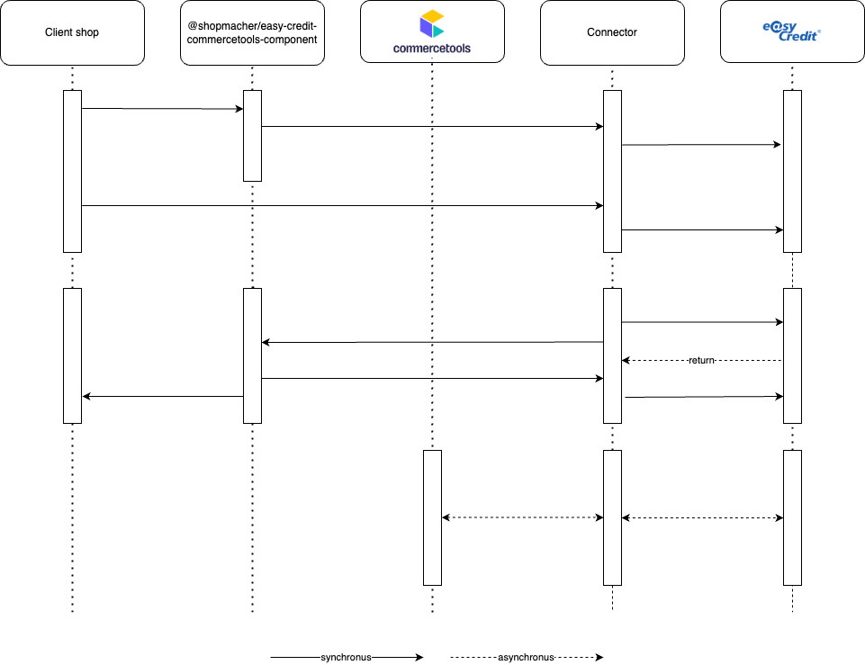

# COMMERCETOOLS EASYCREDIT CONNECTOR

easyCredit-Ratenkauf: Use the easiest installment purchase in Germany now.

Our credo of simple, fair and secure applies to installment purchase customers and to retailers. The fast, simple and seamless process has an immediate online credit check. You can integrate it securely into your online store. We cover the loss risk, and you can receive your payment after only three days.

You can rely on our many years of experience in liquidity management and on the proven high level of customer satisfaction with easyCredit.

The connector also supports easyCredit-Rechnung (pay by invoice). This is a second payment method for physical goods, with its own checkout widget.

## Advantages for the merchant

- **Simple** - The plugin is easy to integrate.

- **Fair** - The pricing model is simple and transparent.

- **Secure** - Maximum protection of payment data is the top priority.

## Advantages for the end customer

- **Immediate** - The credit decision is immediate in the payment process. Conveniently, no PostIdent procedure is necessary.

- **Fair** - The installment price is clear, with no hidden costs or fees.

- **Flexible** - The installment purchase customer can repay early and can take payment breaks.

## Product details

- **Purchase amounts**: easyCredit defines them for each webshop. You cannot configure them in the connector. Without a fresh easyCredit webshop configuration, the connector offers no easyCredit payment method.

- **Terms**: 2 to 60 months, freely selectable by the customer.

- **Where to use it**: in German online stores

## 📔 Supported features

### Installment payment

Installment payment is on by default. The connector offers it if easyCredit has activated it for the webshop. To offer pay by invoice only, set `INSTALLMENT_PAYMENT_ENABLED=0`. You can exclude product types and custom line items from installment payment. If the connector cannot reach easyCredit, it offers no easyCredit payment method. For the settings, see [Configure processor settings](./processor/README.md#configure-processor-settings) and [Payment type availability](./docs/GetPaymentMethod.md#payment-type-availability).

- [Create payments](/docs/CreatePayment.md)
- [Authorize payments](/docs/AuthorizePayment.md)
- [Capture payments](/docs/CapturePayment.md)
- [Refund payments](/docs/RefundPayment.md)

### Pay by invoice (easyCredit-Rechnung)

The checkout offers pay by invoice as a separate payment method. It has its own label and checkout widget. The backend creates and authorizes transactions with `paymentType: BILL_PAYMENT`. To use it, set `BILL_PAYMENT_ENABLED=1`, and make sure that easyCredit activates pay by invoice for the webshop. Pay by invoice is only for physical goods. You can exclude product types and custom line items from pay by invoice. For the settings, see [Configure processor settings](./processor/README.md#configure-processor-settings).

For more information, see the [web components integration guide](./docs/WebComponents.md#pay-by-invoice-as-a-separate-payment-method) and [Create payments](/docs/CreatePayment.md).

## Prerequisite

1. A commercetools Composable Commerce project.
2. commercetools Checkout with a Checkout application. The connector uses checkout sessions, and the Session API needs the key of a Checkout application. The connector does not read the payment settings of the Application. See [Checkout application](./docs/CommercetoolsFrontendIntegration.md#checkout-application).
3. An [easyCredit partner account](https://www.easycredit.de/) with a webshop ID and an API password. easyCredit must activate the payment methods that you offer.

The [commercetools Frontend integration guide](./docs/CommercetoolsFrontendIntegration.md#configuration) gives the configuration steps for the connector and for your frontend.

## Deploy and upgrade

Deploy the connector with commercetools Connect. To manage connectors in the Merchant Center, you must be a member of the Administrators team of the organization. Open the Connect marketplace: click the profile icon, select **Manage organizations & teams**, select the organization and click the **Connect** tab. See [Connect in the Merchant Center](https://docs.commercetools.com/merchant-center/connect).

You can install the connector in two ways:

- **Public connector from the Connect marketplace.** The marketplace lists the connector as **EasyCredit Connector**. Install it, see [Install a Public Connector](https://docs.commercetools.com/merchant-center/connect#install-a-public-connector). Use release `1.1.0` or later. After the installation, read the deployment with [Get Deployment](https://docs.commercetools.com/connect/deployments#get-deployment). `connector.repository.tag` shows the release tag.
- **Organization connector from this repository.** Use this when you must deploy a specific release tag yourself:
  1. Create a connector from the repository `https://github.com/SHOPMACHER/easy-credit-commercetools-connector` and the tag of the release, for example `v1.1.0`. In the Merchant Center, see [Create an Organization Connector](https://docs.commercetools.com/merchant-center/connect#create-an-organization-connector). With the Connect API, create a ConnectorStaged with `repository.url` and `repository.tag`, see [Create a ConnectorStaged](https://docs.commercetools.com/connect/getting-started#create-a-connectorstaged).
  2. Publish the connector. For tests, request the preview. For your production projects, publish it for private use. Certification is necessary only for a listing in the marketplace. See [Publish an Organization Connector](https://docs.commercetools.com/merchant-center/connect#publish-an-organization-connector).
  3. Install the connector, see [Install an Organization Connector](https://docs.commercetools.com/merchant-center/connect#install-an-organization-connector).

Then do these steps:

1. During the installation, enter the configuration of the `processor` application. You must set `CTP_PROJECT_KEY`, `CTP_CLIENT_ID`, `CTP_CLIENT_SECRET`, `CTP_SCOPES`, `WEBSHOP_ID` and `API_PASSWORD`. The `CTP_*` URLs have defaults for the region `europe-west1.gcp`. `CTP_SESSION_URL` and `WIDGET_ENABLED` are also required, but they have defaults. Keep the defaults, unless your shop needs different values. For all variables and example values, see the [processor README](./processor/README.md#configure-processor-settings).
2. Get the URLs of the two applications: `processor` (the processor URL) and `assets` (the asset URL). For how to find them, see [Connector deployment](./docs/CommercetoolsFrontendIntegration.md#connector-deployment).
3. Register the notification URL in the easyCredit merchant portal, see [Notification URL](./docs/CommercetoolsFrontendIntegration.md#notification-url).
4. Configure your shop, see the [commercetools Frontend integration guide](./docs/CommercetoolsFrontendIntegration.md).

To upgrade, follow the upgrade notes of the new release in the [changelog](./CHANGELOG.md). For an upgrade from 1.0.x, see the [upgrade notes](./CHANGELOG.md#upgrade-notes). They give the order of all steps, also the redeploy.

To test the API with Postman, Bruno or Insomnia, see the [API collection](./docs/postman/README.md).

## Integration guide

The [commercetools Frontend integration guide](./docs/CommercetoolsFrontendIntegration.md) shows how to connect a commercetools Frontend project to the connector. It covers the checkout session, the enabler, authorization, order creation, capture and refund.

An order can hold more than one easyCredit payment, because cancelled or switched attempts stay as `Failure`. For how to find the payment that the shopper used, see [Find the used payment](./docs/CommercetoolsFrontendIntegration.md#find-the-used-payment).

## Upgrading from 1.0.x

For the steps to upgrade, see the [upgrade notes](./CHANGELOG.md#upgrade-notes).

## 📐 Architecture Principles

This repository has two standalone modules that interact with commercetools and easyCredit.
A complete integration needs both modules. For more information, read their README files:

- [Assets](/assets/README.md)
- [Processor](/processor/README.md)

## 🤝 Contributing

We welcome contributions.

For information on how to contribute to this repository, read these files:

- [Contributing guideline](/docs/CONTRIBUTING.md)
- [Issue template](/docs/IssueTemplate.md)

## 📝 License

Distributed under the MIT License. See [LICENSE](/LICENSE) for more information.

## 📞 Contact

Do you want to use easyCredit-Ratenkauf?

Contact us at

[sales.ratenkauf@easycredit.de](mailto:sales.ratenkauf@easycredit.de)

[+49 (0) 911 5390 2726](tel:+4991153902726)

Or register here:

[https://partner.easycredit-ratenkauf.de/registrierung](https://partner.easycredit-ratenkauf.de/registrierung)

You must have a valid contract to use the connector.

 <b>Happy Coding! 🚀</b> 

