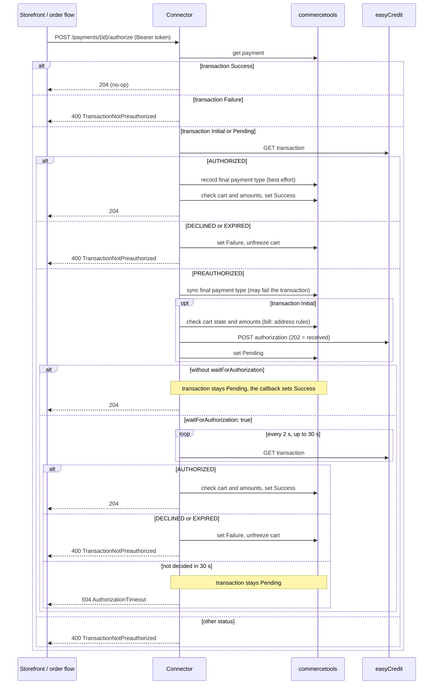

# Authorize Payment

* [Authorize EC transaction](#workflow)
* [Sync the final payment type](#sync-the-final-payment-type)
* [Timeout handling](#timeout-handling)
* [Response Format](#response-format)
* [Error Handling](#error-responses)
* [easyCredit callback](#easycredit-callback)

## Overview
This API authorizes an EC payment using the provided CT `paymentId`. It works for `INSTALLMENT_PAYMENT` and `BILL_PAYMENT` payments alike.

The call is idempotent. By default it returns `204` once the authorization request is sent to easyCredit: the CT transaction is then `Pending`, and the [easyCredit callback](#easycredit-callback) sets it to `Success`. This is the behavior of earlier versions.

With `"waitForAuthorization": true` in the body, the call waits for up to 30 seconds until easyCredit reports the transaction as `AUTHORIZED`. A `204` then means the CT transaction is `Success`. **In this mode, only create the order after a `204`.**
<br />

## Conditions

To use this functionality, the following conditions must be met:

1. A valid `paymentId` must be provided, associated with an existing easyCredit payment (`paymentMethodInfo.paymentInterface` is `easycredit`) holding an `Authorization` transaction with an `interactionId`.
2. The easyCredit transaction must be `PREAUTHORIZED` (the customer completed the checkout) or already `AUTHORIZED`.
3. The request must be authenticated with a commercetools access token (`Authorization: Bearer <access_token>`). This endpoint does not accept `X-Session-Id`.
4. For the first call, the cart must still be `Frozen` and cart total, CT transaction amount and easyCredit order value must be identical (in cents).
<br />

## Workflow

1. **Validate and get `payment`**: Use `paymentId` to get related CT `payment` data and its `Authorization` transaction. The EC `technicalTransactionId` is stored in the custom field `easyCreditTechnicalTransactionId` of that transaction.
2. **Check the CT transaction state**:
   - `Success`: return `204` without any further call (idempotent).
   - `Initial` or `Pending`: continue.
   - `Failure`: `400 TransactionNotPreauthorized`.
3. **Read the easyCredit status** (`GET` transaction):
   - `AUTHORIZED`: record the final payment type (best effort, see [Sync the final payment type](#sync-the-final-payment-type)), check the amounts (see [Amount check after authorization](#amount-check-after-authorization)), set the CT transaction to `Success` and return `204`.
   - `DECLINED` or `EXPIRED`: set the CT transaction to `Failure`, unfreeze the cart and return `400 TransactionNotPreauthorized`.
   - `PREAUTHORIZED`: continue.
   - any other status: `400 TransactionNotPreauthorized`, nothing is written.
4. **Sync the final payment type** (`PREAUTHORIZED` only): easyCredit may offer a switch between installment and pay by invoice on its page, so the connector reads the final type from the easyCredit transaction and keeps `paymentMethodInfo` of the CT payment in sync. This runs before the amount check and before the authorization request, and its errors are returned. See [Sync the final payment type](#sync-the-final-payment-type).
5. **Only if the CT transaction is `Initial`**: check the amounts, send the authorization request to easyCredit and set the CT transaction to `Pending`.
   - The amount check requires the cart to be `Frozen` and cart total, CT transaction amount and easyCredit `orderValue` to be identical in cents. If not, the CT transaction is set to `Failure`, the cart is unfrozen if it is still `Frozen` and `400 AmountMismatch` is returned. In this case no authorization request is sent.
   - For a `BILL_PAYMENT` the connector also checks again that the cart still meets the pay by invoice rules for addresses and customer (billing and shipping address match and are in Germany, private customer only). A frozen cart still accepts address and company updates. If a rule is broken, the CT transaction is set to `Failure`, the cart is unfrozen and the error is returned (for example `400 AddressesUnmatched` or `400 CorporateCustomerNotAllowed`, see [Create Payment](./CreatePayment.md#error-response-400)). No authorization request is sent. The limits need no separate check: cart total, transaction amount and easyCredit `orderValue` must be identical, which rejects any price change.
   - easyCredit answers the authorization request with `202`, which only means the request was received, not that the transaction is authorized. Any other `2xx` is not an accepted authorization either and is answered with `502 AuthorizationFailed`.
   - All easyCredit requests of this endpoint share the 30 second budget that starts with the request. If it is already used up before the authorization request, `504 AuthorizationTimeout` is returned and no request is sent.
   - If the CT transaction is already `Pending`, this step is skipped: a sequential retry continues with step 6 without a second authorization request. Two overlapping calls that both read the transaction as `Initial` each send the authorization request. The second one then finds `Pending` after its request and continues with step 6.
   - The CT transaction is set to `Pending` only after the request was sent, so a failed or lost request leaves it `Initial`. Between the request and the `Pending` write there is a short window in which the transaction is still `Initial` although the request is out. A concurrent [Create Payment](./CreatePayment.md#switching-in-the-shop-checkout) or a payment type switch can fail the attempt in that window. The same happens if anything else sets the transaction to `Failure` in that window, for example the cancel webhook or a very fast `DECLINED` callback. In all these cases the connector logs `EASYCREDIT_AUTHORIZATION_SENT_ATTEMPT_DISCARDED`, stops without polling and returns `400 TransactionNotAuthorized`. "Discarded" in the log text does not imply a concurrent create or switch. easyCredit may still authorize the attempt. If so, the connector logs `EASYCREDIT_AUTHORIZED_CT_NOT_SUCCESS` when the easyCredit callback arrives and its status lookup (5 second limit) succeeds. That needs manual follow-up by the merchant, there is no automatic void at easyCredit.
6. **Without `waitForAuthorization`**: return `204`. The CT transaction stays `Pending` until the easyCredit callback sets it to `Success` or `Failure`.
7. **With `waitForAuthorization: true`, poll easyCredit** every 2 seconds, within the 30 second budget that started with the request:
   - `AUTHORIZED`: check the amounts again (see [Amount check after authorization](#amount-check-after-authorization)), set the CT transaction to `Success` and return `204`.
   - `DECLINED` or `EXPIRED`: set the CT transaction to `Failure`, unfreeze the cart and return `400 TransactionNotPreauthorized`.
   - a transient poll failure (network error, abort or timeout, HTTP `5xx`, `408` or `429`) is logged and retried until the budget is used up.
   - any other `4xx` (for example `401`, `403`, `404`) is permanent: it is returned immediately with the upstream status, without waiting for the budget. The CT transaction stays `Pending`.
   - budget used up: `504 AuthorizationTimeout`. The CT transaction **stays `Pending`**.

### Amount check after authorization

Once easyCredit reports `AUTHORIZED`, the call without `waitForAuthorization` has already returned `204`, so the shop may have created the order from the cart or deleted the cart. The check therefore differs from the one before the authorization request:

- The cart may be `Frozen` or `Ordered`. Cart total, CT transaction amount and easyCredit `orderValue` must still be identical in cents.
- If no cart holds the payment any more, only CT transaction amount and easyCredit `orderValue` are compared. The transaction amount was checked against the frozen cart before the request.
- An `Active` cart, differing amounts or a missing easyCredit order value fail the CT transaction with `400 AmountMismatch`. A cart that is still `Frozen` is unfrozen.
- Any other error of the cart lookup is returned and the CT transaction stays `Pending`.



Updates of the CT payment can run concurrently with the easyCredit callback. The connector re-reads the payment and retries a transaction state update once if commercetools answers with HTTP `409`.
<br />

## Sync the final payment type

Note: the easyCredit sandbox page did not offer a switch on 2026-10-26 (checked: financing terms, data entry, decision pages, plan editor, info FAQ), so the switch path is covered by unit tests only and is not verified end to end against the live service. A deployment that sees a switch should check the first one.

The easyCredit transaction (`GET /transaction`) holds the final payment type in `transaction.paymentType`. The connector compares it with the type stored on the CT payment (`paymentMethodInfo.method`: `BILL_PAYMENT` for pay by invoice, any other value, normally `easycredit`, for installment). Whether and how it acts depends on the easyCredit status and the CT transaction state:

| easyCredit status | CT transaction | Type switched | Action |
| --- | --- | --- | --- |
| `PREAUTHORIZED` | `Initial` | yes | Validate the cart for the final type. If it is valid, write `paymentMethodInfo.method` and `name` and record the interest. On a failure see [below](#validation-of-the-final-type). |
| `PREAUTHORIZED` | `Initial` | no | No validation, no write of the method. The interest is recorded. |
| `PREAUTHORIZED` | `Pending` or `Success` | yes | Record only, no validation. A failing write is logged as a warning. |
| `AUTHORIZED` | not `Failure` | yes | Record only. A failing write is logged as a warning. On this endpoint and in the callback a failing sync of any kind is logged and never changes the outcome; [Get Payment](./GetPayment.md) is stricter, see below. |
| `OPEN`, `DECLINED`, `EXPIRED`, or any status with a `Failure` transaction | | | No-op. |

Where the sync runs:

- This endpoint: strict for `PREAUTHORIZED` (step 4, errors are returned), best effort for `AUTHORIZED` before the amount check.
- [Get Payment](./GetPayment.md): the same rules, so the summary shows the final type. A switch is written by that call. It is not best effort for `AUTHORIZED`: only the write failures above are swallowed, other sync errors are returned.
- [easyCredit callback](#easycredit-callback): only for `AUTHORIZED`, after the `Success` write and best effort. A callback for a `PREAUTHORIZED` transaction does not sync.

A `409` version conflict is retried once with the re-read payment, but only for the `paymentMethodInfo` write. The interest write has no retry: a failure, including a `409`, is only logged as a warning.

### Validation of the final type

The cart is checked for the final type as described in [Create Payment](./CreatePayment.md#payment-type-availability): for `BILL_PAYMENT` that is `BILL_PAYMENT_ENABLED`, the webshop activation and limits, excluded items, private customer and address match; for `INSTALLMENT_PAYMENT` the installment limits, addresses and currency.

- **Deterministic failure**: `BILL_PAYMENT_ENABLED` is not `1`, or every returned error is one of `InvalidAmount`, `BillPaymentExcludedItems`, `CorporateCustomerNotAllowed`, `AddressesUnmatched`, `InvalidBillingAddress`, `InvalidShippingAddress`, `InvalidAddress` or `InvalidCurrency`. The CT transaction is set to `Failure`, the cart is unfrozen and the error is returned (`400`). Nothing is written to `paymentMethodInfo`. If failing the transaction itself fails, that is logged and the validation error is still returned. `InvalidAmount` is computed from the cached webshop limits: during an easyCredit webshop outage the connector uses the last known limits (for up to one hour past the cache lifetime) or, without any, the default installment limits (200 to 10,000 EUR), and bill payment limits only while the webshop data is fresh. A switch can therefore be failed with `InvalidAmount` on the default limits. This only matters for a webshop whose real installment minimum is below 200 EUR.
- **Anything else** (for example `PaymentTypeNotAvailable` from the webshop configuration, `503 BillPaymentCheckFailed`, `503 EasyCreditUnavailable`, a `5xx`, a cart that cannot be read, or a list that also contains another code): the error is returned and the transaction is not touched, so an outage cannot destroy a credit decision the shopper already got. A retry runs the sync again. The cart stays `Frozen` and the transaction `Initial` meanwhile. If the error does not go away, the shop can call the [cancel webhook](./CancelPayment.md) (the transaction becomes `Failure` and the cart is unfrozen) or let the shopper pick another payment method: a new create call discards this attempt, see [Create Payment](./CreatePayment.md#switching-in-the-shop-checkout).

### easyCredit sends no payment type

A value other than `INSTALLMENT_PAYMENT` or `BILL_PAYMENT` is treated like an absent type for the outcome. The sync itself writes exactly one log line per case:

- Unrecognised value (any stored type): one error with the raw value, no warning.
- Absent value, stored type installment: one warning.
- Absent value, stored type `BILL_PAYMENT`: one error.

Outcome for an absent and an unrecognised value:

- Stored type installment: the stored type is kept and the interest is still recorded.
- Stored type `BILL_PAYMENT`: if the sync is gated for validation (easyCredit status `PREAUTHORIZED` and CT transaction `Initial`), the connector fails closed with `502 PaymentTypeUnknown` and writes nothing. In every other case (`AUTHORIZED`, or `PREAUTHORIZED` with a `Pending` or `Success` transaction) nothing is about to be authorized, so the stored type is kept, the log line is still written, the interest is recorded for the stored type and no error is returned, on this endpoint, in the callback and in [Get Payment](./GetPayment.md).

A switch writes `method` `easycredit` for installment and `BILL_PAYMENT` for pay by invoice. An installment payment is not rewritten when easyCredit also says installment. See [Create Payment](./CreatePayment.md#transaction-custom-fields) for the interest fields.
<br />

## Timeout handling

With `waitForAuthorization: true`, if easyCredit does not report a final status within 30 seconds, the connector returns `504 AuthorizationTimeout` and keeps the transaction `Pending`. If the budget was already used up before the authorization request was sent, the transaction stays `Initial` instead and a retry sends the first authorization request rather than resuming polling. The authorization may still complete at easyCredit afterwards. A `504` from the connector and a `504` from an ingress or gateway in front of it both mean the same: **do not create the order**.

To recover, either:

- call the endpoint again. As the transaction is `Pending`, it resumes polling (with `waitForAuthorization: true`) or returns `204` without sending a new authorization request, or
- wait for the easyCredit callback, which sets the transaction to `Success` when easyCredit authorizes it, see [easyCredit callback](#easycredit-callback).

With `waitForAuthorization: true`, the storefront and any ingress or proxy in front of the connector must allow requests of more than 30 seconds.
<br />

## Example URL Call

To authorize a payment, you can make a call to the following URL. Include a commercetools access token with the request.

### Request

**HTTP Method:** `POST`  
**URL:** `https://your-api-endpoint.com/payments/{payment_id}/authorize`  
**Headers:**
```http
Authorization: Bearer <access_token>
Content-Type: application/json
```

**Body** (optional):
```json
{
  "waitForAuthorization": true
}
```

`waitForAuthorization` defaults to `false`, see [Overview](#overview).

To obtain the access token, refer to the [commercetools authorization documentation](https://docs.commercetools.com/api/authorization).
<br />

### Response Format

#### Success Response 204:
The API returns a `204 No content` response:

- without `waitForAuthorization`: the authorization request was sent and the CT transaction is `Pending`, or the payment was already authorized (`Success`).
- with `waitForAuthorization: true`: the payment is authorized and the CT transaction is `Success`, also if it was already authorized before.

#### Error Responses

| Status | Code | Reason |
| --- | --- | --- |
| 400 | `InvalidPaymentMethod` | The payment is not an easyCredit payment. |
| 400 | `InvalidPaymentTransaction` | The payment has no `Authorization` transaction with an `interactionId`. |
| 400 | `TransactionNotPreauthorized` | The CT transaction is `Failure`, or the easyCredit status is neither `PREAUTHORIZED` nor `AUTHORIZED`. For `DECLINED` or `EXPIRED` the CT transaction is set to `Failure` and the cart is unfrozen. |
| 400 | `TransactionNotAuthorized` | The attempt was failed concurrently after the authorization request was sent, see [Workflow](#workflow), step 5. |
| 400 | `AmountMismatch` | The cart is no longer `Frozen` (after easyCredit reported `AUTHORIZED`: neither `Frozen` nor `Ordered`, see [Amount check after authorization](#amount-check-after-authorization)), or cart total, CT transaction amount and easyCredit order value (in cents) differ, or easyCredit sent no order value. The CT transaction is `Failure`. The cart is unfrozen only if it was still `Frozen`. |
| 400 | `InvalidAmount`, `BillPaymentExcludedItems`, `CorporateCustomerNotAllowed`, `AddressesUnmatched`, `InvalidBillingAddress`, `InvalidShippingAddress`, `InvalidAddress`, `InvalidCurrency`, `PaymentTypeNotAvailable` | The cart does not fit the final payment type, or for `BILL_PAYMENT` its address or customer rules are broken. The CT transaction is `Failure` and the cart is unfrozen, except for `PaymentTypeNotAvailable` from webshop data, which leaves the transaction unchanged, see [Validation of the final type](#validation-of-the-final-type). |
| 502 | `PaymentTypeUnknown` | easyCredit sent no or an unrecognised payment type for a `BILL_PAYMENT` payment while the status is `PREAUTHORIZED` and the CT transaction is `Initial`. Nothing is written and the payment cannot be continued. |
| 503 | `BillPaymentCheckFailed` | The payment type was switched to `BILL_PAYMENT` on the easyCredit page and the excluded product types could not be loaded from commercetools, so the cart items could not be checked. An unswitched bill payment does not look up product types at authorize, so it cannot cause this error. The CT transaction is unchanged, retry later, see [Validation of the final type](#validation-of-the-final-type). |
| 503 | `EasyCreditUnavailable` | The webshop configuration needed to validate the final type is not available, see [Webshop configuration](./GetPaymentMethod.md#webshop-configuration). The CT transaction is unchanged, retry later. The `Retry-After` header contains the seconds until the next retry. |
| 504 | `AuthorizationTimeout` | With `waitForAuthorization: true`, easyCredit did not report a final status within 30 seconds. In both modes, the budget was used up before the authorization request or during the first easyCredit lookup. The CT transaction stays `Pending`, or `Initial` if the authorization request was never sent, see [Timeout handling](#timeout-handling). Do not create the order. |
| 502, 504 | `AuthorizationFailed` | The authorization request to easyCredit failed on the network (`502`) or was aborted by a timeout (`504`). The CT transaction is unchanged. |
| upstream status | easyCredit `title`, or `AuthorizationFailed` | easyCredit rejected the authorization request. The code is the title in the easyCredit error body (`AuthorizationFailed` if there is none) and the HTTP status is the one easyCredit returned, except for a `2xx` other than `202`, which is answered with `502 AuthorizationFailed`. The CT transaction is unchanged. |
| 404 | `ResourceNotFound` | The `payment_id` does not exist. |

If the amount check fails while polling, the authorization request was already sent to easyCredit, so the transaction may be authorized there while the CT transaction is `Failure`. The connector then logs an error with the prefix `EASYCREDIT_AUTHORIZED_CT_NOT_SUCCESS` (payment id, `technicalTransactionId`, reason). It fires whenever easyCredit reports `AUTHORIZED` but the CT transaction does not become `Success`: when the amount check or the `Success` write fails at that point for any reason (a mismatch, or an error such as a failed cart lookup, which is then logged once and rethrown), and when the easyCredit callback arrives for a `Failure` transaction that easyCredit reports as `AUTHORIZED` (still `400 TransactionNotAuthorized`). The connector does not void the authorization, this needs manual follow-up.

Example for an unknown `payment_id`:

```json
{
    "message": "The Resource with ID '8efc676b-1069-437-87e2-ad3bba70e35b' was not found.",
    "statusCode": 404,
    "errors": [
        {
            "code": 404,
            "message": "The Resource with ID '8efc676b-1069-437-87e2-ad3bba70e35b' was not found.",
            "fields": [
                {
                    "code": "ResourceNotFound",
                    "message": "The Resource with ID '8efc676b-1069-437-87e2-ad3bba70e35b' was not found."
                }
            ]
        }
    ]
}
```

Example for a timeout:

```json
{
    "message": "Die Autorisierung bei easyCredit ist noch nicht abgeschlossen. Bitte spaeter erneut versuchen.",
    "statusCode": 504,
    "errors": [
        {
            "code": "AuthorizationTimeout",
            "message": "Die Autorisierung bei easyCredit ist noch nicht abgeschlossen. Bitte spaeter erneut versuchen."
        }
    ]
}
```
<br />

## easyCredit callback

easyCredit calls `GET /webhook/{paymentId}/authorize` (the `urlAuthorizationCallback` set by the connector when the transaction is created). The connector does not trust the callback itself: it re-fetches the transaction status from easyCredit.

| CT transaction | easyCredit status | Result |
| --- | --- | --- |
| `Success` | any | No-op, success response. |
| `Initial` or `Pending` | `AUTHORIZED` | [Amount check](#amount-check-after-authorization) (an `Ordered` or deleted cart is accepted), then `Success`, then the final payment type is recorded (best effort, a failure is only logged). |
| `Initial` or `Pending` | `DECLINED`, `EXPIRED` | `Failure`, cart unfrozen, `400 TransactionNotAuthorized`. |
| `Initial` or `Pending` | any other | `400 TransactionNotAuthorized`, nothing is written. |
| `Failure` | any | `400 TransactionNotAuthorized`. |

The connector only writes allowed transitions: `Initial` to `Pending`, `Success` or `Failure`, and `Pending` to `Success` or `Failure`. A `Success` or `Failure` transaction is never overwritten, because overlapping callbacks and authorize calls can race. A `Success` transaction is returned as success without a cart check. If easyCredit is `AUTHORIZED` but the transaction is `Failure`, the response is `400 TransactionNotAuthorized` and the divergence is logged.

A successful callback answers with a `302` redirect to the query parameter `redirectUrl` if it is set, otherwise with `200` and `{ "paymentId": "..." }`.
