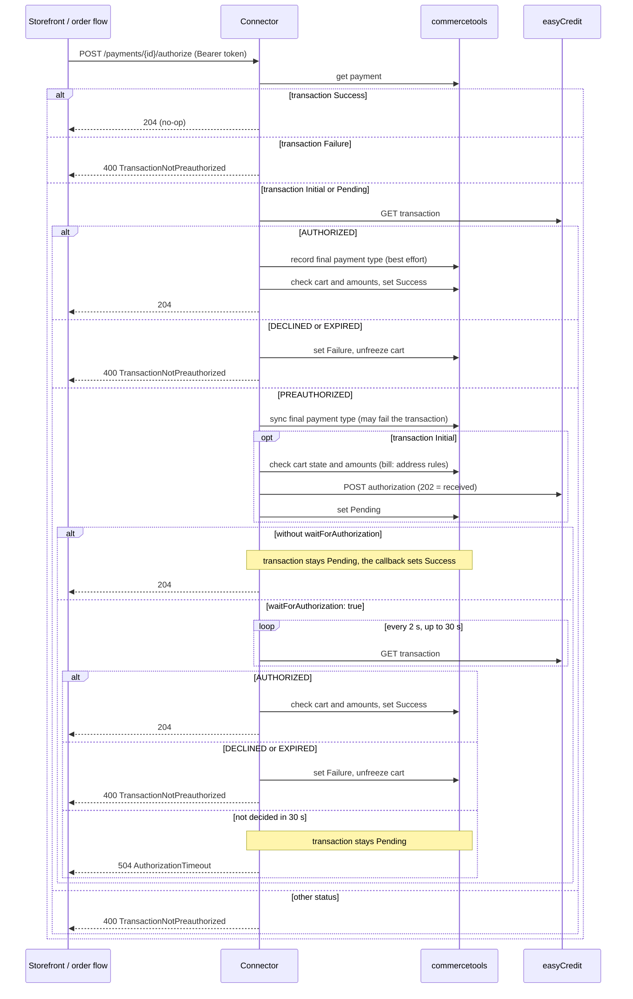

# Authorize Payment

For the terms in this document (EC, CT, easyCredit status values, cart freeze), see [Terms](./CommercetoolsFrontendIntegration.md#terms).

* [Authorize EC transaction](#workflow)
* [Sync the final payment type](#sync-the-final-payment-type)
* [Timeout handling](#timeout-handling)
* [Response Format](#response-format)
* [Error Handling](#error-responses)
* [easyCredit callback](#easycredit-callback)

## Overview
This API authorizes an EC payment. It uses the CT `paymentId`. It works for `INSTALLMENT_PAYMENT` and `BILL_PAYMENT` payments.

A Frontend or BFF caller finds the steps around this call in [Authorize and create the order](./CommercetoolsFrontendIntegration.md#authorize-and-create-the-order).

The call is idempotent. By default, it returns `204` when the connector has sent the authorization request to easyCredit. The CT transaction is then `Pending`. The [easyCredit callback](#easycredit-callback) sets it to `Success`. This is the behavior of earlier versions.

With `"waitForAuthorization": true` in the body, the call waits for up to 30 seconds until easyCredit reports the transaction as `AUTHORIZED`. A `204` then means that the CT transaction is `Success`. **In this mode, create the order only after a `204`.**
<br />

## Conditions

To use this function, these conditions must be true:

1. You give a valid `paymentId`. It belongs to an existing easyCredit payment (`paymentMethodInfo.paymentInterface` is `easycredit`). The payment has an `Authorization` transaction with an `interactionId`.
2. The easyCredit transaction is `PREAUTHORIZED` (the customer completed the checkout) or already `AUTHORIZED`.
3. The request has a commercetools access token (`Authorization: Bearer <access_token>`). The connector accepts any active token that has at least one scope. This endpoint does not accept `X-Session-Id`.
4. For the first call, the cart is still `Frozen`. The cart total, the CT transaction amount and the easyCredit order value are identical (in cents).
<br />

## Workflow

1. **Validate and get `payment`**: Use `paymentId` to get the CT `payment` data and its `Authorization` transaction. The EC `technicalTransactionId` is in the custom field `easyCreditTechnicalTransactionId` of that transaction.
2. **Check the CT transaction state**:
   - `Success`: return `204` without any further call (idempotent).
   - `Initial` or `Pending`: continue.
   - `Failure`: `400 TransactionNotPreauthorized`.
3. **Read the easyCredit status** (`GET` transaction):
   - `AUTHORIZED`: record the final payment type (best effort, see [Sync the final payment type](#sync-the-final-payment-type)). Check the amounts (see [Amount check after authorization](#amount-check-after-authorization)). Set the CT transaction to `Success` and return `204`.
   - `DECLINED` or `EXPIRED`: set the CT transaction to `Failure`, unfreeze the cart and return `400 TransactionNotPreauthorized`.
   - `PREAUTHORIZED`: continue.
   - any other status: `400 TransactionNotPreauthorized`. The connector writes nothing.
4. **Sync the final payment type** (`PREAUTHORIZED` only): easyCredit can offer a switch between installment and pay by invoice on its page (see [Sync the final payment type](#sync-the-final-payment-type)). The connector therefore reads the final type from the easyCredit transaction. It keeps `paymentMethodInfo` of the CT payment in sync. This runs before the amount check and before the authorization request. The connector returns its errors. See [Sync the final payment type](#sync-the-final-payment-type).
5. **Only if the CT transaction is `Initial`**: check the amounts, send the authorization request to easyCredit and set the CT transaction to `Pending`.
   - The amount check needs the cart to be `Frozen`. The cart total, the CT transaction amount and the easyCredit `orderValue` must be identical in cents. If they are not, the connector sets the CT transaction to `Failure`. It unfreezes the cart if it is still `Frozen`. It returns `400 AmountMismatch`. In this case, the connector sends no authorization request.
   - For a `BILL_PAYMENT`, the connector also checks again that the cart still meets the pay by invoice rules for addresses and customer. The billing and shipping address match and are in Germany. The customer is a private customer. A frozen cart still accepts address and company updates. If a rule is broken, the connector sets the CT transaction to `Failure`, unfreezes the cart and returns the error (for example `400 AddressesUnmatched` or `400 CorporateCustomerNotAllowed`, see [Create Payment](./CreatePayment.md#error-response-400)). The connector sends no authorization request. The limits need no separate check. The cart total, the transaction amount and the easyCredit `orderValue` must be identical. This rejects any price change.
   - easyCredit answers the authorization request with `202`. This means only that easyCredit received the request. It does not mean that the transaction is authorized. The connector does not accept any other `2xx` as an authorization. It answers with `502 AuthorizationFailed`.
   - All easyCredit requests of this endpoint share the 30 second budget that starts with the request. If the budget is already used up before the authorization request, it returns `504 AuthorizationTimeout` and sends no request.
   - If the CT transaction is already `Pending`, the connector skips this step. A sequential retry continues with step 6 and sends no second authorization request. Two overlapping calls can both read the transaction as `Initial`. Each of them sends the authorization request. If easyCredit answers the second request with `202`, the second call finds `Pending` and continues with step 6. If easyCredit refuses the second request with a `4xx`, the second call stops immediately. It does not write `Pending` and does not poll, also with `waitForAuthorization`. It returns the easyCredit status and title, see the `upstream status` row in [Error Handling](#error-responses). In the sandbox, easyCredit answered `404` (`CONSTRAINT_VIOLATION`) to a second request for a transaction that it had already confirmed. The answer while easyCredit still processes the first request is not tested.
   - The connector sets the CT transaction to `Pending` only after it sent the request. A failed or lost request therefore leaves it `Initial`. Between the request and the `Pending` write, there is a short window. The transaction is still `Initial` although the request is out. In this window, a concurrent [Create Payment](./CreatePayment.md#switching-in-the-shop-checkout) or a payment type switch can fail the attempt. The same occurs if anything else sets the transaction to `Failure` in that window, for example the cancel webhook or a very fast `DECLINED` callback. In all these cases, the connector logs `EASYCREDIT_AUTHORIZATION_SENT_ATTEMPT_DISCARDED`, stops without polling and returns `400 TransactionNotAuthorized`. "Discarded" in the log text does not mean that a concurrent create or switch occurred. easyCredit can still authorize the attempt. If it does, the connector logs `EASYCREDIT_AUTHORIZED_CT_NOT_SUCCESS` when the easyCredit callback arrives and its status lookup (5 second limit) succeeds. The merchant must follow this up manually. There is no automatic void at easyCredit.
6. **Without `waitForAuthorization`**: return `204`. The CT transaction stays `Pending` until the easyCredit callback sets it to `Success` or `Failure`.
7. **With `waitForAuthorization: true`, poll easyCredit** every 2 seconds, in the 30 second budget that started with the request:
   - `AUTHORIZED`: check the amounts again (see [Amount check after authorization](#amount-check-after-authorization)). Set the CT transaction to `Success` and return `204`.
   - `DECLINED` or `EXPIRED`: set the CT transaction to `Failure`, unfreeze the cart and return `400 TransactionNotPreauthorized`.
   - A temporary poll failure (network error, abort or timeout, HTTP `5xx`, `408` or `429`): the connector logs it and tries again until the budget is used up.
   - Any other `4xx` (for example `401`, `403`, `404`) is permanent. The connector returns it immediately with the upstream status and does not wait for the budget. The CT transaction stays `Pending`.
   - Budget used up: `504 AuthorizationTimeout`. The CT transaction **stays `Pending`**.

### Amount check after authorization

After easyCredit reports `AUTHORIZED`, the call without `waitForAuthorization` has already returned `204`. The shop may already have created the order from the cart or deleted the cart. The check therefore differs from the check before the authorization request:

- The cart can be `Frozen` or `Ordered`. The cart total, the CT transaction amount and the easyCredit `orderValue` must still be identical in cents.
- If no cart holds the payment any more, the connector compares only the CT transaction amount and the easyCredit `orderValue`. The connector checked the transaction amount against the frozen cart before the request.
- An `Active` cart, different amounts or a missing easyCredit order value fail the CT transaction with `400 AmountMismatch`. The connector unfreezes a cart that is still `Frozen`.
- The connector returns any other error of the cart lookup. The CT transaction stays `Pending`.



Updates of the CT payment can run at the same time as the easyCredit callback. If commercetools answers with HTTP `409`, the connector re-reads the payment and tries a transaction state update once more.
<br />

## Sync the final payment type

Note: for the easyCredit API of the switch and the result of the sandbox check, see [Switching on the easyCredit page](./CreatePayment.md#switching-on-the-easycredit-page). The sandbox page offered no switch, so this section describes the sync from the code only.

The easyCredit transaction (`GET /transaction`) holds the final payment type in `transaction.paymentType`. The connector compares it with the type stored on the CT payment (`paymentMethodInfo.method`). `BILL_PAYMENT` is pay by invoice. Any other value, normally `easycredit`, is installment. The action depends on the easyCredit status and the CT transaction state:

| easyCredit status | CT transaction | Type switched | Action |
| --- | --- | --- | --- |
| `PREAUTHORIZED` | `Initial` | yes | Validate the cart for the final type. If it is valid, write `paymentMethodInfo.method` and `name` and record the interest. For a failure, see [below](#validation-of-the-final-type). |
| `PREAUTHORIZED` | `Initial` | no | No validation, no write of the method. The connector records the interest. |
| `PREAUTHORIZED` | `Pending` or `Success` | yes | Record only, no validation. A failing write is logged as a warning. |
| `AUTHORIZED` | not `Failure` | yes | Record only. A failing write is logged as a warning. On this endpoint and in the callback, the connector logs a failing sync of any kind. It never changes the outcome. [Get Payment](./GetPayment.md) is stricter, see below. |
| `OPEN`, `DECLINED`, `EXPIRED`, or any status with a `Failure` transaction | | | No-op. |

Where the sync runs:

- This endpoint: strict for `PREAUTHORIZED` (step 4, the connector returns errors). Best effort for `AUTHORIZED` before the amount check.
- [Get Payment](./GetPayment.md): the same rules, so the summary shows the final type. That call writes a switch. It is not best effort for `AUTHORIZED`. It swallows only the write failures above. It returns other sync errors.
- [easyCredit callback](#easycredit-callback): only for `AUTHORIZED`, after the `Success` write, and best effort. A callback for a `PREAUTHORIZED` transaction does not sync.

The connector retries a `409` version conflict once with the re-read payment. This applies only to the `paymentMethodInfo` write. The interest write has no retry. A failure, `409` included, is only a logged warning.

### Validation of the final type

The connector checks the cart for the final type as described in [Payment type availability](./GetPaymentMethod.md#payment-type-availability). For `BILL_PAYMENT`, it checks `BILL_PAYMENT_ENABLED`, the webshop activation and limits, excluded items, private customer and address match. For `INSTALLMENT_PAYMENT`, it checks `INSTALLMENT_PAYMENT_ENABLED`, the webshop activation and limits, excluded items, addresses and currency.

- **Deterministic failure**: the final type is off in the connector configuration (`INSTALLMENT_PAYMENT_ENABLED=0` or `BILL_PAYMENT_ENABLED` not `1`). Or every returned error is one of `InvalidAmount`, `InstallmentPaymentExcludedItems`, `BillPaymentExcludedItems`, `CorporateCustomerNotAllowed`, `AddressesUnmatched`, `InvalidBillingAddress`, `InvalidShippingAddress`, `InvalidAddress` or `InvalidCurrency`. The connector sets the CT transaction to `Failure`, unfreezes the cart and returns the error (`400`). It writes nothing to `paymentMethodInfo`. If it cannot fail the transaction, it logs this and still returns the validation error. The connector computes `InvalidAmount` only from a fresh webshop configuration. Without one, the call returns `503 EasyCreditUnavailable`, see below.
- **Anything else**: for example `PaymentTypeNotAvailable` from the webshop configuration, `503 InstallmentPaymentCheckFailed`, `503 BillPaymentCheckFailed`, `503 EasyCreditUnavailable`, a `5xx`, a cart that the connector cannot read, or a list that also has another code. The connector returns the error and does not touch the transaction. An outage therefore cannot destroy a credit decision that the shopper already got. A retry runs the sync again. Meanwhile the cart stays `Frozen` and the transaction stays `Initial`. If the error does not go away, the shop can call the [cancel webhook](./CancelPayment.md). The transaction then becomes `Failure` and the cart is unfrozen. Or the shopper can pick another payment method. A new create call then discards this attempt, see [Create Payment](./CreatePayment.md#switching-in-the-shop-checkout).

### easyCredit sends no payment type

For the outcome, the connector treats a value other than `INSTALLMENT_PAYMENT` or `BILL_PAYMENT` like an absent type. The sync writes exactly one log line for each case:

- Unrecognised value (any stored type): one error with the raw value, no warning.
- Absent value, stored type installment: one warning.
- Absent value, stored type `BILL_PAYMENT`: one error.

Outcome for an absent and for an unrecognised value:

- Stored type installment: the connector keeps the stored type and still records the interest.
- Stored type `BILL_PAYMENT`: if the sync is gated for validation (easyCredit status `PREAUTHORIZED` and CT transaction `Initial`), the connector fails closed with `502 PaymentTypeUnknown` and writes nothing. In every other case (`AUTHORIZED`, or `PREAUTHORIZED` with a `Pending` or `Success` transaction), nothing is about to be authorized. The connector keeps the stored type and still writes the log line. It records the interest for the stored type and returns no error. This is true on this endpoint, in the callback and in [Get Payment](./GetPayment.md).

A switch writes `method` `easycredit` for installment and `BILL_PAYMENT` for pay by invoice. The connector does not rewrite an installment payment when easyCredit also says installment. For the interest fields, see [Create Payment](./CreatePayment.md#transaction-custom-fields).
<br />

## Timeout handling

With `waitForAuthorization: true`, easyCredit can fail to report a final status within 30 seconds. The connector then returns `504 AuthorizationTimeout` and keeps the transaction `Pending`. If the budget was already used up before the connector sent the authorization request, the transaction stays `Initial` instead. A retry then sends the first authorization request and does not resume polling. The authorization can still complete at easyCredit afterwards. A `504` from the connector and a `504` from an ingress or gateway in front of it mean the same: **do not create the order**.

To recover, do one of these:

- Call the endpoint again. As the transaction is `Pending`, the call resumes polling (with `waitForAuthorization: true`) or returns `204`. It sends no new authorization request.
- Wait for the easyCredit callback. It sets the transaction to `Success` when easyCredit authorizes it, see [easyCredit callback](#easycredit-callback).

With `waitForAuthorization: true`, the storefront and any ingress or proxy in front of the connector must allow requests of more than 30 seconds.
<br />

## Example URL Call

To authorize a payment, call this URL. Include a commercetools access token in the request.

### Request

**HTTP Method:** `POST`  
**URL:** `https://your-api-endpoint.com/payments/{payment_id}/authorize`  
**Headers:**
```http
Authorization: Bearer <access_token>
Content-Type: application/json
```

**Body** (required, can be `{}`):
```json
{
  "waitForAuthorization": true
}
```

`waitForAuthorization` is `false` by default, see [Overview](#overview). A request without a body returns `400 InvalidJsonInput`. Send at least `{}`.

To get the access token, see the [commercetools authorization documentation](https://docs.commercetools.com/api/authorization).
<br />

### Response Format

#### Success Response 204:
The API returns a `204 No content` response:

- Without `waitForAuthorization`: the connector sent the authorization request and the CT transaction is `Pending`, or the payment was already authorized (`Success`).
- With `waitForAuthorization: true`: the payment is authorized and the CT transaction is `Success`. This is true also if it was already authorized before.

#### Error Responses

| Status | Code | Reason |
| --- | --- | --- |
| 400 | `InvalidPaymentMethod` | The payment is not an easyCredit payment. |
| 400 | `InvalidPaymentTransaction` | The payment has no `Authorization` transaction with an `interactionId`. |
| 400 | `TransactionNotPreauthorized` | The CT transaction is `Failure`, or the easyCredit status is not `PREAUTHORIZED` and not `AUTHORIZED`. For `DECLINED` or `EXPIRED`, the connector sets the CT transaction to `Failure` and unfreezes the cart. |
| 400 | `TransactionNotAuthorized` | Another process set the attempt to `Failure` at the same time, after the connector sent the authorization request. See [Workflow](#workflow), step 5. |
| 400 | `AmountMismatch` | The cart is no longer `Frozen` (after easyCredit reported `AUTHORIZED`: not `Frozen` and not `Ordered`, see [Amount check after authorization](#amount-check-after-authorization)). Or the cart total, the CT transaction amount and the easyCredit order value (in cents) differ. Or easyCredit sent no order value. The CT transaction is `Failure`. The connector unfreezes the cart only if it was still `Frozen`. |
| 400 | `InvalidAmount`, `InstallmentPaymentExcludedItems`, `BillPaymentExcludedItems`, `CorporateCustomerNotAllowed`, `AddressesUnmatched`, `InvalidBillingAddress`, `InvalidShippingAddress`, `InvalidAddress`, `InvalidCurrency`, `PaymentTypeNotAvailable` | The cart does not fit the final payment type, or for `BILL_PAYMENT` its address or customer rules are broken. The CT transaction is `Failure` and the cart is unfrozen. The exception is `PaymentTypeNotAvailable` from webshop data: it leaves the transaction as it is. See [Validation of the final type](#validation-of-the-final-type). |
| 502 | `PaymentTypeUnknown` | easyCredit sent no payment type, or an unrecognised one, for a `BILL_PAYMENT` payment while the status is `PREAUTHORIZED` and the CT transaction is `Initial`. The connector writes nothing. You cannot continue the payment. |
| 503 | `InstallmentPaymentCheckFailed`, `BillPaymentCheckFailed` | The shopper switched the payment type on the easyCredit page. The connector could not load the excluded product types of the final type from commercetools, so it could not check the cart items. A payment without a switch does not look up product types at authorize, so it cannot cause this error. The CT transaction does not change. Retry later, see [Validation of the final type](#validation-of-the-final-type). |
| 503 | `EasyCreditUnavailable` | The webshop configuration that the connector needs to validate the final type is not available, see [Webshop configuration](./GetPaymentMethod.md#webshop-configuration). The CT transaction does not change. Retry later. The `Retry-After` header has the seconds until the next retry. |
| 504 | `AuthorizationTimeout` | With `waitForAuthorization: true`, easyCredit did not report a final status within 30 seconds. In both modes, the budget was used up before the authorization request or during the first easyCredit lookup. The CT transaction stays `Pending`, or `Initial` if the connector did not send the authorization request. See [Timeout handling](#timeout-handling). Do not create the order. |
| 502, 504 | `AuthorizationFailed` | The authorization request to easyCredit failed on the network (`502`) or a timeout aborted it (`504`). The CT transaction does not change. |
| upstream status | easyCredit `title`, or `AuthorizationFailed` | easyCredit rejected the authorization request. The code is the title in the easyCredit error body (`AuthorizationFailed` if there is none). The HTTP status is the status that easyCredit returned. The exception is a `2xx` other than `202`: the connector answers it with `502 AuthorizationFailed`. The CT transaction does not change. |
| 404 | `ResourceNotFound` | The `payment_id` does not exist. |

If the amount check fails while the connector polls, the connector already sent the authorization request to easyCredit. The transaction can therefore be authorized there while the CT transaction is `Failure`. The connector then logs an error with the prefix `EASYCREDIT_AUTHORIZED_CT_NOT_SUCCESS` (payment id, `technicalTransactionId`, reason). It logs it whenever easyCredit reports `AUTHORIZED` but the CT transaction does not become `Success`:

- The amount check or the `Success` write fails at that point, for any reason. This can be a mismatch, or an error such as a failed cart lookup. The connector then logs it once and throws it again.
- The easyCredit callback arrives for a `Failure` transaction that easyCredit reports as `AUTHORIZED` (still `400 TransactionNotAuthorized`).

The connector does not void the authorization. This needs manual follow-up.

Example for an unknown `payment_id`:

```json
{
    "message": "The Resource with ID '8efc676b-1069-437-87e2-ad3bba70e35b' was not found.",
    "statusCode": 404,
    "errors": [
        {
            "code": 404,
            "message": "The Resource with ID '8efc676b-1069-437-87e2-ad3bba70e35b' was not found.",
            "fields": [
                {
                    "code": "ResourceNotFound",
                    "message": "The Resource with ID '8efc676b-1069-437-87e2-ad3bba70e35b' was not found."
                }
            ]
        }
    ]
}
```

Example for a timeout:

```json
{
    "message": "Die Autorisierung bei easyCredit ist noch nicht abgeschlossen. Bitte spaeter erneut versuchen.",
    "statusCode": 504,
    "errors": [
        {
            "code": "AuthorizationTimeout",
            "message": "Die Autorisierung bei easyCredit ist noch nicht abgeschlossen. Bitte spaeter erneut versuchen."
        }
    ]
}
```
<br />

## easyCredit callback

easyCredit calls `GET /webhook/{paymentId}/authorize`. This is the `urlAuthorizationCallback` that the connector sets when it creates the transaction. The connector does not trust the callback itself. It gets the transaction status from easyCredit again.

| CT transaction | easyCredit status | Result |
| --- | --- | --- |
| `Success` | any | No-op, success response. |
| `Initial` or `Pending` | `AUTHORIZED` | [Amount check](#amount-check-after-authorization) (the connector accepts an `Ordered` or deleted cart), then `Success`. Then the connector records the final payment type (best effort, it only logs a failure). |
| `Initial` or `Pending` | `DECLINED`, `EXPIRED` | `Failure`, cart unfrozen, `400 TransactionNotAuthorized`. |
| `Initial` or `Pending` | any other | `400 TransactionNotAuthorized`. The connector writes nothing. |
| `Failure` | any | `400 TransactionNotAuthorized`. |

The connector writes only allowed transitions: `Initial` to `Pending`, `Success` or `Failure`, and `Pending` to `Success` or `Failure`. It never overwrites a `Success` or `Failure` transaction, because overlapping callbacks and authorize calls can race. It returns a `Success` transaction as success without a cart check. If easyCredit is `AUTHORIZED` but the transaction is `Failure`, the response is `400 TransactionNotAuthorized` and the connector logs the divergence.

A successful callback answers with `200` and `{ "paymentId": "..." }`. The callback ignores a `redirectUrl` query parameter.

easyCredit calls the processor in two ways: this callback and the booking notification, see [Notification URL](./CommercetoolsFrontendIntegration.md#notification-url). The [cancel webhook](./CancelPayment.md) is different: the shop or the shopper's browser calls it.
