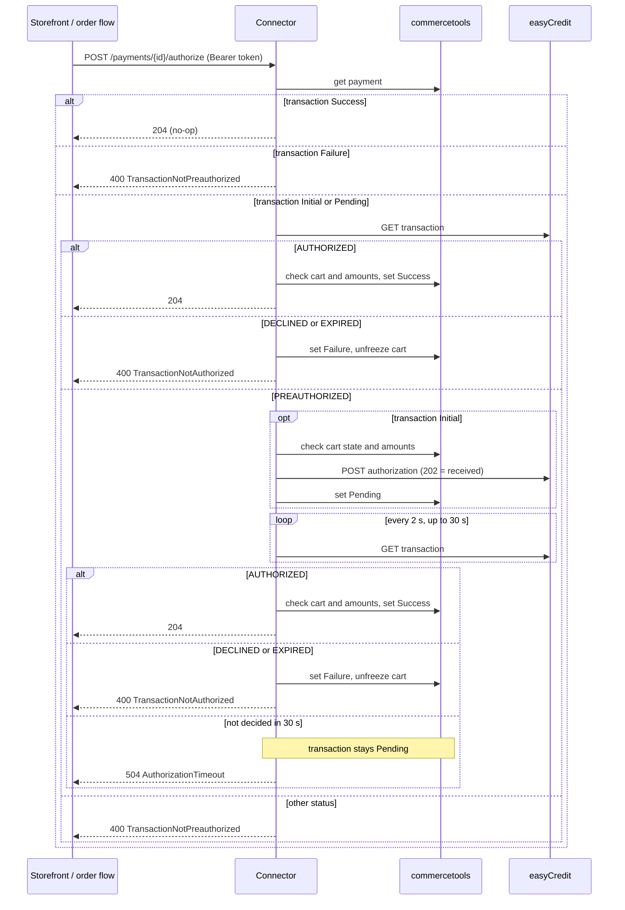

# Authorize Payment

* [Authorize EC transaction](#workflow)
* [Timeout handling](#timeout-handling)
* [Response Format](#response-format)
* [Error Handling](#error-responses)
* [easyCredit callback](#easycredit-callback)

## Overview
This API authorizes an EC payment using the provided CT `paymentId`. It works for `INSTALLMENT_PAYMENT` and `BILL_PAYMENT` payments alike.

The call is idempotent and waits for easyCredit to report the transaction as `AUTHORIZED`, for up to 30 seconds. A `204` means the CT transaction is `Success`. **Only create the order after a `204`.**
<br />

## Conditions

To use this functionality, the following conditions must be met:

1. A valid `paymentId` must be provided, associated with an existing easyCredit payment (`paymentMethodInfo.paymentInterface` is `easycredit`) holding an `Authorization` transaction with an `interactionId`.
2. The easyCredit transaction must be `PREAUTHORIZED` (the customer completed the checkout) or already `AUTHORIZED`.
3. The request must be authenticated with a commercetools access token (`Authorization: Bearer <access_token>`). This endpoint does not accept `X-Session-Id`.
4. For the first call, the cart must still be `Frozen` and cart total, CT transaction amount and easyCredit order value must be identical (in cents).
<br />

## Workflow

1. **Validate and get `payment`**: Use `paymentId` to get related CT `payment` data and its `Authorization` transaction. The EC `technicalTransactionId` is stored in the custom field `easyCreditTechnicalTransactionId` of that transaction.
2. **Check the CT transaction state**:
   - `Success`: return `204` without any further call (idempotent).
   - `Initial` or `Pending`: continue.
   - `Failure`: `400 TransactionNotPreauthorized`.
3. **Read the easyCredit status** (`GET` transaction):
   - `AUTHORIZED`: check the amounts, set the CT transaction to `Success` and return `204`.
   - `DECLINED` or `EXPIRED`: set the CT transaction to `Failure`, unfreeze the cart and return `400 TransactionNotAuthorized`.
   - `PREAUTHORIZED`: continue.
   - any other status: `400 TransactionNotPreauthorized`, nothing is written.
4. **Only if the CT transaction is `Initial`**: check the amounts, send the authorization request to easyCredit and set the CT transaction to `Pending`.
   - The amount check requires the cart to be `Frozen` and cart total, CT transaction amount and easyCredit `orderValue` to be identical in cents. If not, the CT transaction is set to `Failure`, the cart is unfrozen if it is still `Frozen` and `400 AmountMismatch` is returned. In this case no authorization request is sent.
   - easyCredit answers the authorization request with `202`, which only means the request was received, not that the transaction is authorized. Any other `2xx` is not an accepted authorization either and is answered with `502 AuthorizationFailed`.
   - All easyCredit requests of this endpoint share the 30 second budget that starts with the request. If it is already used up before the authorization request, `504 AuthorizationTimeout` is returned and no request is sent.
   - If the CT transaction is already `Pending`, this step is skipped: a retry resumes at the polling step without a second authorization request.
5. **Poll easyCredit** every 2 seconds, within the 30 second budget that started with the request:
   - `AUTHORIZED`: check the amounts again, set the CT transaction to `Success` and return `204`.
   - `DECLINED` or `EXPIRED`: set the CT transaction to `Failure`, unfreeze the cart and return `400 TransactionNotAuthorized`.
   - a transient poll failure (network error, abort or timeout, HTTP `5xx`, `408` or `429`) is logged and retried until the budget is used up.
   - any other `4xx` (for example `401`, `403`, `404`) is permanent: it is returned immediately with the upstream status, without waiting for the budget. The CT transaction stays `Pending`.
   - budget used up: `504 AuthorizationTimeout`. The CT transaction **stays `Pending`**.



Updates of the CT payment can run concurrently with the easyCredit callback. The connector re-reads the payment and retries a transaction state update once if commercetools answers with HTTP `409`.
<br />

## Timeout handling

If easyCredit does not report a final status within 30 seconds, the connector returns `504 AuthorizationTimeout` and keeps the transaction `Pending`. If the budget was already used up before the authorization request was sent, the transaction stays `Initial` instead and a retry sends the first authorization request rather than resuming polling. The authorization may still complete at easyCredit afterwards. A `504` from the connector and a `504` from an ingress or gateway in front of it both mean the same: **do not create the order**.

To recover, either:

- call the endpoint again. As the transaction is `Pending`, it resumes polling without sending a new authorization request, or
- wait for the easyCredit callback, which sets the transaction to `Success` when easyCredit authorizes it, see [easyCredit callback](#easycredit-callback).

The storefront and any ingress or proxy in front of the connector must allow requests of more than 30 seconds.
<br />

## Example URL Call

To authorize a payment, you can make a call to the following URL. Include a commercetools access token with the request.

### Request

**HTTP Method:** `POST`  
**URL:** `https://your-api-endpoint.com/payments/{payment_id}/authorize`  
**Headers:**
```http
Authorization: Bearer <access_token>
Content-Type: application/json
```

To obtain the access token, refer to the [commercetools authorization documentation](https://docs.commercetools.com/api/authorization).
<br />

### Response Format

#### Success Response 204:
The payment is authorized and the CT transaction is `Success`. The API returns a `204 No content` response, also if the payment was already authorized before.

#### Error Responses

| Status | Code | Reason |
| --- | --- | --- |
| 400 | `InvalidPaymentMethod` | The payment is not an easyCredit payment. |
| 400 | `InvalidPaymentTransaction` | The payment has no `Authorization` transaction with an `interactionId`. |
| 400 | `TransactionNotPreauthorized` | The CT transaction is `Failure`, or the easyCredit status is neither `PREAUTHORIZED`, `AUTHORIZED`, `DECLINED` nor `EXPIRED`. |
| 400 | `TransactionNotAuthorized` | easyCredit reported `DECLINED` or `EXPIRED`. The CT transaction is `Failure` and the cart is unfrozen. |
| 400 | `AmountMismatch` | The cart is no longer `Frozen`, or cart total, CT transaction amount and easyCredit order value (in cents) differ, or easyCredit sent no order value. The CT transaction is `Failure`. The cart is unfrozen only if it was still `Frozen`. |
| 504 | `AuthorizationTimeout` | easyCredit did not report a final status within 30 seconds, or the budget was used up before the authorization request or during the first easyCredit lookup. The CT transaction stays `Pending`, or `Initial` if the authorization request was never sent, see [Timeout handling](#timeout-handling). Do not create the order. |
| 502, 504 | `AuthorizationFailed` | The authorization request to easyCredit failed on the network (`502`) or was aborted by a timeout (`504`). The CT transaction is unchanged. |
| upstream status | easyCredit `title`, or `AuthorizationFailed` | easyCredit rejected the authorization request. The code is the title in the easyCredit error body (`AuthorizationFailed` if there is none) and the HTTP status is the one easyCredit returned, except for a `2xx` other than `202`, which is answered with `502 AuthorizationFailed`. The CT transaction is unchanged. |
| 404 | `ResourceNotFound` | The `payment_id` does not exist. |

If the amount check fails while polling, the authorization request was already sent to easyCredit, so the transaction may be authorized there while the CT transaction is `Failure`. The connector then logs an error with the prefix `EASYCREDIT_AUTHORIZED_CT_NOT_SUCCESS` (payment id, `technicalTransactionId`, reason). It fires whenever easyCredit reports `AUTHORIZED` but the CT transaction does not become `Success`: when the amount check or the `Success` write fails at that point for any reason (a mismatch, or an error such as a failed cart lookup, which is then logged once and rethrown), and when the easyCredit callback arrives for a `Failure` transaction that easyCredit reports as `AUTHORIZED` (still `400 TransactionNotAuthorized`). The connector does not void the authorization, this needs manual follow-up.

Example for an unknown `payment_id`:

```json
{
    "message": "The Resource with ID '8efc676b-1069-437-87e2-ad3bba70e35b' was not found.",
    "statusCode": 404,
    "errors": [
        {
            "code": 404,
            "message": "The Resource with ID '8efc676b-1069-437-87e2-ad3bba70e35b' was not found.",
            "fields": [
                {
                    "code": "ResourceNotFound",
                    "message": "The Resource with ID '8efc676b-1069-437-87e2-ad3bba70e35b' was not found."
                }
            ]
        }
    ]
}
```

Example for a timeout:

```json
{
    "message": "Die Autorisierung bei easyCredit ist noch nicht abgeschlossen. Bitte spaeter erneut versuchen.",
    "statusCode": 504,
    "errors": [
        {
            "code": "AuthorizationTimeout",
            "message": "Die Autorisierung bei easyCredit ist noch nicht abgeschlossen. Bitte spaeter erneut versuchen."
        }
    ]
}
```
<br />

## easyCredit callback

easyCredit calls `GET /webhook/{paymentId}/authorize` (the `urlAuthorizationCallback` set by the connector when the transaction is created). The connector does not trust the callback itself: it re-fetches the transaction status from easyCredit.

| CT transaction | easyCredit status | Result |
| --- | --- | --- |
| `Success` | any | No-op, success response. |
| `Initial` or `Pending` | `AUTHORIZED` | Amount check, then `Success`. |
| `Initial` or `Pending` | `DECLINED`, `EXPIRED` | `Failure`, cart unfrozen, `400 TransactionNotAuthorized`. |
| `Initial` or `Pending` | any other | `400 TransactionNotAuthorized`, nothing is written. |
| `Failure` | any | `400 TransactionNotAuthorized`. |

A successful callback answers with a `302` redirect to the query parameter `redirectUrl` if it is set, otherwise with `200` and `{ "paymentId": "..." }`.
