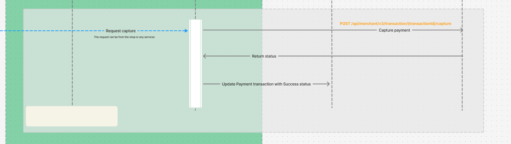

# Capture Payment

* [Capture EC transaction](#workflow)
* [Response Format](#success-response-204)
* [Error Handling](#error-responses)

## Overview
This API is designed to capture EC payment using the provided CT `paymentId`. It works for `INSTALLMENT_PAYMENT` and `BILL_PAYMENT` payments alike.

For pay by invoice (`BILL_PAYMENT`) the capture reports the shipment to EC: the customer pays at the earliest 30 days after delivery. Request it once the order is shipped. The flow, the EC bookings and the notification are the same as for installment.
<br />

Behavior changes for existing integrations, installment included, are listed in the [changelog](../CHANGELOG.md#upgrade-notes).

## Conditions

To use this functionality, the following conditions must be met:

1. A valid `paymentId` must be provided, associated with an existing payment that holds an `authorized EC transaction` in CommerceTools.
2. The request must be authenticated with a CommerceTools access token.
3. A payment is captured only once. If it already has a `Charge` transaction in state `Pending` or `Success`, the request returns `204` without capturing again, so a repeated request (for example a shipping event sent twice) is safe.
<br />

## Workflow

1. **Validate and get `payment`**: Use `paymentId` to get related CT `payment` data.
2. **Retrieve EC `technicalTransactionId`**: The id is stored in a custom field named `easyCreditTechnicalTransactionId` under the payment transaction
3. **Check the EC transaction**: With the `technicalTransactionId`, the connector reads the EC transaction. If its status is not `AUTHORIZED`, the API returns `400 TransactionIsNotAuthorized`. If EC answers this read with an error, cannot be reached or does not answer within 10 seconds, the API returns that error (see [Error Responses](#error-responses)). In all these cases no `Charge` transaction is added and nothing is captured.
4. **Add a `Charge` transaction**: A `Charge` transaction in state `Pending` is added before EC is called, so an EC notification that arrives early finds it. If a parallel capture request added its `Charge` first, this request returns `204` without capturing.
5. **Capture the EC transaction**: A capture request with the CT `paymentId` as `orderId` and the optional `trackingNumber` is sent to EC. If EC rejects it or cannot be reached, the `Charge` is set to `Failure` and the API returns the error.
6. **Complete the `Charge`**: EC captures asynchronously. The EC notification sets the `Charge` to `Success` if EC booked the capture, or `Failure` if EC reports it as failed. If the capture was requested again after a failure, the newest EC capture booking decides, so the earlier failed booking does not fail the new `Charge` while EC is still processing it.


<br />

## Example URL Call

To capture a payment, you can make a call to the following URL. Ensure to include a CommerceTools access token for authentication.

### Request

**HTTP Method:** `POST`  
**URL:** `https://your-api-endpoint.com/payments/{payment_id}/capture`  
**Headers:**
```http
Authorization: Bearer <access_token>
Content-Type: application/json
```

**Body:** `trackingNumber` is optional (at most 50 characters) and passed on to EC.
```json
{
    "trackingNumber": "1Z999AA10123456784"
}
```
<br />

### Response Format

#### Success Response 204:
On successful capture the payment, the API returns a `204 No content` response.

#### Error Responses:

| Status | `code` | When | `Charge` |
| --- | --- | --- | --- |
| `400` | `InvalidJsonInput` | The body is invalid, for example a `trackingNumber` longer than 50 characters. | none added |
| `400` | `TransactionIsNotAuthorized` | The EC transaction is not `AUTHORIZED`. | none added |
| `401` | `invalid_token` | The access token is missing or invalid. | none added |
| `404` | `404`, with `ResourceNotFound` in `fields` | No payment exists for `payment_id`. | none added |
| `409` | `409`, with `ConcurrentModification` in `fields` | Another request changed the payment while the `Charge` was added. Nothing was sent to EC, the capture can be requested again. | none added |
| EC status (`4xx` or `5xx`) | `title` of the EC response, or `CaptureFailed` | EC rejects the capture (`401` and `403` included) or answers with a server error. | `Failure` |
| `502` / `504` | `CaptureFailed` | EC cannot be reached or answers with a `2xx` other than `202` (`502`), or does not answer within 10 seconds (`504`). | `Failure`, or none if this happens while the EC transaction is read (workflow step 3) |

After a `Failure` the capture can be requested again. EC captures a transaction only once, so a retry cannot capture it twice. EC does not document whether it accepts a new capture after a failed one; if it does not, the API returns its error.

A payment that does not exist:

```json
{
    "message": "The Resource with ID '8efc676b-1069-437-87e2-ad3bba70e35b' was not found.",
    "statusCode": 404,
    "errors": [
        {
            "code": 404,
            "message": "The Resource with ID '8efc676b-1069-437-87e2-ad3bba70e35b' was not found.",
            "fields": [
                {
                    "code": "ResourceNotFound",
                    "message": "The Resource with ID '8efc676b-1069-437-87e2-ad3bba70e35b' was not found."
                }
            ]
        }
    ]
}
```

A capture that EC rejects: `code` and `message` hold the `title` of the EC response, `fields` its `violations`. The values below only show the shape.

```json
{
    "message": "<EC title>",
    "statusCode": 400,
    "errors": [
        {
            "code": "<EC title>",
            "message": "<EC title>",
            "fields": [
                {
                    "field": "<field>",
                    "message": "<message in English>",
                    "messageDE": "<message in German>"
                }
            ]
        }
    ]
}
```
