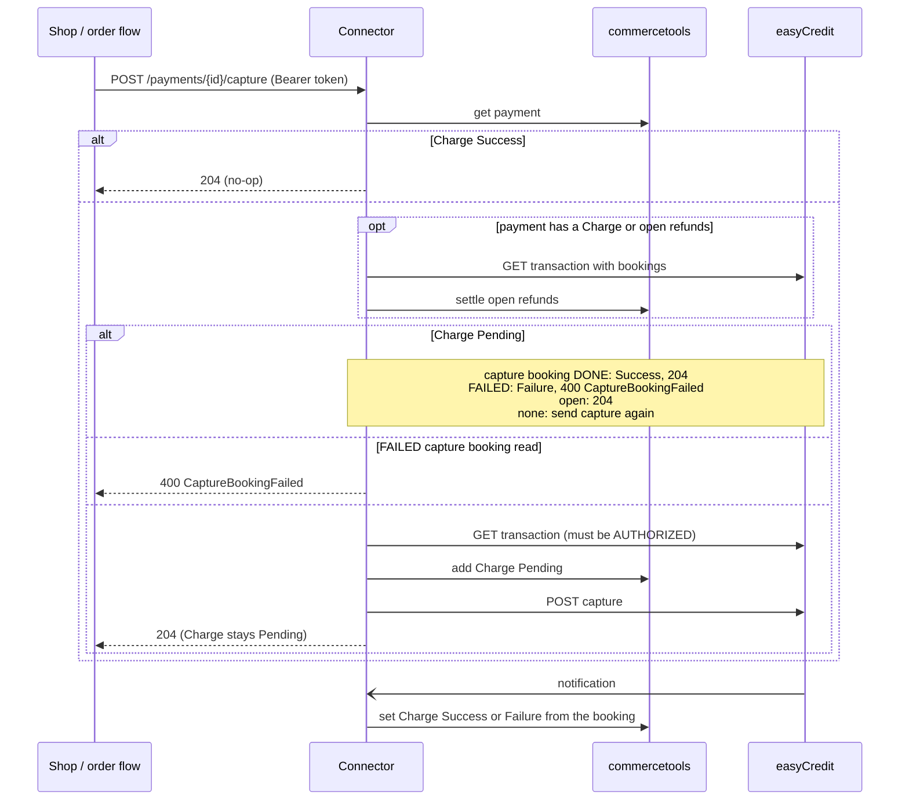

# Capture Payment

For the terms in this document (EC, CT, easyCredit status values, cart freeze), see [Terms](./CommercetoolsFrontendIntegration.md#terms).

* [Capture EC transaction](#workflow)
* [Response Format](#success-response-204)
* [Error Handling](#error-responses)
* [After a failed capture](#after-a-failed-capture)

## Overview
This API captures an EC payment. It uses the CT `paymentId`. It works for `INSTALLMENT_PAYMENT` and `BILL_PAYMENT` payments.

For pay by invoice (`BILL_PAYMENT`), the capture reports the shipment to EC. The customer pays at the earliest 30 days after delivery. Request the capture when the order is shipped. The flow, the EC bookings and the notification are the same as for installment.
<br />

Behavior changes for existing integrations, installment included, are in the [changelog](../CHANGELOG.md#upgrade-notes).

An order can have more than one easyCredit payment. Capture the payment with a `Success` `Authorization` transaction, see [Find the used payment](./CommercetoolsFrontendIntegration.md#find-the-used-payment).

## Conditions

To use this function, these conditions must be true:

1. You give a valid `paymentId`. It belongs to an existing payment with an `authorized EC transaction` in CommerceTools.
2. The request has a CommerceTools access token. The token has one of the scopes `manage_payments`, `manage_checkout_payment_intents` or `manage_project`.
3. The connector captures a payment only once. If the payment has a `Charge` transaction in state `Success`, the request returns `204` and does not capture again. A repeated request (for example, a shipping event that you send twice) is therefore safe. A `Charge` in state `Pending` is handled in workflow step 2.
4. After EC fails the capture of a payment (a `FAILED` capture booking), the connector sends no more captures.
   - When the connector reads that booking (workflow step 2), the API returns `400 CaptureBookingFailed` and does not call EC. This applies for every reason that EC gives.
   - In the EC sandbox, a further capture after a failed capture on an expired transaction got `409 CAPTURE already submitted`. This is the same answer as for a duplicate capture.
   - The EC API allows only one capture for each transaction, see the [EC merchant API definition](https://partner.easycredit-ratenkauf.de/api/merchant/v3/openapi). The connector does not send a further capture, so the EC answer for other failure reasons does not apply.
   - See [After a failed capture](#after-a-failed-capture).
<br />

## Workflow

1. **Validate and get `payment`**: Use `paymentId` to get the CT `payment` data. If the payment has a `Charge` in state `Success`, the API returns `204` here. It does not read EC.
2. **Read the EC bookings**: The connector reads the EC transaction with its bookings only if the payment has a `Charge` or open refunds. The first capture of a payment without open refunds does not read it. This is the same as in earlier versions.
   - If the read is only for open refunds, the capture continues and the refunds stay open.
   - If the payment has a `Charge` and the read fails, the API returns the error and nothing changes. The read fails if EC answers with an error, EC is not reachable or EC does not answer within 10 seconds.
   - The connector settles open refunds from these bookings, as described in [Refund Payment](./RefundPayment.md#process).
   - If the payment has a `Charge` in state `Pending` (for example, because the EC notification did not arrive), the capture booking decides. The request ends here:
     - `DONE`: the `Charge` becomes `Success` and the API returns `204`.
     - `FAILED`: the `Charge` becomes `Failure` and the API returns `400 CaptureBookingFailed`.
     - Still open (`PENDING` or `PROCESSING`): the `Charge` stays `Pending` and the API returns `204`. This is true however old the `Charge` is.
     - No capture booking: EC did not receive the capture, or EC does not list the booking yet. The connector sends the capture again for the same `Charge` (step 5). There is no time limit. EC takes one capture for each transaction and answers any further capture with `409`. A repeat therefore cannot capture twice.
     - No `bookings` in the EC response: the `Charge` stays `Pending` and the API returns `204`. EC sends an empty list for a transaction without bookings. This case is therefore not expected.
   - If the payment has no `Charge` in state `Pending` and the bookings hold a `FAILED` capture booking, the API returns `400 CaptureBookingFailed`. The connector adds no `Charge` and sends nothing to EC.
   - The connector does not read a payment here without a `Charge` and without open refunds. This is true even if EC holds a `FAILED` capture booking. An example is a capture of an earlier version that added no `Charge`. The connector sends the capture. If EC answers `409` (as it did in the sandbox), the new `Charge` stays `Pending` and the API returns `204`. The next capture request reads the booking, sets the `Charge` to `Failure` and returns `400 CaptureBookingFailed`.
3. **Check the EC transaction**: The EC `technicalTransactionId` is in the custom field `easyCreditTechnicalTransactionId` of the `Authorization` transaction. The connector uses it to read the EC transaction.
   - If the status is not `AUTHORIZED`, the API returns `400 TransactionIsNotAuthorized`.
   - If EC answers this read with an error, is not reachable or does not answer within 10 seconds, the API returns that error (see [Error Responses](#error-responses)).
   - In all these cases, the connector adds no `Charge` transaction and captures nothing.
4. **Add a `Charge` transaction**: The connector adds a `Charge` transaction in state `Pending` before it calls EC. An EC notification that arrives early then finds it. If a parallel capture request added its `Charge` first, this request returns `204` and does not capture.
5. **Capture the EC transaction**: The connector sends a capture request to EC. The request has the CT `paymentId` as `orderId` and the optional `trackingNumber`. It has no amount.
   - EC accepts it (`202`): the API returns `204` and the `Charge` stays `Pending`.
   - EC answers `409` because it already has a capture for the transaction (for example, one from a parallel request): the `Charge` stays `Pending` and the API returns `204`. The booking of that capture completes the `Charge` (step 2 or 6).
   - EC answers with a `5xx` or a `2xx` other than `202`, is not reachable or does not answer within 10 seconds: EC may still have booked the capture, so the `Charge` stays `Pending`.
     - The API returns the EC status for a `5xx`.
     - It returns `502` for a `2xx` other than `202` or an unreachable EC.
     - It returns `504` for a timeout.
     - Request the capture again later. Step 2 then completes the `Charge` or sends the capture again.
   - EC rejects it with another `4xx` (`401`, `403` and `429` included): a new `Charge` becomes `Failure` and the API returns the error. A `Charge` whose capture the connector sent again (step 2) stays `Pending`, because its first capture can have reached EC.
6. **Complete the `Charge`**: EC captures asynchronously. The EC notification sets the `Charge` to `Success` if EC booked the capture. It sets the `Charge` to `Failure` if the booking failed. The notification needs the registered notification URL, see [Notification URL](./CommercetoolsFrontendIntegration.md#notification-url).


<br />

## Example URL Call

To capture a payment, call this URL. Include a CommerceTools access token for authentication.

### Request

**HTTP Method:** `POST`  
**URL:** `https://your-api-endpoint.com/payments/{payment_id}/capture`  
**Headers:**
```http
Authorization: Bearer <access_token>
Content-Type: application/json
```

**Body** (required, can be `{}`): `trackingNumber` is optional (at most 50 characters). The connector passes it to EC. A request without a body returns `400 InvalidJsonInput`.
```json
{
    "trackingNumber": "1Z999AA10123456784"
}
```
<br />

### Response Format

#### Success Response 204:
If the capture succeeds, the API returns a `204 No content` response.

#### Error Responses:

| Status | `code` | When | `Charge` |
| --- | --- | --- | --- |
| `400` | `InvalidJsonInput` | The body is not valid, for example a `trackingNumber` longer than 50 characters. | none added |
| `400` | `TransactionIsNotAuthorized` | The EC transaction is not `AUTHORIZED`. | none added |
| `401` | `invalid_token` | The access token is missing or not valid, or has none of the scopes `manage_payments`, `manage_checkout_payment_intents` and `manage_project` (`fields.validAuthorities` then lists them). | none added |
| `404` | `404`, with `ResourceNotFound` in `fields` | No payment exists for `payment_id`. | none added |
| `400` | `CaptureBookingFailed` | EC failed the capture booking, so the connector sends no more captures (workflow step 2). `fields.reason` holds the EC reason in English, if EC sent one. Every later capture request returns this error. See [After a failed capture](#after-a-failed-capture). | `Failure` for a `Pending` `Charge`, none added otherwise |
| `409` | `409`, with `ConcurrentModification` in `fields` | Another request changed the payment while the connector added the `Charge`. The connector sent nothing to EC. You can request the capture again. | none added |
| EC status (`4xx` other than `409`) | `title` of the EC response, or `CaptureFailed` | EC rejects the capture (`401`, `403` and `429` included). | `Failure` for a new `Charge`, `Pending` for a `Charge` whose capture was sent again |
| EC status (`5xx`) | `title` of the EC response, or `CaptureFailed` | EC answers with a server error. EC may still have booked the capture. | `Pending` |
| `502` / `504` | `CaptureFailed` | EC is not reachable or answers with a `2xx` other than `202` (`502`), or EC does not answer within 10 seconds (`504`). | `Pending`, or unchanged if this occurs while the connector reads the EC transaction or its bookings (workflow steps 2 and 3) |

After an error other than `400 CaptureBookingFailed`, you can request the capture again. EC captures a transaction only once, so a retry cannot capture it twice.

A payment that does not exist:

```json
{
    "message": "The Resource with ID '8efc676b-1069-437-87e2-ad3bba70e35b' was not found.",
    "statusCode": 404,
    "errors": [
        {
            "code": 404,
            "message": "The Resource with ID '8efc676b-1069-437-87e2-ad3bba70e35b' was not found.",
            "fields": [
                {
                    "code": "ResourceNotFound",
                    "message": "The Resource with ID '8efc676b-1069-437-87e2-ad3bba70e35b' was not found."
                }
            ]
        }
    ]
}
```

A capture that EC rejects: `code` and `message` hold the `title` of the EC response. `fields` holds its `violations`. The values below show only the shape.

```json
{
    "message": "<EC title>",
    "statusCode": 400,
    "errors": [
        {
            "code": "<EC title>",
            "message": "<EC title>",
            "fields": [
                {
                    "field": "<field>",
                    "message": "<message in English>",
                    "messageDE": "<message in German>"
                }
            ]
        }
    ]
}
```
<br />

## After a failed capture

After EC fails the capture booking of a payment, commercetools shows this:

- The `Charge` stays in state `Failure`. EC notifications complete only a `Charge` in state `Pending`. A further `FAILED` notification therefore changes nothing.
- Every later capture request returns `400 CaptureBookingFailed`. It sends nothing to EC and adds no `Charge`.

Check the transaction in the EC merchant portal. An expired transaction cannot be captured, through the API or in the portal.

The EC API definition does not tell which booking a capture in the portal creates. Thus a portal capture can reach commercetools or not. The connector reads only capture bookings with `bookingType` `ApiBooking` and `type` `CAPTURE`:

- If the portal capture creates such a booking in state `DONE` and EC sends a notification, the notification adds a `Charge` in state `Success`. Later capture requests return `204`.
- If it creates such a booking but no notification arrives, the next capture request finds the `DONE` booking and reads the EC transaction (workflow step 3). It returns `400 TransactionIsNotAuthorized`, because the transaction is no longer `AUTHORIZED`.
- If it creates no such booking, the `FAILED` booking still decides. Capture requests keep returning `400 CaptureBookingFailed`.

To record a capture that you made outside the connector, add a `Charge` in state `Success` with the commercetools API (`addTransaction`). Capture requests then return `204` and do not call EC (condition 3). The `Failure` `Charge` stays as it is.
