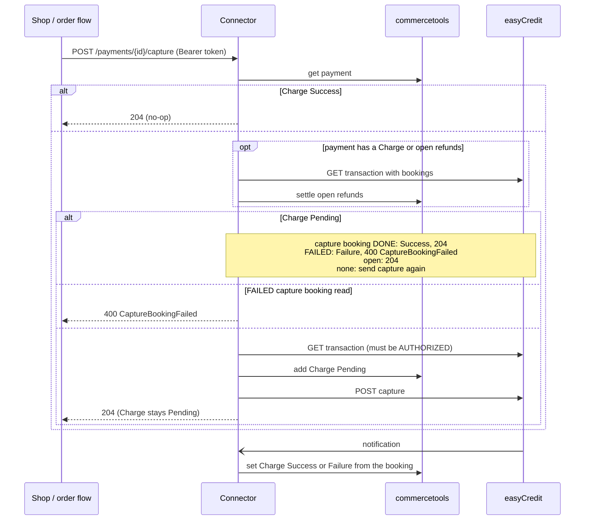

# Capture Payment

* [Capture EC transaction](#workflow)
* [Response Format](#success-response-204)
* [Error Handling](#error-responses)
* [After a failed capture](#after-a-failed-capture)

## Overview
This API is designed to capture EC payment using the provided CT `paymentId`. It works for `INSTALLMENT_PAYMENT` and `BILL_PAYMENT` payments alike.

For pay by invoice (`BILL_PAYMENT`) the capture reports the shipment to EC: the customer pays at the earliest 30 days after delivery. Request it once the order is shipped. The flow, the EC bookings and the notification are the same as for installment.
<br />

Behavior changes for existing integrations, installment included, are listed in the [changelog](../CHANGELOG.md#upgrade-notes).

## Conditions

To use this functionality, the following conditions must be met:

1. A valid `paymentId` must be provided, associated with an existing payment that holds an `authorized EC transaction` in CommerceTools.
2. The request must be authenticated with a CommerceTools access token that has one of the scopes `manage_payments`, `manage_checkout_payment_intents` or `manage_project`.
3. A payment is captured only once. If it already has a `Charge` transaction in state `Success`, the request returns `204` without capturing again, so a repeated request (for example a shipping event sent twice) is safe. A `Charge` in state `Pending` is handled in workflow step 2.
4. Once EC failed the capture of a payment (a `FAILED` capture booking), the connector sends no further capture, like EC's own Shopware plugin. When the connector reads that booking (workflow step 2), the API returns `400 CaptureBookingFailed` without calling EC, for every reason EC gives. In the EC sandbox, a further capture after a failed one on an expired transaction got `409 CAPTURE already submitted`, the same answer as a duplicate capture. How EC answers a further capture after a failure for another reason is not verified. See [After a failed capture](#after-a-failed-capture).
<br />

## Workflow

1. **Validate and get `payment`**: Use `paymentId` to get related CT `payment` data. A payment with a `Charge` in state `Success` returns `204` here, without reading EC.
2. **Read the EC bookings**: The connector reads the EC transaction with its bookings only if the payment already has a `Charge` or has open refunds. The first capture of a payment without open refunds does not read it, as in earlier versions. If the payment has a `Charge` and EC answers this read with an error, cannot be reached or does not answer within 10 seconds, the API returns that error and nothing changes. If the read was only for open refunds, the capture goes on and the refunds stay open. Open refunds are settled from these bookings, as described in [Refund Payment](./RefundPayment.md#process).
   - If the payment has a `Charge` in state `Pending`, for example because the EC notification never arrived, the capture booking decides and the request ends here:
     - `DONE`: the `Charge` is set to `Success` and the API returns `204`.
     - `FAILED`: the `Charge` is set to `Failure` and the API returns `400 CaptureBookingFailed`.
     - Still open (`PENDING` or `PROCESSING`): the `Charge` stays `Pending` and the API returns `204`, however old the `Charge` is.
     - No capture booking: EC either never received the capture or has not listed the booking yet. The capture is sent again for the same `Charge` (step 5), without a time limit: EC takes one capture per transaction and answers any further one with `409`, so sending again cannot capture twice.
     - No `bookings` in the EC response: the `Charge` stays `Pending` and the API returns `204`. EC sends an empty list for a transaction without bookings, so this is not expected.
   - Otherwise, if the bookings hold a `FAILED` capture booking, the API returns `400 CaptureBookingFailed`. No `Charge` is added and nothing is sent to EC.
   - A payment without a `Charge` and without open refunds is not read here, even if EC already holds a `FAILED` capture booking (for example a capture of an earlier version that added no `Charge`). Its capture is sent. If EC answers `409`, as it did in the sandbox, the new `Charge` stays `Pending` and the API returns `204`. The next capture request reads the booking, sets the `Charge` to `Failure` and returns `400 CaptureBookingFailed`.
3. **Check the EC transaction**: The EC `technicalTransactionId` is stored in the custom field `easyCreditTechnicalTransactionId` of the `Authorization` transaction. With it, the connector reads the EC transaction. If its status is not `AUTHORIZED`, the API returns `400 TransactionIsNotAuthorized`. If EC answers this read with an error, cannot be reached or does not answer within 10 seconds, the API returns that error (see [Error Responses](#error-responses)). In all these cases no `Charge` transaction is added and nothing is captured.
4. **Add a `Charge` transaction**: A `Charge` transaction in state `Pending` is added before EC is called, so an EC notification that arrives early finds it. If a parallel capture request added its `Charge` first, this request returns `204` without capturing.
5. **Capture the EC transaction**: A capture request with the CT `paymentId` as `orderId` and the optional `trackingNumber` is sent to EC.
   - EC accepts it (`202`): the API returns `204` and the `Charge` stays `Pending`.
   - EC answers `409` because it already has a capture for the transaction, for example one sent again by a parallel request: the `Charge` stays `Pending` and the API returns `204`. The booking of that capture completes the `Charge` (step 2 or 6).
   - EC answers with a `5xx`, a `2xx` other than `202`, cannot be reached or does not answer within 10 seconds: EC may still have booked the capture, so the `Charge` stays `Pending`. The API returns the EC status for a `5xx`, `502` for a `2xx` other than `202` or an unreachable EC, and `504` for a timeout. Request the capture again later: step 2 then completes the `Charge` or sends the capture again.
   - EC rejects it with another `4xx` (`401`, `403` and `429` included): a new `Charge` is set to `Failure` and the API returns the error. A `Charge` whose capture was sent again (step 2) stays `Pending`, as its first capture may have reached EC.
6. **Complete the `Charge`**: EC captures asynchronously. The EC notification sets the `Charge` to `Success` if EC booked the capture, or `Failure` if the booking failed.


<br />

## Example URL Call

To capture a payment, you can make a call to the following URL. Ensure to include a CommerceTools access token for authentication.

### Request

**HTTP Method:** `POST`  
**URL:** `https://your-api-endpoint.com/payments/{payment_id}/capture`  
**Headers:**
```http
Authorization: Bearer <access_token>
Content-Type: application/json
```

**Body** (required, may be `{}`): `trackingNumber` is optional (at most 50 characters) and passed on to EC. A request without a body returns `400 InvalidJsonInput`.
```json
{
    "trackingNumber": "1Z999AA10123456784"
}
```
<br />

### Response Format

#### Success Response 204:
On successful capture the payment, the API returns a `204 No content` response.

#### Error Responses:

| Status | `code` | When | `Charge` |
| --- | --- | --- | --- |
| `400` | `InvalidJsonInput` | The body is invalid, for example a `trackingNumber` longer than 50 characters. | none added |
| `400` | `TransactionIsNotAuthorized` | The EC transaction is not `AUTHORIZED`. | none added |
| `401` | `invalid_token` | The access token is missing or invalid, or has none of the scopes `manage_payments`, `manage_checkout_payment_intents` and `manage_project` (then `fields.validAuthorities` lists them). | none added |
| `404` | `404`, with `ResourceNotFound` in `fields` | No payment exists for `payment_id`. | none added |
| `400` | `CaptureBookingFailed` | EC failed the capture booking, so the connector sends no further capture (workflow step 2). `fields.reason` holds the EC reason in English, if EC sent one. Every later capture request returns this error, see [After a failed capture](#after-a-failed-capture). | `Failure` for a `Pending` `Charge`, none added otherwise |
| `409` | `409`, with `ConcurrentModification` in `fields` | Another request changed the payment while the `Charge` was added. Nothing was sent to EC, the capture can be requested again. | none added |
| EC status (`4xx` other than `409`) | `title` of the EC response, or `CaptureFailed` | EC rejects the capture (`401`, `403` and `429` included). | `Failure` for a new `Charge`, `Pending` for a `Charge` whose capture was sent again |
| EC status (`5xx`) | `title` of the EC response, or `CaptureFailed` | EC answers with a server error. EC may still book the capture. | `Pending` |
| `502` / `504` | `CaptureFailed` | EC cannot be reached or answers with a `2xx` other than `202` (`502`), or does not answer within 10 seconds (`504`). | `Pending`, or unchanged if this happens while the EC transaction or its bookings are read (workflow steps 2 and 3) |

After an error other than `400 CaptureBookingFailed` the capture can be requested again. EC captures a transaction only once, so a retry cannot capture it twice.

A payment that does not exist:

```json
{
    "message": "The Resource with ID '8efc676b-1069-437-87e2-ad3bba70e35b' was not found.",
    "statusCode": 404,
    "errors": [
        {
            "code": 404,
            "message": "The Resource with ID '8efc676b-1069-437-87e2-ad3bba70e35b' was not found.",
            "fields": [
                {
                    "code": "ResourceNotFound",
                    "message": "The Resource with ID '8efc676b-1069-437-87e2-ad3bba70e35b' was not found."
                }
            ]
        }
    ]
}
```

A capture that EC rejects: `code` and `message` hold the `title` of the EC response, `fields` its `violations`. The values below only show the shape.

```json
{
    "message": "<EC title>",
    "statusCode": 400,
    "errors": [
        {
            "code": "<EC title>",
            "message": "<EC title>",
            "fields": [
                {
                    "field": "<field>",
                    "message": "<message in English>",
                    "messageDE": "<message in German>"
                }
            ]
        }
    ]
}
```
<br />

## After a failed capture

Once EC failed the capture booking of a payment, commercetools shows the following:

- The `Charge` stays in state `Failure`. EC notifications complete only a `Charge` in state `Pending`, so a further `FAILED` notification changes nothing.
- Every later capture request returns `400 CaptureBookingFailed`. It sends nothing to EC and adds no `Charge`.

Check the transaction in the EC merchant portal. An expired transaction cannot be captured, neither through the API nor in the portal.

Whether a capture made in the portal reaches commercetools is not verified. The connector reads only capture bookings with `bookingType` `ApiBooking` and `type` `CAPTURE`:

- If the portal capture creates such a booking in state `DONE` and EC sends a notification, the notification adds a `Charge` in state `Success`. Later capture requests return `204`.
- If it creates such a booking but no notification arrives, the next capture request finds the `DONE` booking, reads the EC transaction (workflow step 3) and returns `400 TransactionIsNotAuthorized`, as the transaction is no longer `AUTHORIZED`.
- If it creates no such booking, the `FAILED` booking still decides and capture requests keep returning `400 CaptureBookingFailed`.

To record a capture made outside the connector, add a `Charge` in state `Success` with the commercetools API (`addTransaction`). Capture requests then return `204` without calling EC (condition 3). The `Failure` `Charge` stays as it is.
