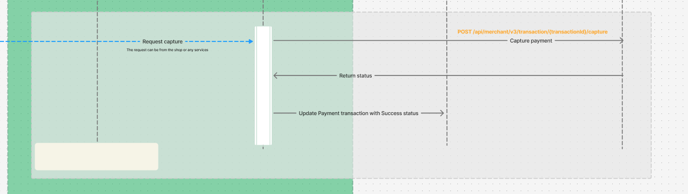

# Capture Payment

* [Capture EC transaction](#workflow)
* [Response Format](#success-response-204)
* [Error Handling](#error-responses)

## Overview
This API is designed to capture EC payment using the provided CT `paymentId`. It works for `INSTALLMENT_PAYMENT` and `BILL_PAYMENT` payments alike.

For pay by invoice (`BILL_PAYMENT`) the capture reports the shipment to EC: the customer pays at the earliest 30 days after delivery. Request it once the order is shipped. The flow, the EC bookings and the notification are the same as for installment.
<br />

Behavior changes for existing integrations, installment included, are listed in the [changelog](../CHANGELOG.md#upgrade-notes).

## Conditions

To use this functionality, the following conditions must be met:

1. A valid `paymentId` must be provided, associated with an existing payment that holds an `authorized EC transaction` in CommerceTools.
2. The request must be authenticated with a CommerceTools access token that has one of the scopes `manage_payments`, `manage_checkout_payment_intents` or `manage_project`.
3. A payment is captured only once. If it already has a `Charge` transaction in state `Success`, the request returns `204` without capturing again, so a repeated request (for example a shipping event sent twice) is safe. A `Charge` in state `Pending` is handled in workflow step 2.
<br />

## Workflow

1. **Validate and get `payment`**: Use `paymentId` to get related CT `payment` data. A payment with a `Charge` in state `Success` returns `204` here, without reading EC.
2. **Read the EC bookings**: The connector reads the EC transaction with its bookings only if the payment already has a `Charge` or has open refunds. The first capture of a payment without open refunds does not read it, as in earlier versions. If the payment has a `Charge` and EC answers this read with an error, cannot be reached or does not answer within 10 seconds, the API returns that error and nothing changes. If the read was only for open refunds, the capture goes on and the refunds stay open. Open refunds are settled from these bookings, as described in [Refund Payment](./RefundPayment.md#process). If the payment has a `Charge` in state `Pending`, for example because the EC notification never arrived, the bookings decide:
   - A `DONE` capture booking sets the `Charge` to `Success` and the API returns `204`.
   - A `FAILED` capture booking of this `Charge` sets it to `Failure` and the capture continues with step 3.
   - A capture booking of this `Charge` that is still `PENDING` leaves the `Charge` `Pending`, and the API returns `204`, however old the `Charge` is.
   - Without a capture booking of this `Charge`, EC either never received its capture or has not listed the booking yet. The capture is sent again for the same `Charge` (step 5). The EC status is not checked, and there is no time limit: EC takes one capture per transaction and answers any further one with `409`, so sending again cannot capture twice.
   - If EC sends the transaction without `bookings`, the `Charge` stays `Pending` and the API returns `204`.
3. **Check the EC transaction**: The EC `technicalTransactionId` is stored in the custom field `easyCreditTechnicalTransactionId` of the `Authorization` transaction. With it, the connector reads the EC transaction. If its status is not `AUTHORIZED`, the API returns `400 TransactionIsNotAuthorized`. If EC answers this read with an error, cannot be reached or does not answer within 10 seconds, the API returns that error (see [Error Responses](#error-responses)). In all these cases no `Charge` transaction is added and nothing is captured.
4. **Add a `Charge` transaction**: A `Charge` transaction in state `Pending` is added before EC is called, so an EC notification that arrives early finds it. If the payment already had a `Charge`, the IDs (`uuid`) of the capture bookings that EC listed in step 2 are stored in its custom field `easyCreditEarlierCaptureBookings`, so a booking of an earlier, failed capture is never taken as the result of this one. If EC sent no `bookings` in that case, the API returns `502 CaptureFailed` instead, as an earlier capture could not be told apart. A payment without a `Charge` has no earlier capture, so the field is not written. If a parallel capture request added its `Charge` first, this request returns `204` without capturing.
5. **Capture the EC transaction**: A capture request with the CT `paymentId` as `orderId` and the optional `trackingNumber` is sent to EC.
   - EC accepts it (`202`): the API returns `204` and the `Charge` stays `Pending`.
   - EC answers `409` because it already has a capture for the transaction. Without an earlier capture, that capture can only be the one of this `Charge`: the `Charge` stays `Pending` and the API returns `204`. After an earlier capture, the `409` may also mean that EC refuses a new capture, so the API returns the `409`. A new `Charge` is then set to `Failure`. A `Charge` whose capture was sent again (step 2) stays `Pending`, as its first capture may still be listed later: a later request returns `204` once EC lists its booking.
   - EC answers with a `5xx`, cannot be reached or does not answer within 10 seconds: EC may still have booked the capture, so the `Charge` stays `Pending` and the API returns `502` or `504`. Request the capture again later: step 2 then completes the `Charge` or sends the capture again.
   - EC rejects it with another `4xx`: the `Charge` is set to `Failure` and the API returns the error.
6. **Complete the `Charge`**: EC captures asynchronously. The EC notification sets the `Charge` to `Success` if EC booked the capture, or `Failure` if a booking of this `Charge` failed. Bookings listed in `easyCreditEarlierCaptureBookings` are ignored, whatever their dates, so the failed booking of an earlier capture does not fail the new `Charge` while EC is still processing it.


<br />

## Example URL Call

To capture a payment, you can make a call to the following URL. Ensure to include a CommerceTools access token for authentication.

### Request

**HTTP Method:** `POST`  
**URL:** `https://your-api-endpoint.com/payments/{payment_id}/capture`  
**Headers:**
```http
Authorization: Bearer <access_token>
Content-Type: application/json
```

**Body:** `trackingNumber` is optional (at most 50 characters) and passed on to EC.
```json
{
    "trackingNumber": "1Z999AA10123456784"
}
```
<br />

### Response Format

#### Success Response 204:
On successful capture the payment, the API returns a `204 No content` response.

#### Error Responses:

| Status | `code` | When | `Charge` |
| --- | --- | --- | --- |
| `400` | `InvalidJsonInput` | The body is invalid, for example a `trackingNumber` longer than 50 characters. | none added |
| `400` | `TransactionIsNotAuthorized` | The EC transaction is not `AUTHORIZED`. | none added |
| `401` | `invalid_token` | The access token is missing or invalid, or has none of the scopes `manage_payments`, `manage_checkout_payment_intents` and `manage_project` (then `fields.validAuthorities` lists them). | none added |
| `404` | `404`, with `ResourceNotFound` in `fields` | No payment exists for `payment_id`. | none added |
| `409` | `409`, with `ConcurrentModification` in `fields` | Another request changed the payment while the `Charge` was added. Nothing was sent to EC, the capture can be requested again. | none added |
| EC status (`4xx`) | `title` of the EC response, or `CaptureFailed` | EC rejects the capture (`401` and `403` included). | `Failure` |
| `409` | `title` of the EC response | EC already has a capture and the payment had an earlier capture (workflow step 5). | `Failure` for a new `Charge`, `Pending` for a `Charge` whose capture was sent again |
| EC status (`5xx`) | `title` of the EC response, or `CaptureFailed` | EC answers with a server error. EC may still book the capture. | `Pending` |
| `502` / `504` | `CaptureFailed` | EC cannot be reached or answers with a `2xx` other than `202` (`502`), or does not answer within 10 seconds (`504`). | `Pending`, or unchanged if this happens while the EC transaction or its bookings are read (workflow steps 2 and 3) |
| `502` | `CaptureFailed` | EC sends the transaction without `bookings` and the payment already had a `Charge` (workflow step 4). | none added |

After an error the capture can be requested again. EC captures a transaction only once, so a retry cannot capture it twice. EC does not document whether it accepts a new capture after a failed one; if it does not, the API returns its `409`.

A payment that does not exist:

```json
{
    "message": "The Resource with ID '8efc676b-1069-437-87e2-ad3bba70e35b' was not found.",
    "statusCode": 404,
    "errors": [
        {
            "code": 404,
            "message": "The Resource with ID '8efc676b-1069-437-87e2-ad3bba70e35b' was not found.",
            "fields": [
                {
                    "code": "ResourceNotFound",
                    "message": "The Resource with ID '8efc676b-1069-437-87e2-ad3bba70e35b' was not found."
                }
            ]
        }
    ]
}
```

A capture that EC rejects: `code` and `message` hold the `title` of the EC response, `fields` its `violations`. The values below only show the shape.

```json
{
    "message": "<EC title>",
    "statusCode": 400,
    "errors": [
        {
            "code": "<EC title>",
            "message": "<EC title>",
            "fields": [
                {
                    "field": "<field>",
                    "message": "<message in English>",
                    "messageDE": "<message in German>"
                }
            ]
        }
    ]
}
```
