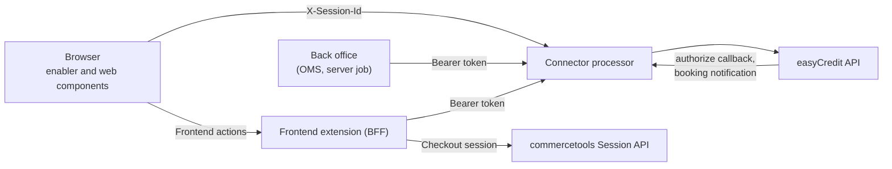
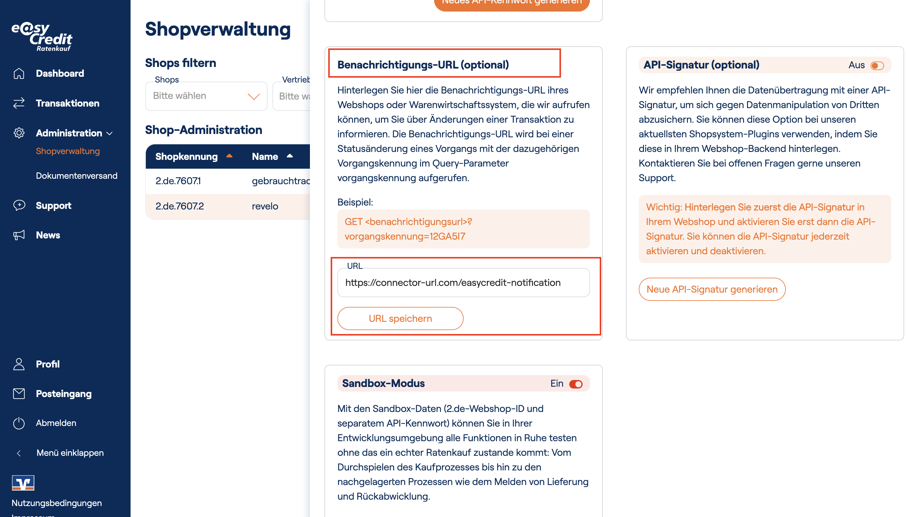

# commercetools Frontend integration

This guide shows how a commercetools Frontend shop uses the easyCredit connector, from the product page to the refund. It is for developers who know commercetools Frontend (extensions, action controllers, Studio project configuration).

The guide applies to the connector `1.1.0` and later, and to the npm package `@shopmacher/easy-credit-commercetools-component` `1.1.0` and later. The endpoint documents in this folder give the full rules of each API call. This guide links to them.

If your shop uses connector 1.0.x, read the [upgrade notes](../CHANGELOG.md#upgrade-notes) first.

* [Terms](#terms)
* [Architecture](#architecture)
* [Configuration](#configuration)
* [Checkout session](#checkout-session)
* [Load the enabler](#load-the-enabler)
* [Show the payment methods](#show-the-payment-methods)
* [Widget on the product and cart page](#widget-on-the-product-and-cart-page)
* [Create the payment and redirect](#create-the-payment-and-redirect)
* [Return from easyCredit](#return-from-easycredit)
* [Authorize and create the order](#authorize-and-create-the-order)
* [Order recovery job](#order-recovery-job)
* [Find the used payment](#find-the-used-payment)
* [Labels and summary](#labels-and-summary)
* [Capture](#capture)
* [Refund](#refund)
* [Test and go live](#test-and-go-live)
* [Troubleshooting](#troubleshooting)

Blocks with the title **Recommended pattern** show code that follows the connector contract. These patterns are not tested end to end in a shop. Test them in your project before you go live.

The snippets are TypeScript. Each snippet starts with a comment that tells where it runs and the example file name:

- **Browser:** code of your storefront.
- **BFF:** code of your Frontend extension (action controllers).

The snippets show only the easyCredit part. They do not show the styling or the error UI of the shop. The BFF snippets use the global `fetch`, `btoa` and `AbortSignal.timeout`. These need Node.js 18 or later. commercetools Frontend supports Node.js 22.x for extensions, see [Extensions](https://docs.commercetools.com/frontend-development/extensions).

These names are placeholders for code of your shop:

| Placeholder | Meaning |
| --- | --- |
| `showError`, `showInfo` | Show a message to the shopper. |
| `callAction` | Calls a Frontend action from the browser. It returns the parsed response body of the action. It throws an error if the action fails. The action names in this guide are `<namespace>/<action>`. |
| `createOrderFromCart` | The existing order creation of your shop (browser side). |

The Frontend SDK does not throw. Its `callAction` returns `{ isError: false, data }` or `{ isError: true, error }`, see [Frontend SDK](https://docs.commercetools.com/frontend-development/frontend-sdk). A `callAction` for this guide can wrap it:

```ts
// Browser. File easycredit-call-action.ts: callAction on the Frontend SDK. Import the SDK instance of your shop.
import { sdk } from './sdk';

export async function callAction<T>(actionName: string): Promise<T> {
  const response = await sdk.callAction<T>({ actionName });
  if (response.isError) {
    throw response.error;
  }

  return response.data;
}
```

## Terms

| Term | Meaning |
| --- | --- |
| Processor | The API service of the connector. Its URL is the processor URL. |
| Enabler | The JavaScript library of the connector (class `Enabler`). The asset service of the connector serves it. The enabler creates the web components. |
| Web components | The checkout, label, summary and widget components. They show easyCredit elements and call the processor from the browser. |
| BFF | The Frontend extension of the shop (action controllers). It calls the processor from the server. |
| EC, CT | Short forms of easyCredit and commercetools in the endpoint documents. |
| OMS | Order management system. A back-office system that processes orders, for example for shipment. |
| Cancel webhook | `GET /webhook/:paymentId/cancel` on the processor. It cancels an easyCredit payment that is not authorized. The shop calls it, or the shopper's browser calls it through the cancel and denial links. |
| Authorize callback | easyCredit calls `GET /webhook/:paymentId/authorize` on the processor after it authorizes a payment. The processor then sets the commercetools transaction to `Success`. |
| Booking notification | easyCredit calls `GET /easycredit-notification` on the processor after it books a capture or a refund. The processor then completes the `Charge` or `Refund` transaction. See [Notification URL](#notification-url). |
| easyCredit status | The status of the easyCredit transaction, see the [easyCredit API definition](https://ratenkauf.easycredit.de/api/payment/v3/openapi). What authorize does for each status: `PREAUTHORIZED`: it sends the authorization request. `AUTHORIZED`: it checks the amounts and sets the transaction to `Success`. `DECLINED` or `EXPIRED`: it sets the transaction to `Failure`. `OPEN`: it returns `400 TransactionNotPreauthorized`. |
| `technicalTransactionId` | The TeamBank ID of the easyCredit transaction. The connector uses it for the calls to the easyCredit payment API. The connector stores it in the custom field `easyCreditTechnicalTransactionId` of the `Authorization` transaction. |
| `transactionId` | The functional ID of the easyCredit transaction, with 6 characters. The easyCredit merchant API (the API of the merchant portal) identifies a transaction by this ID, see the [easyCredit merchant API definition](https://partner.easycredit-ratenkauf.de/api/merchant/v3/openapi). The booking notification sends it as `vorgangskennung`. Use this ID first when you look for a transaction in the merchant portal. This guide does not describe the screens of the portal. |
| `interactionId` | The field of the commercetools `Authorization` transaction that holds the easyCredit `transactionId`. |
| Cart freeze | The connector freezes the cart when it creates a payment, with the commercetools strategy `SoftFreeze`. A frozen cart refuses most cart updates. See [Create Payment](./CreatePayment.md#cart-freeze). |
| Fail closed | If the connector cannot check a condition, it does not offer the payment type. |
| Post-deploy script | The script `postDeploy` in [connect.yaml](../connect.yaml). commercetools Connect runs it after a successful deployment, see [Automation scripts](https://docs.commercetools.com/connect/automation-scripts). It stores the processor URL and creates or updates the transaction custom type. A deployment can show success also if this script failed, see [Verify the resource, not the status](https://docs.commercetools.com/certifications/deploy-marketplace-connector/deploy-a-connector-in-merchant-center). Thus check its result through the API. |
| In-flight payment | A payment that the shopper started before you deployed a new connector version, and that is not complete yet. |
| Order recovery job | A scheduled server job of your shop. It completes or cancels easyCredit payments that the checkout did not complete. See [Order recovery job](#order-recovery-job). |
| Reconcile | A manual check of refunds and captures in the easyCredit merchant portal. You correct the commercetools transaction states after the check. For refunds, see [Refund Payment](./RefundPayment.md#process). For captures, see [After a failed capture](./CapturePayment.md#after-a-failed-capture). |
| easyCredit merchant portal | The partner portal of easyCredit at `https://partner.easycredit-ratenkauf.de/portal`. The portal is in German: **Shopverwaltung** is the shop administration, and **Benachrichtigungs-URL** is the notification URL. |
| A/B test | For pay by invoice, the easyCredit label component shows one of several label variants. It selects the variant at random and keeps it in the browser of the shopper. It ignores a label text from the shop. A shop that renders its own invoice label is not part of this test. |

## Architecture



The browser calls the processor directly through the enabler. The processor allows requests from all origins (CORS), so you do not have to configure an origin. These calls use the checkout session ID in the header `X-Session-Id`:

| Call | Used by |
| --- | --- |
| `GET /payments/payment-method/:cartId` | checkout component |
| `POST /payments` | checkout component |
| `GET /payments/:paymentId` | summary component |
| `GET /operations/widget-enabled` | widget and label component (no session necessary) |

The BFF and the back office call the processor with a commercetools OAuth access token (`Authorization: Bearer <token>`):

| Call | Caller | Token |
| --- | --- | --- |
| `POST /payments/:paymentId/authorize` | BFF, order recovery job | any active token with at least one scope |
| `POST /payments/:paymentId/capture` | back office | see [Back-office API client](#back-office-api-client) |
| `POST /payments/:paymentId/refund` | back office | see [Back-office API client](#back-office-api-client) |

The cancel webhook needs no authentication. Keep each token on the server. Do not send a token to the browser.

<br />

## Configuration

The integration uses three commercetools API clients. Do not mix them up:

| API client | Used by | Calls | Where to set it |
| --- | --- | --- | --- |
| Connector API client | the processor | its own calls to commercetools | `CTP_CLIENT_ID`, `CTP_CLIENT_SECRET`, `CTP_SCOPES` in the connector deployment |
| BFF API client | the storefront BFF | session, cart read, authorize | the project configuration of your Frontend project |
| Back-office API client | your OMS, fulfilment system or server jobs | capture, refund, order recovery job | your back-office system |

### Connector deployment

Deploy the connector with commercetools Connect, see [Deploy and upgrade](../README.md#deploy-and-upgrade). You set the variables of the processor in the deployment. [connect.yaml](../connect.yaml) defines them. You must set at least `CTP_PROJECT_KEY`, `CTP_CLIENT_ID`, `CTP_CLIENT_SECRET`, `CTP_SCOPES`, `WEBSHOP_ID` and `API_PASSWORD`. `CTP_SESSION_URL` and `WIDGET_ENABLED` are also required, but they have defaults. Keep the defaults, unless your shop needs different values. For pay by invoice, also set `BILL_PAYMENT_ENABLED=1`. The [processor README](../processor/README.md#configure-processor-settings) lists all variables with example values, also the variables that control the payment methods. [Get Payment Method](./GetPaymentMethod.md#payment-type-availability) gives the full availability rules and limits.

The deployment has two applications: `processor` (its URL is the processor URL) and `assets` (its URL is the asset URL). To find the application URLs, read the deployment with [Get Deployment](https://docs.commercetools.com/connect/deployments#get-deployment). Read the two URLs from `applications[*].url` of the response. The response has a `url` for the `processor` application and for the `assets` application. The post-deploy script also stores the processor URL in the custom object with the container `easycredit-connector` and the key `easycredit-connector-url`.

commercetools Connect serves the asset application. The connector does not set its HTTP headers, and the commercetools documentation does not describe its CORS headers. An `import()` from another origin needs CORS headers. A classic `<script>` element does not. Before you go live, do these checks on the domain of your storefront:

1. If your shop sends a Content Security Policy, allow the asset origin in `script-src`. The components load the easyCredit web components, images and data from `https://ratenkauf.easycredit.de`. Allow this origin in `script-src`, `img-src` and `connect-src`. Allow the processor origin in `connect-src`.
2. Load the enabler with `import()` from the asset URL, as in [Load the enabler](#load-the-enabler). Make sure that the browser console shows no CORS or CSP error.
3. If the `import()` fails because of CORS, load the UMD bundle with a classic `<script>` element (option 2 in [Load the enabler](#load-the-enabler)).

### Notification URL

easyCredit completes captures and refunds asynchronously. It then calls the booking notification of the processor:

- URL: `<PROCESSOR_URL>/easycredit-notification`. easyCredit adds the `transactionId` as the query parameter `vorgangskennung`.
- Method: `GET`. The endpoint needs no authentication. It does not trust the request: it reads the transaction again from easyCredit.
- Response: `204`.

Register this URL in the [easyCredit merchant portal](https://partner.easycredit-ratenkauf.de/portal/shopverwaltung): go to Administration > **Shopverwaltung** (shop administration), click your webshop ID, and enter the URL in the field **Benachrichtigungs-URL** (notification URL).



For what the processor does with a notification, see [Refund Payment](./RefundPayment.md#handling-notification).

Without this URL, `Charge` and `Refund` transactions stay `Pending`. Only a later capture or refund request of the same payment, or a manual call of the notification URL, then completes them.

### Studio project configuration

The shop needs the processor URL and the asset URL of the deployed connector. The connector does not read these values. Add them to the project configuration schema of your shop. The BFF snippets in this guide read these keys from the project configuration. All key names are examples:

| Key | Value |
| --- | --- |
| `EASYCREDIT_CONNECTOR_PROCESSOR_URL` | processor URL |
| `EASYCREDIT_CONNECTOR_ASSET_URL` | asset URL |
| `EASYCREDIT_BFF_CLIENT_ID`, `EASYCREDIT_BFF_CLIENT_SECRET` | BFF API client |
| `EASYCREDIT_CT_AUTH_URL`, `EASYCREDIT_CT_API_URL`, `EASYCREDIT_CT_PROJECT_KEY` | commercetools auth URL, API URL and project key |
| `EASYCREDIT_CT_SESSION_URL` | commercetools Session API URL |
| `EASYCREDIT_CHECKOUT_APPLICATION_KEY` | key of a Checkout application (optional) |

Add the keys to the project schema in the Studio, then enter the values for each Studio environment. See [Manage project configuration](https://docs.commercetools.com/frontend-development/api-hub-configuration). This example shows the two connector URLs and the client secret:

```json
{
  "schema": [
    {
      "name": "easyCredit connector",
      "fields": [
        { "label": "Processor URL", "field": "EASYCREDIT_CONNECTOR_PROCESSOR_URL", "type": "string", "required": true },
        { "label": "Asset URL", "field": "EASYCREDIT_CONNECTOR_ASSET_URL", "type": "string", "required": true },
        { "label": "BFF client secret", "field": "EASYCREDIT_BFF_CLIENT_SECRET", "type": "encrypted", "required": true }
      ]
    }
  ]
}
```

Add the other keys of the table as `string` fields. The commercetools documentation tells you to use the type `encrypted` for secret credentials. Use it for `EASYCREDIT_BFF_CLIENT_SECRET`. Do not use it for the other keys, because encryption makes the extension slower. Do not give the client secret to a Frontend component or a data source. The extension reads it on the server.

The browser gets the two connector URLs through the action `project/getEasyCreditSettings`, see [Register the actions](#register-the-actions).

### Checkout application

In a project where commercetools Checkout is not enabled, the connector does not need commercetools Checkout, and the key of a Checkout application (`metadata.applicationKey` in the Session API body) is optional. In such a project, the Session API created a session with an unknown key and a session with no key, and the processor accepted the two sessions. The processor does not read the session metadata. It checks only that the session is `ACTIVE` and has a cart.

If commercetools Checkout is enabled in your project, the Session API can check the key. This case is not tested. Your shop should then send the key of its real Checkout application. See [Connectors and Applications](https://docs.commercetools.com/checkout/connectors-and-applications#applications).

### BFF API client

> **Recommended pattern**
>
> - Create a dedicated API client for the easyCredit calls of the BFF. Give it these scopes:
>   - `manage_sessions`: the BFF creates the checkout session.
>   - `view_orders`: the BFF reads the cart and its payments. The expansion of `paymentInfo.payments[*]` needs only the scope of the cart, see [Reference Expansion](https://docs.commercetools.com/api/general-concepts#reference-expansion).
> - Authorize needs only an active token with at least one scope, see [Authorize Payment](./AuthorizePayment.md#conditions). The BFF does not capture or refund, so it does not need `manage_payments`.
> - Cache the token until it expires. commercetools Frontend stops external calls of an extension after 8 seconds ([Extensions](https://docs.commercetools.com/frontend-development/extensions)). A new token for each call uses part of that time.

### Back-office API client

Capture and refund need a token with one of the scopes `manage_payments`, `manage_checkout_payment_intents` or `manage_project`, see [Capture Payment](./CapturePayment.md#conditions) and [Refund Payment](./RefundPayment.md#api-endpoint). Use an API client of your back office for these calls. The [order recovery job](#order-recovery-job) needs `manage_orders` and `view_payments`. Do not give these tokens to the storefront.

### Shared BFF helpers

All BFF actions in this guide import these helpers:

```ts
// BFF. File easycredit-bff.ts: configuration, token and payment helpers for all easyCredit actions.
import type { Cart, Payment } from '@commercetools/platform-sdk';
import type { ActionContext, Request, Response } from '@frontastic/extension-types';

export type EasyCreditBffConfig = {
  processorUrl: string;
  assetUrl: string;
  authUrl: string; // for example https://auth.<region>.commercetools.com
  apiUrl: string; // for example https://api.<region>.commercetools.com
  sessionUrl: string; // for example https://session.<region>.commercetools.com
  projectKey: string;
  checkoutApplicationKey?: string;
  clientId: string;
  clientSecret: string;
};

// The processor does not accept a double slash, so remove a trailing slash.
const withoutTrailingSlash = (url: unknown): string => String(url ?? '').replace(/\/+$/, '');

export function getEasyCreditBffConfig(actionContext: ActionContext): EasyCreditBffConfig {
  const config = actionContext.frontasticContext?.projectConfiguration ?? {};

  return {
    processorUrl: withoutTrailingSlash(config.EASYCREDIT_CONNECTOR_PROCESSOR_URL),
    assetUrl: withoutTrailingSlash(config.EASYCREDIT_CONNECTOR_ASSET_URL),
    authUrl: config.EASYCREDIT_CT_AUTH_URL,
    apiUrl: config.EASYCREDIT_CT_API_URL,
    sessionUrl: config.EASYCREDIT_CT_SESSION_URL,
    projectKey: config.EASYCREDIT_CT_PROJECT_KEY,
    checkoutApplicationKey: config.EASYCREDIT_CHECKOUT_APPLICATION_KEY,
    clientId: config.EASYCREDIT_BFF_CLIENT_ID,
    clientSecret: config.EASYCREDIT_BFF_CLIENT_SECRET,
  };
}

let cachedToken: { value: string; expiresAt: number } | undefined;

export async function getBffToken(config: EasyCreditBffConfig): Promise<string> {
  // Keep a margin of 60 s, so that a token does not expire during a call.
  if (cachedToken && cachedToken.expiresAt - 60_000 > Date.now()) {
    return cachedToken.value;
  }

  const response = await fetch(`${config.authUrl}/oauth/token`, {
    method: 'POST',
    headers: {
      Authorization: `Basic ${btoa(`${config.clientId}:${config.clientSecret}`)}`,
      'Content-Type': 'application/x-www-form-urlencoded',
    },
    body: 'grant_type=client_credentials',
  });

  if (!response.ok) {
    throw new Error(`Token request failed with status ${response.status}`);
  }

  const { access_token, expires_in } = (await response.json()) as { access_token: string; expires_in: number };
  cachedToken = { value: access_token, expiresAt: Date.now() + expires_in * 1000 };

  return access_token;
}

// The cart ID of the shopper. Change this if your shop keeps the cart ID in a different place.
export function getCartId(request: Request): string | undefined {
  return request.sessionData?.cartId;
}

export function noCartResponse(request: Request): Response {
  return { statusCode: 400, body: JSON.stringify({ message: 'No cart' }), sessionData: request.sessionData };
}

// Reads the full commercetools payments of a cart.
export async function getCartPayments(config: EasyCreditBffConfig, token: string, cartId: string): Promise<Payment[]> {
  const response = await fetch(
    `${config.apiUrl}/${config.projectKey}/carts/${cartId}?expand=${encodeURIComponent('paymentInfo.payments[*]')}`,
    { headers: { Authorization: `Bearer ${token}` } },
  );

  if (!response.ok) {
    throw new Error(`Cart request failed with status ${response.status}`);
  }

  const cart = (await response.json()) as Cart;

  return (cart.paymentInfo?.payments ?? []).flatMap((reference) => (reference.obj ? [reference.obj] : []));
}

export function isEasyCreditPayment(payment: Payment): boolean {
  return payment.paymentMethodInfo.paymentInterface?.toLowerCase() === 'easycredit';
}

// The current attempt: the easyCredit payment with the latest createdAt.
export function findNewestEasyCreditPayment(payments: Payment[]): Payment | undefined {
  return payments
    .filter(isEasyCreditPayment)
    .reduce<Payment | undefined>(
      (newest, payment) => (!newest || payment.createdAt > newest.createdAt ? payment : newest),
      undefined,
    );
}

export function isInvoice(payment: Payment): boolean {
  // BILL_PAYMENT is invoice. All other values (for example easycredit) are installment.
  return payment.paymentMethodInfo.method === 'BILL_PAYMENT';
}
```

The expand `paymentInfo.payments[*]` returns the full commercetools payments of the cart.

### Register the actions

The browser calls the BFF actions by the name `<namespace>/<action>`. Register the actions in the `actions` export of your extension. This is an example. Add the actions to the namespaces that your extension already has:

```ts
// BFF. File index.ts of the extension (example).
import type { ExtensionRegistry } from '@frontastic/extension-types';
import { authorizeEasyCreditPayment } from './authorizeEasyCreditPayment';
import { cancelEasyCreditPayment } from './cancelEasyCreditPayment';
import { getEasyCreditPayment } from './getEasyCreditPayment';
import { getEasyCreditSession } from './getEasyCreditSession';
import { getEasyCreditSettings } from './getEasyCreditSettings';

export default {
  actions: {
    cart: { getEasyCreditSession, getEasyCreditPayment, authorizeEasyCreditPayment, cancelEasyCreditPayment },
    project: { getEasyCreditSettings },
  },
} as ExtensionRegistry;
```

The settings action gives the two connector URLs to the browser:

```ts
// BFF. File getEasyCreditSettings.ts. Action "project/getEasyCreditSettings": the connector URLs for the browser.
import type { ActionContext, Request, Response } from '@frontastic/extension-types';
import { getEasyCreditBffConfig } from './easycredit-bff';

export async function getEasyCreditSettings(request: Request, actionContext: ActionContext): Promise<Response> {
  const { processorUrl, assetUrl } = getEasyCreditBffConfig(actionContext);

  return { statusCode: 200, body: JSON.stringify({ processorUrl, assetUrl }), sessionData: request.sessionData };
}
```

### Page containers

The snippets mount the components into these elements. Render them in your pages. The IDs are examples, but the snippets use them:

```html
<!-- Payment step: one label and one form for each payment type -->
<div id="easycredit-checkout-label"></div>
<div id="easycredit-checkout"></div>
<div id="easycredit-bill-checkout-label"></div>
<div id="easycredit-bill-checkout"></div>

<!-- Review step -->
<div id="easycredit-summary"></div>

<!-- Product page and cart page -->
<div id="easycredit-widget"></div>
```

<br />

## Checkout session

The checkout component and the summary component send the checkout session ID in the header `X-Session-Id`. The processor accepts only an active session that has a cart. If the session is missing, not valid or expired, the processor returns `401 invalid_token`.

`GET /operations/widget-enabled` needs no session. It returns only `isEnabled`, `webShopId` and `paymentTypes`. The widget and the label component use only this endpoint.

The BFF creates the session with the commercetools Session API: `POST https://session.<region>.commercetools.com/<projectKey>/sessions`. The body contains the cart ID (`cart.cartRef.id`). The key of a Checkout application (`metadata.applicationKey`) is optional, see [Checkout application](#checkout-application). The token needs the scope `manage_sessions`. The response contains the session `id` and `expiryAt`. See [Create Checkout Sessions](https://docs.commercetools.com/checkout/installing-checkout#create-checkout-sessions).

A session belongs to one cart and has an expiry time (`expiryAt`). The action below keeps the session ID in the Frontend session data. It creates a new session if the cart ID changes or the session expires. The browser gets only the session ID.

```ts
// BFF. File getEasyCreditSession.ts. Action "cart/getEasyCreditSession": returns { sessionId } for the cart of the shopper.
import type { ActionContext, Request, Response } from '@frontastic/extension-types';
import {
  type EasyCreditBffConfig,
  getBffToken,
  getCartId,
  getEasyCreditBffConfig,
  noCartResponse,
} from './easycredit-bff';

type StoredSession = { cartId: string; sessionId: string; expiresAt: number };

async function createCheckoutSession(config: EasyCreditBffConfig, cartId: string): Promise<StoredSession> {
  const response = await fetch(`${config.sessionUrl}/${config.projectKey}/sessions`, {
    method: 'POST',
    headers: { Authorization: `Bearer ${await getBffToken(config)}`, 'Content-Type': 'application/json' },
    body: JSON.stringify({
      cart: { cartRef: { id: cartId } },
      ...(config.checkoutApplicationKey && { metadata: { applicationKey: config.checkoutApplicationKey } }),
    }),
  });

  if (!response.ok) {
    throw new Error(`Session request failed with status ${response.status}`);
  }

  const session = (await response.json()) as { id: string; expiryAt: string };

  return { cartId, sessionId: session.id, expiresAt: new Date(session.expiryAt).getTime() };
}

export async function getEasyCreditSession(request: Request, actionContext: ActionContext): Promise<Response> {
  const cartId = getCartId(request);
  if (!cartId) {
    return noCartResponse(request);
  }

  let session: StoredSession | undefined = request.sessionData?.easyCreditSession;
  // Use a new session for a new cart, and one minute before the old session expires.
  if (!session || session.cartId !== cartId || session.expiresAt - 60_000 < Date.now()) {
    session = await createCheckoutSession(getEasyCreditBffConfig(actionContext), cartId);
  }

  return {
    statusCode: 200,
    body: JSON.stringify({ sessionId: session.sessionId }),
    sessionData: { ...request.sessionData, easyCreditSession: session },
  };
}
```

<br />

## Load the enabler

The asset URL of the connector serves the enabler as an ES module and as a UMD bundle.

**Option 1: ES module.** Import `<ASSET_URL>/connector-enabler.es.js`. In a bundler such as webpack, add `/* webpackIgnore: true */`, so that the bundler does not try to resolve the URL at build time.

```ts
// Browser. File easycredit-enabler.ts: loads the enabler from the asset URL.
import type { WebComponent } from '@shopmacher/easy-credit-commercetools-component';

type ConnectorUrls = { processorUrl: string; assetUrl: string };

let connectorUrls: Promise<ConnectorUrls> | undefined;

// Reads the connector URLs once from the project configuration, see "Register the actions".
export function getConnectorUrls(): Promise<ConnectorUrls> {
  connectorUrls ??= callAction<ConnectorUrls>('project/getEasyCreditSettings').catch((error: unknown) => {
    connectorUrls = undefined; // Try again on the next call.
    throw error;
  });

  return connectorUrls;
}

// Creates an enabler for one session.
export async function createEnabler(sessionId: string): Promise<WebComponent> {
  const { processorUrl, assetUrl } = await getConnectorUrls();
  const { Enabler } = await import(/* webpackIgnore: true */ `${assetUrl}/connector-enabler.es.js`);

  return new Enabler({ processorUrl, sessionId });
}
```

Install the npm package `@shopmacher/easy-credit-commercetools-component@^1.1.0` as a development dependency. The package gives the types. The `import type` lines add no code to the bundle. The package exports these types:

- `WebComponent`: the type of the enabler object. The class `Enabler` implements it.
- `CheckoutComponent`: the type of a checkout component.
- `CheckoutComponentOptions`, `PaymentType` and the options of the other components.

**Option 2: classic script.** Load `<ASSET_URL>/connector-enabler.umd.js` with a classic `<script>` element. This bundle sets `window.Connector.Enabler`. It is the same class as `Enabler` from the ES module. The snippets in [Web Components](./WebComponents.md) use the name `Enabler`. With this bundle, use `window.Connector.Enabler` for it.

```html
<script src="<ASSET_URL>/connector-enabler.umd.js"></script>
<script>
  const enabler = new window.Connector.Enabler({ processorUrl: '<PROCESSOR_URL>', sessionId: '<SESSION_ID>' });
</script>
```

Do not load the ES bundle with `<script type="module" src="...">`. That bundle sets no global, so the page cannot get the `Enabler`. Import the bundle instead, as in option 1.

You should load the enabler from the asset URL, not from a fixed npm version. The asset URL always serves the enabler of the deployed connector release. Thus the enabler and the processor always have the same version, also during a rollout.

<br />

## Show the payment methods

Build one checkout component for each payment type, `INSTALLMENT_PAYMENT` and `BILL_PAYMENT`. Call `isAvailable?.()` before you show an option. If the method does not exist (an older component), treat the payment type as not available.

```ts
// Browser. File easycredit-payment-step.ts: payment step of the checkout.
import type {
  CheckoutComponent,
  CheckoutComponentOptions,
  PaymentType,
  WebComponent,
} from '@shopmacher/easy-credit-commercetools-component';
import { type EasyCreditCustomer, getCheckoutOptions } from './easycredit-checkout-options';
import { createEnabler } from './easycredit-enabler';

const PAYMENT_METHODS: Array<{ paymentType: PaymentType; elementId: string }> = [
  { paymentType: 'INSTALLMENT_PAYMENT', elementId: 'easycredit-checkout' },
  { paymentType: 'BILL_PAYMENT', elementId: 'easycredit-bill-checkout' },
];

// Returns the shown components by payment type. Hide the options of all other payment types.
export async function mountPaymentMethods(
  enabler: WebComponent,
  checkoutOptions: Omit<CheckoutComponentOptions, 'paymentType'>,
): Promise<Partial<Record<PaymentType, CheckoutComponent>>> {
  const [labelBuilder, checkoutBuilder] = await Promise.all([
    enabler.createLabelBuilder(),
    enabler.createCheckoutBuilder(),
  ]);

  const shown: Partial<Record<PaymentType, CheckoutComponent>> = {};

  for (const { paymentType, elementId } of PAYMENT_METHODS) {
    // Remove the content of an earlier run first, so that no old form stays on the page.
    document.getElementById(`${elementId}-label`)?.replaceChildren();
    document.getElementById(elementId)?.replaceChildren();

    const checkoutComponent = checkoutBuilder.build({ ...checkoutOptions, paymentType });

    // An older component has no isAvailable(). Treat that as "not available".
    const isAvailable = (await checkoutComponent.isAvailable?.().catch(() => false)) ?? false;
    if (!isAvailable) {
      continue;
    }

    labelBuilder.build({ paymentType }).mount(`#${elementId}-label`);
    try {
      await checkoutComponent.mount(`#${elementId}`);
    } catch (error) {
      console.error(`Cannot mount ${paymentType}`, error);
    }

    shown[paymentType] = checkoutComponent;
  }

  return shown;
}

// Call this when the payment step opens, and again when the cart total, an address or the cart ID changes.
export async function showEasyCreditPaymentMethods(
  cartId: string,
  customer: EasyCreditCustomer,
): Promise<Partial<Record<PaymentType, CheckoutComponent>>> {
  const { sessionId } = await callAction<{ sessionId: string }>('cart/getEasyCreditSession');
  const enabler = await createEnabler(sessionId);

  return mountPaymentMethods(enabler, getCheckoutOptions(cartId, customer));
}
```

`customer` comes from the account data of your shop:

- `isLoggedIn`: the shopper is logged in.
- `createdAt`: the `createdAt` value of the commercetools customer, an ISO date and time.
- `numberOfOrders`: the number of earlier orders of the customer, for example from your order query.

For a guest, use `{ isLoggedIn: false, numberOfOrders: 0 }`.

Run `showEasyCreditPaymentMethods` again when one of these values changes:

- the cart total (the limits are different for each payment type)
- the billing or shipping address
- the cart ID

**Addresses.** For both payment types, the billing address and the shipping address must be in Germany and identical, also in the e-mail and the phone number. For pay by invoice, this applies to every shipping address of the cart. Thus copy the e-mail and the phone of a guest to both addresses. For the list of fields, see [Payment type availability](./GetPaymentMethod.md#payment-type-availability).

`isAvailable()` tells you whether to show the option. Some errors show the option with an alert in the easyCredit form. Call `isAvailable()` before `mount()`. For the hidden and alert cases and the exceptions of `mount()`, see [Availability](./WebComponents.md#availability).

<br />

## Widget on the product and cart page

The widget shows the easyCredit offer for an amount. It needs `WIDGET_ENABLED=1` in the connector. The label component also needs this value. The checkout component does not.

The widget reads `GET /operations/widget-enabled`. This endpoint needs no session. For the payment types that the widget shows, see [Pay by invoice in the widget](./WebComponents.md#pay-by-invoice-in-the-widget).

The enabler options require a `sessionId` string. For a widget without a session, use an empty string. The widget sends this value in `X-Session-Id`, and `GET /operations/widget-enabled` ignores the header. Use this enabler only for the widget. The checkout and summary components need a valid session.

```ts
// Browser. File easycredit-widget.ts: product page or cart page. The price is a commercetools Money value.
import { createEnabler } from './easycredit-enabler';

export async function mountWidget(price: { centAmount: number; fractionDigits: number }): Promise<void> {
  // The widget needs no session. Use this enabler only for the widget.
  const enabler = await createEnabler('');
  const widgetBuilder = await enabler.createWidgetBuilder();

  // easyCredit reads the amount only when the widget renders, so mount again after a price change.
  document.getElementById('easycredit-widget')?.replaceChildren();

  widgetBuilder.build({ amount: price.centAmount / 10 ** price.fractionDigits }).mount('#easycredit-widget');
}
```

`amount` is in EUR major units, for example `599.9`.

<br />

## Create the payment and redirect

Each easyCredit checkout form has its own submit button. The shopper selects a payment type in the form of that type and clicks its button. The checkout component of that type then sends `POST /payments`. Each component handles only the submit of its own form. On success, `onSuccess` gets the `redirectUrl` of the easyCredit page.

Your shop can also start the payment from its own button, for example "Continue". Keep the components that `mountPaymentMethods` returns. Then call `submit()` on the component of the selected type, for example `shown[selectedPaymentType]?.submit()`. `submit()` sends the request immediately. It does not check the easyCredit form.

```ts
// Browser. File easycredit-checkout-options.ts: options of the checkout components.
import type { CheckoutComponentOptions } from '@shopmacher/easy-credit-commercetools-component';

export type EasyCreditCustomer = { isLoggedIn: boolean; createdAt?: string; numberOfOrders: number };

export function getCheckoutOptions(
  cartId: string,
  customer: EasyCreditCustomer,
): Omit<CheckoutComponentOptions, 'paymentType'> {
  const checkoutUrl = window.location.origin + window.location.pathname;

  return {
    cartId,
    // The shop routes the step parameter itself. The names are examples.
    redirectLinks: {
      urlSuccess: `${checkoutUrl}?step=review`,
      urlCancellation: `${checkoutUrl}?step=payment&status=cancelled`,
      urlDenial: `${checkoutUrl}?step=payment&status=denied`,
    },
    // The connector sends these values to easyCredit without a change.
    customerRelationship: {
      customerStatus: customer.isLoggedIn && customer.numberOfOrders > 0 ? 'EXISTING_CUSTOMER' : 'NEW_CUSTOMER',
      customerSince: customer.createdAt?.slice(0, 10), // format yyyy-MM-dd
      numberOfOrders: customer.numberOfOrders,
    },
    onError: () => showError('The payment did not start. Please try again.'),
    // Go to the easyCredit page.
    onSuccess: (response) => window.location.replace(response.redirectUrl),
  };
}
```

`customerRelationship` tells easyCredit about the customer. The connector does not check or change it. Send `customerSince` in the format `yyyy-MM-dd`. The allowed `customerStatus` values are `NEW_CUSTOMER`, `EXISTING_CUSTOMER` and `PREMIUM_CUSTOMER`. Your shop decides which value applies. The snippet shows one possible rule.

**Cart freeze.** Create Payment freezes the cart. The cart stays frozen while the shopper is on the easyCredit page. If the shopper uses the browser Back button on the easyCredit page, cart updates fail. The cart stays frozen until the shop calls the cancel webhook or creates a new payment. See [Create Payment](./CreatePayment.md#cart-freeze).

**Switching in the shop.** The shopper can select a different payment method after an easyCredit attempt:

- **To the other easyCredit type:** call Create Payment again. Create Payment keeps, discards or refuses each earlier easyCredit attempt of the cart, see [Switching in the shop checkout](./CreatePayment.md#switching-in-the-shop-checkout).
- **To a payment method that is not easyCredit:** first read the state of the `Authorization` transaction of each easyCredit payment of the cart. Only an `Initial` payment can be cancelled. Then call the cancel webhook for it. The cancel webhook sets the payment to `Failure` and unfreezes the cart. See [Cancel Payment](./CancelPayment.md#switching-to-another-payment-method).

The shop must never cancel a `Pending` payment. `Pending` means that the connector already sent the authorization request to easyCredit. easyCredit can still authorize the payment. Thus the cancel webhook refuses a `Pending` payment with `400 PaymentInProgress` and changes nothing. The exception: easyCredit already reports `DECLINED` or `EXPIRED`. If the BFF reads `Initial` and a parallel authorization then sets `Pending`, the cancel webhook also returns `400 PaymentInProgress`.

If a payment is `Pending` or `Success`, the payment is in review. Do not cancel it. Tell the shopper that easyCredit still checks the payment. The shopper must not select a different payment method for this cart. The [order recovery job](#order-recovery-job) completes the payment.

Call the cancel webhook from the BFF, because the BFF can read the cart payments. The call needs no token and no signature. Without `redirectUrl`, the processor answers `200` with `{ "paymentId": "..." }`. A payment that is already `Failure` also gets `200`. If easyCredit already authorized the payment, the processor answers `400 TransactionIsAuthorized`. If the payment is `Pending` now, the processor answers `400 PaymentInProgress`. In both cases, the payment is also in review.

```ts
// BFF. File cancelEasyCreditPayment.ts. Action "cart/cancelEasyCreditPayment": call it before the shopper pays with a method that is not easyCredit.
import type { ActionContext, Request, Response } from '@frontastic/extension-types';
import {
  findNewestEasyCreditPayment,
  getBffToken,
  getCartId,
  getCartPayments,
  getEasyCreditBffConfig,
  isEasyCreditPayment,
  noCartResponse,
} from './easycredit-bff';

// inReview: easyCredit can still authorize a payment of the cart. The shopper must not switch the payment method.
export type CancelResult =
  | { status: 'cancelled' }
  | { status: 'none' }
  | { status: 'inReview' }
  | { status: 'failed'; httpStatus: number };

export async function cancelEasyCreditPayment(request: Request, actionContext: ActionContext): Promise<Response> {
  const cartId = getCartId(request);
  if (!cartId) {
    return noCartResponse(request);
  }

  const config = getEasyCreditBffConfig(actionContext);
  const payments = await getCartPayments(config, await getBffToken(config), cartId);
  const respond = (result: CancelResult): Response => ({
    statusCode: 200,
    body: JSON.stringify(result),
    sessionData: request.sessionData,
  });

  // Pending: the authorization request is at easyCredit. Success: easyCredit authorized the payment.
  // Never cancel these payments. The order recovery job completes them.
  const inReview = payments.some(
    (payment) =>
      isEasyCreditPayment(payment) &&
      payment.transactions.some(
        ({ type, state }) => type === 'Authorization' && (state === 'Pending' || state === 'Success'),
      ),
  );
  if (inReview) {
    return respond({ status: 'inReview' });
  }

  // Only Initial and Failure are left. For a payment that is already Failure, the processor also answers 200.
  const payment = findNewestEasyCreditPayment(payments);
  if (!payment) {
    return respond({ status: 'none' });
  }

  const response = await fetch(`${config.processorUrl}/webhook/${payment.id}/cancel`);
  if (response.ok) {
    return respond({ status: 'cancelled' });
  }

  const { errors } = (await response.json().catch(() => ({}))) as { errors?: { code?: string }[] };
  if (errors?.some(({ code }) => code === 'TransactionIsAuthorized' || code === 'PaymentInProgress')) {
    return respond({ status: 'inReview' });
  }

  return respond({ status: 'failed', httpStatus: response.status });
}
```

<br />

## Return from easyCredit

easyCredit sends the shopper back to one of the three `redirectLinks`:

- **`urlSuccess`:** the shopper completed the easyCredit form. The payment is not authorized yet. Show the review step with the summary, see [Labels and summary](#labels-and-summary). Then [authorize and create the order](#authorize-and-create-the-order).
- **`urlCancellation` and `urlDenial`:** the connector sends these through the cancel webhook. The cancel webhook sets the payment to `Failure` and unfreezes the cart. Then it redirects the shopper to your URL. If the cancel fails, or easyCredit already authorized the payment, the redirect target is different, see [Request from the browser](./CancelPayment.md#request-from-the-browser).

The connector does not add a status to your URLs. To show a message, put your own marker into the URLs, for example `?status=cancelled` and `?status=denied`. Your shop routes the `step` parameter to the correct checkout step.

> **Recommended pattern**
>
> Also handle `error=cancel_failed`. The cart can then still be frozen. Let the shopper try again, or call the cancel webhook from the BFF.

```ts
// Browser. File easycredit-return.ts. Call this when the payment step of the checkout opens.
export function showEasyCreditReturnMessage(): void {
  const params = new URLSearchParams(window.location.search);

  if (params.get('error') === 'cancel_failed') {
    showError('The payment was not cancelled. Please try again or select a different payment method.');
  } else if (params.get('status') === 'cancelled') {
    showInfo('You cancelled the payment. Please select a payment method.');
  } else if (params.get('status') === 'denied') {
    showInfo('easyCredit did not accept the payment. Please select a different payment method.');
  }
}
```

<br />

## Authorize and create the order

The shop authorizes the payment when the shopper places the order. Create the order only after the authorization succeeds.

**Which payment to authorize.** Authorize the newest easyCredit payment of the cart: the one with the latest `createdAt`. A cart can also contain older attempts with a `Failure` transaction. Use `findNewestEasyCreditPayment` before the order exists (authorize, summary, cancel). Use `findUsedEasyCreditPayment` from [Find the used payment](#find-the-used-payment) after the authorization (capture, refund, order display).

**Time budget.** With `{ "waitForAuthorization": true }`, the connector waits up to 30 seconds for easyCredit. commercetools Frontend stops external calls of an extension after 8 seconds. Thus the BFF stops its call after 6 seconds. The browser then calls the action again. It calls the action at most 6 times in total. 6 calls of 6 seconds each take at most about 36 seconds.

> **Recommended pattern**
>
> The BFF action sends `{ "waitForAuthorization": true }` with a timeout of 6 seconds. The browser calls the BFF action again while the result is "pending". After a `204`, the browser creates the order with the existing order action of the shop.

```ts
// BFF. File authorizeEasyCreditPayment.ts. Action "cart/authorizeEasyCreditPayment".
import type { ActionContext, Request, Response } from '@frontastic/extension-types';
import {
  findNewestEasyCreditPayment,
  getBffToken,
  getCartId,
  getCartPayments,
  getEasyCreditBffConfig,
  noCartResponse,
} from './easycredit-bff';

// Frontend stops external calls after 8 s. This value leaves time for the token and the cart read.
const AUTHORIZE_TIMEOUT_MS = 6000;

export type AuthorizeResult =
  | { status: 'authorized'; paymentId: string }
  | { status: 'pending' }
  | { status: 'failed'; httpStatus: number; code?: string };

// Codes that do not change when you send the request again.
const PERMANENT_5XX_CODES = ['PaymentTypeUnknown'];

async function authorize(processorUrl: string, token: string, paymentId: string): Promise<AuthorizeResult> {
  let response: globalThis.Response;
  try {
    response = await fetch(`${processorUrl}/payments/${paymentId}/authorize`, {
      method: 'POST',
      headers: { Authorization: `Bearer ${token}`, 'Content-Type': 'application/json' },
      body: JSON.stringify({ waitForAuthorization: true }),
      signal: AbortSignal.timeout(AUTHORIZE_TIMEOUT_MS),
    });
  } catch {
    // Timeout or network error: the connector can still be at work.
    return { status: 'pending' };
  }

  if (response.status === 204) {
    return { status: 'authorized', paymentId };
  }

  const body = (await response.json().catch(() => ({}))) as { errors?: Array<{ code?: string }> };
  const code = body.errors?.[0]?.code;

  if (response.status >= 500 && !PERMANENT_5XX_CODES.includes(code ?? '')) {
    return { status: 'pending' };
  }

  return { status: 'failed', httpStatus: response.status, code };
}

export async function authorizeEasyCreditPayment(request: Request, actionContext: ActionContext): Promise<Response> {
  const cartId = getCartId(request);
  if (!cartId) {
    return noCartResponse(request);
  }

  const config = getEasyCreditBffConfig(actionContext);
  const token = await getBffToken(config);
  const payment = findNewestEasyCreditPayment(await getCartPayments(config, token, cartId));

  const result: AuthorizeResult = payment
    ? await authorize(config.processorUrl, token, payment.id)
    : { status: 'failed', httpStatus: 400, code: 'NoEasyCreditPayment' };

  return { statusCode: 200, body: JSON.stringify(result), sessionData: request.sessionData };
}
```

```ts
// Browser. File easycredit-place-order.ts. Call this when the shopper places the order.
// Copy the type AuthorizeResult into your storefront if it cannot import it from the extension.
import type { AuthorizeResult } from './authorizeEasyCreditPayment';

const MAX_ATTEMPTS = 6;

export async function placeEasyCreditOrder(): Promise<void> {
  let result = await callAction<AuthorizeResult>('cart/authorizeEasyCreditPayment');

  for (let attempt = 1; result.status === 'pending' && attempt < MAX_ATTEMPTS; attempt++) {
    result = await callAction<AuthorizeResult>('cart/authorizeEasyCreditPayment');
  }

  if (result.status === 'authorized') {
    await createOrderFromCart();
    return;
  }

  if (result.status === 'pending') {
    // Do not create the order. easyCredit can still authorize the payment later.
    showInfo('easyCredit still checks your payment. We will inform you.');
    return;
  }

  showError('easyCredit did not authorize the payment. Please select a different payment method.');
}
```

The authorize request always needs a JSON body. Send at least `{}`. A request without a body gets `400 InvalidJsonInput`.

**Status table.** This table applies to `{ "waitForAuthorization": true }`:

| Response | Meaning | Shop action |
| --- | --- | --- |
| `204` | The commercetools transaction is `Success`. | Create the order. |
| No response within 6 s (BFF timeout) | The connector continues to work after the BFF stops waiting. | Call again. |
| `504 AuthorizationTimeout` | easyCredit did not report a final status in time. The transaction is `Pending`, or `Initial` if the authorization request was not sent. | Call again. |
| `502` or `504 AuthorizationFailed`, or an easyCredit `5xx` | The authorization request to easyCredit has an unknown result. The transaction stays `Initial`. | Call again. Do not create the order. |
| `503 EasyCreditUnavailable`, `503 *CheckFailed` | The connector cannot check the payment type now. The transaction does not change. | Call again. Do not create the order. |
| `502 PaymentTypeUnknown` | easyCredit sent no valid payment type. The payment cannot continue. | Do not call again. Do not create the order. |
| `400 AmountMismatch`, `400 TransactionNotAuthorized` | The transaction is `Failure`. easyCredit can still authorize the payment. | Do not create the order. Show an error. Monitor the logs, see below. |
| Other `4xx` | easyCredit or the connector refused the authorization. | Do not create the order. Show an error. |

A new call sends a second authorization request only if the commercetools transaction is still `Initial`. For the full rules, see [Authorize Payment](./AuthorizePayment.md#workflow) and [Timeout handling](./AuthorizePayment.md#timeout-handling).

**All attempts are still pending.** After about 36 seconds, stop and do these steps:

1. Do not create the order.
2. Tell the shopper that easyCredit still checks the payment.
3. Let the [order recovery job](#order-recovery-job) complete the payment. The authorize callback can set the transaction to `Success` after the shopper left.

**Do not poll Get Payment** (`GET /payments/:paymentId`) for the result. Call authorize again. If you call the connector directly, without a proxy that has a short time limit, set an HTTP timeout of more than 30 seconds.

Monitor the processor logs for the prefix `EASYCREDIT_AUTHORIZED_CT_NOT_SUCCESS`. Each hit needs a manual check in the easyCredit merchant portal. See [Authorize Payment](./AuthorizePayment.md#error-responses).

**A second authorization request.** Use the recommended pattern without changes. Run the order recovery job as the fallback. The shop must not start a second authorize call for the same cart while one runs:

- Disable the button that places the order.
- Ignore repeated submits for the same cart, also from a second browser tab.

In one `placeEasyCreditOrder` loop, the browser calls the BFF action again only after the previous BFF call ended. But the BFF timeout stops only the BFF call. The processor call continues. Thus a retry can send a second authorization request for the same transaction in these cases:

- The first processor call has not written `Pending` yet. The transaction is `Initial` until the authorization request of that call is complete.
- The first call returned `502` or `504 AuthorizationFailed`. The transaction stays `Initial`.

The [easyCredit API definition](https://ratenkauf.easycredit.de/api/payment/v3/openapi) lists the answers `202`, `400`, `401`, `403` and `409` for the authorization request. In the sandbox, easyCredit answered `404` (`CONSTRAINT_VIOLATION`) to a second request about 1 s after the first request got `202`. easyCredit authorized the transaction once. The answer to a second request while easyCredit still processes the first request is not tested. If easyCredit answers with a `4xx`, the shopper sees an error. But the first request can still authorize the payment. Then the payment is authorized and no order exists. The order recovery job finds this payment and creates the order.

<br />

## Order recovery job

The order recovery job completes or cancels easyCredit payments that the checkout did not complete. Your shop needs it, because a payment can become authorized after the shopper left the checkout.

Run the job on a schedule in your back end, for example every 5 minutes. The job must not start a run while the previous run is still active, because each authorize call for a `Pending` payment can take 30 seconds. The connector does not include this job. Run it where your other back-office jobs run, for example as a Connect job application or a cron job. Do not run it in the Frontend extension, because an action runs only for a request. Use the back-office API client, with the scopes `manage_orders` (carts and orders) and `view_payments`.

**Lower time limit.** The job must process only payments that were created after the go-live time of connector 1.1.0. For a new shop, this is the time of the first deployment. For an upgrade from 1.0.x, this is the time when Get Deployment shows the status `Deployed` after the redeploy. Older payments can have a 1.0.x state. The job must not cancel them or send alerts for them. Examine them one time by hand, see step 5 of the [upgrade checklist](../CHANGELOG.md#upgrade-checklist). Start the job immediately after the go-live time. In the first run, use the go-live time as the lower limit of the `Success` query, instead of now minus 24 hours. Thus the job also finds payments that became `Success` before its first run.

**Find the payments.** Query the payments with `GET /{projectKey}/payments?where=...` and these [query predicates](https://docs.commercetools.com/api/predicates/query). A predicate on an array, such as `transactions(...)`, matches if one element meets all conditions in the parentheses. Write the times as ISO 8601 UTC values, for example `"2026-11-16T10:00:00.000Z"`:

```text
paymentMethodInfo(paymentInterface="easycredit") and transactions(type="Authorization" and state="Success") and lastModifiedAt < "<now minus 10 minutes>" and lastModifiedAt > "<now minus 24 hours>" and createdAt > "<go-live time>"
paymentMethodInfo(paymentInterface="easycredit") and transactions(type="Authorization" and state="Pending") and lastModifiedAt < "<now minus 10 minutes>" and createdAt > "<go-live time>"
paymentMethodInfo(paymentInterface="easycredit") and transactions(type="Authorization" and state="Initial") and lastModifiedAt < "<now minus 24 hours>" and createdAt > "<go-live time>"
```

A check against a commercetools project gave these results. The `Success` and `Initial` predicates found the same payments as a full filter of all payments. The API accepted the `Pending` predicate, but the project had no `Pending` payment, so the check covered only its syntax. The cart predicate `paymentInfo(payments(id="<paymentId>"))` found the cart. You should also test the predicates against your project before you run the job.

`lastModifiedAt` changes with each update of the payment. Thus the job does not take a payment that the checkout updated a short time ago. The lower limit of 24 hours keeps the `Success` query small. The connector writes `paymentInterface` `easycredit` in lowercase.

For each payment, read its cart with the predicate `paymentInfo(payments(id="<paymentId>"))`. The connector uses the same predicate. Skip the payment if the cart is `Ordered`. If no cart exists, send an alert for a manual check.

**Do one action for each payment.** The times are example values:

| `Authorization` state | Action |
| --- | --- |
| `Success` | Create the order from the cart, see **Create the order** below. If the `lastModifiedAt` of the payment is more than 23 hours ago and no order exists, send an alert for a manual check. The payment then leaves the query window. |
| `Pending`, not modified for 10 minutes | Call authorize with `{ "waitForAuthorization": true }` and an HTTP timeout of more than 30 seconds. See the authorize answers below. Never cancel a `Pending` payment automatically. |
| `Initial`, not modified for 24 hours | The shopper did not complete the checkout. Call the cancel webhook without a query. See the cancel answers below. Do not call authorize: for an easyCredit status `PREAUTHORIZED`, authorize sends the authorization request, but the shopper has not placed the order. |

**Authorize answers:**

| Answer | Job action |
| --- | --- |
| `204` | Create the order. |
| `401` or `403` | The token of the job is not valid or has no scope, or easyCredit refused the credentials of the connector. Stop the whole run and send an alert. Do not change a payment. |
| `504`, `408`, `429`, other `5xx` | Leave the payment. Try again in the next run. If the payment is still open 6 hours after its `createdAt`, send an alert. |
| `502 PaymentTypeUnknown` | Do not try again. Send an alert. |
| `400 AmountMismatch`, `400 TransactionNotAuthorized` | The transaction is `Failure`, but easyCredit can have authorized the payment. Do not create the order. Send an alert for a manual check in the easyCredit merchant portal. |
| `400 TransactionNotPreauthorized` | If easyCredit declined the payment or it expired, authorize already set the transaction to `Failure` and unfroze the cart. Nothing more is necessary. Otherwise the payment stays `Pending`: send an alert. |
| Any other `4xx` | Send an alert. Do not cancel the payment. |

**Cancel answers:**

| Answer | Job action |
| --- | --- |
| `200` | The payment is `Failure` and the cart is unfrozen. Nothing more is necessary. |
| `400 PaymentInProgress` | The payment is `Pending` now. A parallel authorization sent the request to easyCredit. Do nothing. The next runs handle it as `Pending`. |
| `400 TransactionIsAuthorized` | easyCredit authorized the payment. Do not call authorize in the same run. The authorize callback normally sets the payment to `Success`, and the `Success` query then takes it. If the payment stays `Initial`, the next runs get this answer again: send an alert. |
| Any other answer | Send an alert. |

**Create the order.** Use [Create Order from Cart](https://docs.commercetools.com/api/projects/orders#create-order-from-cart): `POST /{projectKey}/orders` with the body `{ "cart": { "typeId": "cart", "id": "<cartId>" }, "version": <cartVersion> }`. The token needs `manage_orders`. The job cannot use `createOrderFromCart` of the browser. Set the same fields as the order creation of your shop, for example `orderNumber`. The linked page lists all fields of the body (`OrderFromCartDraft`).

**Tell the shopper.** The checkout did not create the order. The shopper saw that easyCredit still checks the payment, or an error, see [Authorize and create the order](#authorize-and-create-the-order). After the job creates the order, tell the shopper that the order exists, for example with your usual order confirmation. The text and the channel are your decision. The connector sends no message to the shopper.

**Alerts.** An alert is a message to the monitoring channel of your team, for example e-mail, chat or an incident tool. Send each alert only once for each payment and reason. For example, keep the payment IDs and reasons that the job already alerted on in a store of the job.

<br />

## Find the used payment

An order can contain more than one easyCredit payment. A cancelled, declined or failed attempt stays on the cart and on the order with a `Failure` transaction. For example, the shopper cancels on the easyCredit page and then pays with the other easyCredit type.

To find the payment that the shopper used, select the payment that has:

- `paymentMethodInfo.paymentInterface` `easycredit` (case-insensitive)
- an `Authorization` transaction in the state `Success`

Read the payment type from `paymentMethodInfo.method`. `BILL_PAYMENT` is pay by invoice. All other values are installment. Installment payments keep `easycredit` as the `method`.

Use the commercetools payment, for example from a cart or order that you read with the expand `paymentInfo.payments[*]`. Do not use the payment objects that your Frontend extension converts for the browser, because these objects can have different field names.

```ts
// BFF. Add this to the file easycredit-bff.ts. The used payment: easyCredit, with a successful authorization.
export function findUsedEasyCreditPayment(payments: Payment[]): Payment | undefined {
  return payments.find(
    (payment) =>
      isEasyCreditPayment(payment) &&
      payment.transactions.some(({ type, state }) => type === 'Authorization' && state === 'Success'),
  );
}
```

Use this payment for capture and refund. `isInvoice` in the [shared BFF helpers](#shared-bff-helpers) tells you the payment type. A server job outside the Frontend extension can copy `findUsedEasyCreditPayment`, `isEasyCreditPayment` and `isInvoice`. These functions use only the commercetools types.

<br />

## Labels and summary

**Label.** `createLabelBuilder().build({ paymentType })` renders the easyCredit label of a payment type, see [Label component](./WebComponents.md#label-component). It renders only if `WIDGET_ENABLED` is `1`. For pay by invoice, easyCredit controls the label text, see *A/B test* in [Terms](#terms).

**Summary.** `createSummaryBuilder().build({ paymentId, paymentType })` renders the payment details on the review step. It reads `GET /payments/:paymentId` and needs a valid session. Pass the payment type that the shopper selected. The summary then shows the correct type also if the response is an error. See [Web Components](./WebComponents.md#summary-component).

**Interest.** The cart total and the order total do not include the installment interest. The summary component gives the easyCredit `decision` to the easyCredit web component. This guide does not describe what the easyCredit component shows. Show the interest and the total with interest in the order summary of your shop. For the fields and the rules, see [Showing the interest on the storefront](./GetPayment.md#showing-the-interest-on-the-storefront).

After the return to `urlSuccess`, the browser has no payment ID. Get it from the BFF:

```ts
// BFF. File getEasyCreditPayment.ts. Action "cart/getEasyCreditPayment": the current attempt, for the summary on the review step.
import type { ActionContext, Request, Response } from '@frontastic/extension-types';
import {
  findNewestEasyCreditPayment,
  getBffToken,
  getCartId,
  getCartPayments,
  getEasyCreditBffConfig,
  isInvoice,
  noCartResponse,
} from './easycredit-bff';

export async function getEasyCreditPayment(request: Request, actionContext: ActionContext): Promise<Response> {
  const cartId = getCartId(request);
  if (!cartId) {
    return noCartResponse(request);
  }

  const config = getEasyCreditBffConfig(actionContext);
  const payment = findNewestEasyCreditPayment(await getCartPayments(config, await getBffToken(config), cartId));

  const body = payment
    ? { paymentId: payment.id, paymentType: isInvoice(payment) ? 'BILL_PAYMENT' : 'INSTALLMENT_PAYMENT' }
    : {};

  return { statusCode: 200, body: JSON.stringify(body), sessionData: request.sessionData };
}
```

```ts
// Browser. File easycredit-summary.ts: review step after the return from easyCredit.
import type { PaymentType } from '@shopmacher/easy-credit-commercetools-component';
import { createEnabler } from './easycredit-enabler';

export async function mountEasyCreditSummary(): Promise<void> {
  const { paymentId, paymentType } = await callAction<{ paymentId?: string; paymentType?: PaymentType }>(
    'cart/getEasyCreditPayment',
  );
  if (!paymentId) {
    return;
  }

  const { sessionId } = await callAction<{ sessionId: string }>('cart/getEasyCreditSession');
  const summaryBuilder = await (await createEnabler(sessionId)).createSummaryBuilder();

  summaryBuilder.build({ paymentId, paymentType }).mount('#easycredit-summary');
}
```

<br />

## Capture

Capture the payment when the order ships. Call `POST /payments/:paymentId/capture` from your fulfilment system, your order management system or a server job. Use a token of the [back-office API client](#back-office-api-client). Do not call it from the storefront. The body is `{ "trackingNumber"?: string }`, with at most 50 characters. The body is required: send at least `{}`, because a request without a body gets `400 InvalidJsonInput`. See [Capture Payment](./CapturePayment.md#request).

Use the payment from [Find the used payment](#find-the-used-payment). See [Capture Payment](./CapturePayment.md).

You must capture only through the connector. A capture in the easyCredit merchant portal is not supported, see [Capture Payment](./CapturePayment.md#overview).

The connector captures a payment only once, see [Capture Payment](./CapturePayment.md#conditions), condition 3. The capture has no amount, see [Capture Payment](./CapturePayment.md#workflow), step 5. For a split shipment, decide when your shop reports the shipment, for example with the first or with the last parcel. If you do not ship a part of the order, refund that part.

Take `trackingNumber` from the delivery data of your shop, for example the parcel tracking number from your carrier or fulfilment system. With a split shipment, send the tracking number of the parcel that you report.

The booking notification completes the `Charge` transaction, so register the [notification URL](#notification-url).

<br />

## Refund

Refund is a back-office operation. Call `POST /payments/:paymentId/refund` from a Merchant Center custom application, your order management system or a server job. Use a token of the [back-office API client](#back-office-api-client). Do not offer refunds to shoppers in the storefront.

The body is `{ "amount": number }` in EUR major units. After a timeout, do not send the refund again before you read the `Refund` transactions of the payment. Send it again only if the earlier `Refund` transaction is `Failure`, because each request creates a new refund. The booking notification completes the `Refund` transaction, so register the [notification URL](#notification-url). For the full rules, see [Refund Payment](./RefundPayment.md#process).

<br />

## Test and go live

**Sandbox.** The connector has no sandbox setting. It always calls the easyCredit APIs at `https://ratenkauf.easycredit.de/api` and `https://partner.easycredit-ratenkauf.de/api`. `WEBSHOP_ID` and `API_PASSWORD` select the easyCredit webshop. To test, ask easyCredit for the credentials of a test webshop. Use them in a separate test deployment. Register the notification URL of each deployment for its own webshop ID in the merchant portal. easyCredit provides the test data, see [Troubleshooting](#troubleshooting).

**Go-live checklist.** Before you go live, make sure that:

1. The live deployment uses the live `WEBSHOP_ID` and `API_PASSWORD`. The webshop check in the [upgrade notes](../CHANGELOG.md#details) returns `200`.
2. The transaction custom type has the interest fields, see the [upgrade notes](../CHANGELOG.md#details).
3. The notification URL of the live processor is registered for the live webshop ID, see [Notification URL](#notification-url).
4. The Studio configuration of the live environment has the live processor URL and asset URL.
5. The enabler loads on your live domain without CORS or CSP errors, see [Connector deployment](#connector-deployment).
6. The processor accepts a session that your BFF creates, see [Checkout session](#checkout-session).
7. The back-office API client has a scope for capture and refund, see [Back-office API client](#back-office-api-client).
8. The order recovery job runs with its lower time limit, and its alerts reach your team.
9. In the test deployment, one order for each payment type that you offer completed: authorize, capture and refund.

For an upgrade from 1.0.x, also do the steps of the [upgrade checklist](../CHANGELOG.md#upgrade-checklist).

<br />

## Troubleshooting

- **`400 PaymentTypeNotAvailable` for pay by invoice:** first, make sure that `BILL_PAYMENT_ENABLED` is `1` in the connector. Then make sure that easyCredit activated pay by invoice for the webshop. The response is the same for several causes, see [Get Payment Method](./GetPaymentMethod.md#error-responses).
- **`504` from Create Payment:** another payment API extension in the commercetools project can cause this. Give each other payment API extension a `condition` on its own `paymentInterface`. For the cause, see [Create Payment](./CreatePayment.md).
- **`503 EasyCreditUnavailable`:** the connector cannot read the easyCredit webshop configuration. Make sure that `WEBSHOP_ID` and `API_PASSWORD` are correct and that easyCredit has data for the webshop. See [Webshop configuration](./GetPaymentMethod.md#webshop-configuration).
- **The payment methods do not show:** make sure that the session is valid. A response without `webShopId` (for example `401 invalid_token`) hides all easyCredit options.
- **`Charge` or `Refund` transactions stay `Pending`:** make sure that the [notification URL](#notification-url) is registered in the easyCredit merchant portal.
- **Test data for the easyCredit sandbox:** easyCredit provides the sandbox and the test data. Contact easyCredit or see the [easyCredit developer documentation](https://developer.easycredit-ratenkauf.de/).
