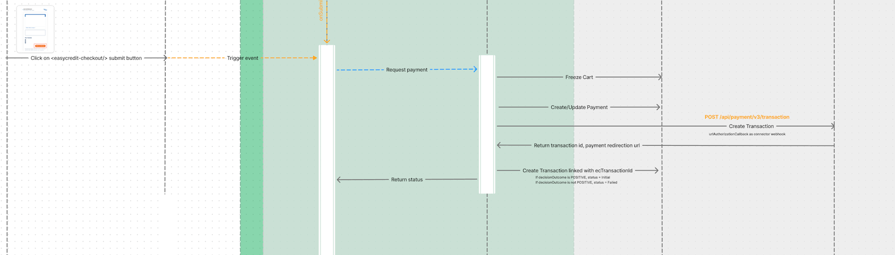

# Create Payment

* [Create payment workflow](#workflow)
* [Example request](#request)
* [Switching in the shop checkout](#switching-in-the-shop-checkout)
* [Switching on the easyCredit page](#switching-on-the-easycredit-page)
* [Redirect links](#redirect-links)
* [Response Format](#success-response)
* [Error response](#error-response-4xx)

## Overview
This API is designed to create payment details from CommerceTools using the provided `cartId`, needed `redirectLinks` and `customerRelationship` data. The optional `paymentType` selects `INSTALLMENT_PAYMENT` (default) or `BILL_PAYMENT`.

For an express checkout from the product page or the cart, without addresses, see [Create Express Payment](./CreateExpressPayment.md).
<br />

## Conditions

To use this functionality, the following conditions must be met:

1. A valid `cartId` must be provided, corresponding to a cart in CommerceTools.
2. The session must be authenticated, and a valid session token must be included in the request.
<br />

## Workflow

1. **Get `cart`**: Retrieve CT `cart` instance by `cartId`. If the selected payment type is switched off in the connector, the request is rejected before the cart is read. If the cart of the session holds the placeholder address of an abandoned express attempt, that attempt is ended first, or the request is refused with `400 PaymentInProgress` while easyCredit may still authorize it, see [Abandoned attempt](./CreateExpressPayment.md#abandoned-attempt).
2. **Check payment type availability, then the cart**: The selected payment type must be switched on in the connector (`INSTALLMENT_PAYMENT_ENABLED=1` or `BILL_PAYMENT_ENABLED=1`), activated for the webshop, the cart total must be within its limits and the cart must not contain excluded items, see [Excluded cart items](./GetPaymentMethod.md#excluded-cart-items). Activation status and limits come from a fresh easyCredit webshop configuration (`GET /payment/v3/webshop/{webShopId}`), see [Payment type availability](#payment-type-availability). Then the addresses and currency are validated. The cart is fetched again for this request, so items added after the GET payment method call are checked too.
3. **Discard stale attempts and freeze the cart**: Earlier easyCredit payments on the cart are discarded or refused, see [Switching in the shop checkout](#switching-in-the-shop-checkout). The cart is then frozen, see [Cart freeze](#cart-freeze).
4. **Create CT Payment**: Create the payment from the cart and attach it to the cart. `paymentMethodInfo` records the selected type, see [Stored payment method](#stored-payment-method).
5. **Create EC transaction**: Convert CT data into EC data (including the `paymentType`) and create the transaction. `paymentSwitchPossible` is `true` only if `BILL_PAYMENT_ENABLED=1`. The connector then supports a switch between installment and pay by invoice when easyCredit offers one on its page, see [Switching on the easyCredit page](#switching-on-the-easycredit-page).
6. **Add CT transaction**: An `Authorization` transaction is added to the CT payment, with the easyCredit `transactionId` as `interactionId` and the `technicalTransactionId` in a custom field. Its state is `Initial`, or `Failure` if easyCredit answers with a negative decision (the API then returns `400 TransactionNotSuccess` and unfreezes the cart).


<br />

## Stored payment method

The `paymentType` is only a selector. The connector validates it server-side and stores it on the CT payment:

| `paymentMethodInfo` field | Value |
| --- | --- |
| `paymentInterface` | `easycredit` (unchanged, payment lookup and validation key on this field) |
| `method` | `easycredit` for installment, as in earlier versions, or `BILL_PAYMENT` |
| `name` | `{ "de": "easyCredit Ratenkauf" }` or `{ "de": "easyCredit Rechnung" }` |

Every `method` other than `BILL_PAYMENT` is treated as `INSTALLMENT_PAYMENT`. Order flows that identify easyCredit payments by `method === 'easycredit'` keep working for installment, but miss pay by invoice: use `paymentInterface` to find all easyCredit payments.
<br />

## Cart freeze

A cart that is not frozen yet is frozen with the default strategy (`SoftFreeze`), as in earlier versions. A cart that is already frozen keeps its strategy. With `SoftFreeze` the shipping method can still be changed and discount codes can still be removed (commercetools Cart freeze documentation). The authorization checks that the cart is still frozen and that cart total, CT transaction amount and easyCredit order value are identical. A cart whose total changed after the payment was started is therefore rejected with `400 AmountMismatch` and its transaction is set to `Failure`, see [Authorize Payment](./AuthorizePayment.md#workflow).

Freezing can reprice the cart (unfreezing documents it, freezing an active cart does not say either way). If the total, the currency or the line items of the frozen cart differ from the cart that was validated (for example a gift line item added by a cart discount), the limits, the payment type availability and the [excluded cart items](./GetPaymentMethod.md#excluded-cart-items) are validated again on the frozen cart. On failure no payment is created and the cart is unfrozen again.

Validation failures (addresses, currency, payment type availability) leave the cart untouched, including a cart that was already frozen. Once the cart is frozen, every failure of the request unfreezes it again. Until the CT `Authorization` transaction is written, the CT payment is an orphan on the cart. If the easyCredit call or writing that transaction fails, the connector also removes the payment from the cart in the same update that unfreezes it. A negative decision writes a `Failure` transaction and only unfreezes the cart. If this cleanup fails, it is only logged and the original error is returned.
<br />

## Switching in the shop checkout

If the shopper changes the payment method in the shop checkout, the shop calls this endpoint again for the same cart. A frozen cart can still hold the earlier easyCredit payment. The connector does not reuse that payment, it replaces it. After the cart validation succeeded (a rejected request leaves the cart untouched) and before the cart is frozen, it checks every payment of the cart whose `paymentMethodInfo.paymentInterface` is `easycredit` (case-insensitive) in two passes.

Pass 1 only reads, so a refusal changes nothing:

| Earlier payment | Result |
| --- | --- |
| No `Authorization` transaction, or the transaction is `Failure` | Ignored, the payment stays on the cart. |
| Transaction `Pending` or `Success` | `400 PaymentInProgress`. |
| Transaction `Initial` and easyCredit (5 second limit) reports `AUTHORIZED` | `400 PaymentInProgress`. |
| Transaction `Initial` and easyCredit answers `404` or `410` (the transaction is gone, for example invalidated by a newer one), or any status other than `AUTHORIZED` (for example `OPEN`, `PREAUTHORIZED`, `DECLINED`, `EXPIRED`) | Stale, will be discarded. |
| Transaction `Initial` and the easyCredit lookup fails for any other reason (network error, timeout, `5xx`) | `400 PaymentInProgress`. |

Pass 2 runs only if at least one attempt is stale. The transaction of every stale attempt is set to `Failure`, but only if it is still `Initial`. An attempt that is already `Failure` (for example because the cancel webhook ran in between) counts as done. If an attempt is no longer `Initial` (for example it moved to `Pending` or `Success` after pass 1, because an authorization request was sent and written as `Pending`), pass 2 refuses with `400 PaymentInProgress` and that attempt is neither failed nor removed. This check is not airtight: the authorize call writes `Pending` only after it sent the authorization request, so there is a short window in which the attempt is still `Initial` although the request is out. An attempt discarded in that window is failed here, the authorize call then logs `EASYCREDIT_AUTHORIZATION_SENT_ATTEMPT_DISCARDED` and stops, and if easyCredit authorizes it anyway, the connector logs `EASYCREDIT_AUTHORIZED_CT_NOT_SUCCESS` when the easyCredit callback arrives and its status lookup succeeds. The merchant has to follow that up manually, there is no automatic void at easyCredit. Stale attempts handled earlier in the same loop then already have a `Failure` transaction and stay attached to the cart, and this step does not unfreeze the cart. A retry ignores `Failure` attempts. Otherwise one cart update removes all stale payments. A frozen cart is unfrozen before and frozen again with its previous strategy in the same update. Creating the new payment continues as described in the [workflow](#workflow), including the re-validation if unfreezing repriced the cart, see [Cart freeze](#cart-freeze).

Other payment methods are not visible to the connector. If the shopper switches to a payment method that is not easyCredit, the shop must call the cancel webhook so that the payment is failed and the cart is unfrozen, see [Cancel Payment](./CancelPayment.md#switching-to-another-payment-method). The same webhook is the way out of an attempt that is stuck in `Pending`: this endpoint refuses it with `PaymentInProgress`, the cancel webhook cancels it unless easyCredit already reports `AUTHORIZED`. Alternatively wait until the attempt is decided, see [Timeout handling](./AuthorizePayment.md#timeout-handling).
<br />

## Switching on the easyCredit page

With `BILL_PAYMENT_ENABLED=1`, every `POST /transaction` to easyCredit carries `paymentSwitchPossible: true`, and the connector supports a switch between installment and pay by invoice when easyCredit offers one on its page. The easyCredit sandbox page did not offer a switch on 2026-10-26 (checked: financing terms, data entry, decision pages, plan editor, info FAQ), so the switch path is covered by unit tests only and is not verified end to end against the live service. A deployment that sees a switch should check the first one. The connector does not learn about a switch from a redirect: `urlSuccess` goes straight to the shop. It reads the final payment type from easyCredit when the shop calls [Get Payment](./GetPayment.md) or [Authorize Payment](./AuthorizePayment.md), and when the easyCredit callback arrives. The final type is validated again for the cart before authorization, see [Authorize Payment](./AuthorizePayment.md#sync-the-final-payment-type). A shopper who is offered a switch can pick pay by invoice after the credit check even if the cart fails one of its rules. The authorization is then rejected. With `BILL_PAYMENT_ENABLED=0` the flag is `false`, so easyCredit offers no switch and installment payments behave as in earlier versions.
<br />

## Redirect links

The shopper's browser is sent to `urlSuccess` by easyCredit, and to `urlCancellation` and `urlDenial` by the connector's cancel webhook. The webhook link is signed, so it only redirects to the link of its payment, see [Cancel Payment](./CancelPayment.md). Which links a payment may carry is set by the request.

With `REDIRECT_ALLOWED_HOSTS` set (comma-separated host names, for example `shop.example.com,www.shop.example.com`), every link of Create Payment and [Create Express Payment](./CreateExpressPayment.md) must be an absolute `http` or `https` URL on one of these hosts, without user name or password, whitespace, control characters or backslashes. Otherwise the request returns `400 InvalidField` before the cart is read. The connector stores and signs the link in its parsed form, for example `https://shop.example.com/` for `https://SHOP.example.com`.

Without `REDIRECT_ALLOWED_HOSTS`, Create Payment passes the links on as before, including relative links, and Create Express Payment applies the same format checks without the host check. Anyone with a valid session can then create a payment whose cancel link sends the shopper to any site, so set `REDIRECT_ALLOWED_HOSTS` in production.

## Transaction custom fields

The `Authorization` transaction carries custom fields of one shared custom type. Its key is `TRANSACTION_CUSTOM_TYPE_KEY` (default `easy-credit-technical-transaction-id`) and the post-deploy script creates it or adds missing field definitions:

| Field | Type | Content |
| --- | --- | --- |
| `easyCreditTechnicalTransactionId` | String | easyCredit `technicalTransactionId`, set when the transaction is created. |
| `easyCreditInterest` | Number | `decision.interest` from easyCredit, in EUR. Only for installment payments. |
| `easyCreditTotalValue` | Number | `decision.totalValue` from easyCredit, in EUR. Only for installment payments. |

The interest fields are written when [Get Payment](./GetPayment.md), [Authorize Payment](./AuthorizePayment.md) or the easyCredit callback reads the easyCredit transaction, whenever they differ from the stored values. This also covers a changed term on the easyCredit page without a type switch. A switch to pay by invoice removes them. They are informational: there is no interest line item in the cart, because a frozen cart rejects price-affecting updates and the cart total must equal the easyCredit `orderValue`, which excludes interest. The `Charge` transaction added by [Capture Payment](./CapturePayment.md) copies only `easyCreditTechnicalTransactionId`. The interest fields stay on the `Authorization` transaction, which holds the credit terms the shopper agreed to. To show the interest on the storefront see [Get Payment](./GetPayment.md#showing-the-interest-on-the-storefront).

**Existing deployments** do not have the two interest field definitions until the post-deploy script runs again. Redeploy the connector to run it. Until then, writing the fields fails: the connector logs a warning (`Failed to record the interest and total value on the transaction`) and, from `updatePayment`, an error (`Error in updatePayment`) on every installment Get Payment or Authorize Payment call. Nothing else changes.
<br />

## Payment type availability

The request is rejected before any cart or payment change if:

- the connector has no fresh easyCredit webshop configuration, for example because easyCredit cannot be reached, answered with an error or sent an invalid installment configuration, see [Webshop configuration](GetPaymentMethod.md#webshop-configuration) (`503 EasyCreditUnavailable`). This applies to both payment types,
- the selected payment type is disabled or not activated for the webshop (error code below). For installment this means `INSTALLMENT_PAYMENT_ENABLED` is `0`, `availability: false` or `installmentPaymentActive: false`. For bill this means `BILL_PAYMENT_ENABLED` is not `1`, `availability: false`, `billPaymentActive: false`, or absent or invalid bill configuration. The error is `400 PaymentTypeNotAvailable`,
- the payment type is enabled but the cart contains an excluded product type or custom line item (`400 InstallmentPaymentExcludedItems` or `400 BillPaymentExcludedItems`). This takes precedence over `InvalidAmount`. A matching custom line item skips the product type lookup,
- the payment type is enabled but the product type lookup fails, for example because of a missing `view_product_types` scope or a commercetools outage (`503 InstallmentPaymentCheckFailed` or `503 BillPaymentCheckFailed`). This takes precedence over `InvalidAmount`,
- the payment type is enabled but the cart total is outside its effective limits (`400 InvalidAmount`). A disabled type never returns `InvalidAmount`, only `PaymentTypeNotAvailable`.

The optional request field `paymentType` defaults to `INSTALLMENT_PAYMENT`, so a request without it is rejected with `PaymentTypeNotAvailable` if `INSTALLMENT_PAYMENT_ENABLED=0`. Any other value is rejected by the body schema with `400 InvalidJsonInput`. The checkout component sends the payment type it was built with. `BILL_PAYMENT` is accepted if it is enabled and activated for the webshop and the customer is a private person. A GET payment method response for a payment type and this endpoint use the same check.

Limits are defined by easyCredit per webshop and cannot be configured in the connector. There are no default limits and stale webshop data is never used, see [Get Payment Method](./GetPaymentMethod.md#webshop-configuration) for caching and retries.

The billing address must be complete for both payment types, see the `InvalidAddress` error below.
<br />

## Example URL Call

To create a payment, you can make a call to the following URL. Ensure to include the session header for authentication.

### Request

**HTTP Method:** `POST`  
**URL:** `https://your-api-endpoint.com/payments/`  
**Headers:**
```http
X-Session-Id: <session_id>
Content-Type: application/json
```

To obtain the `X-Session-Id`, refer to the [CommerceTools Sessions API documentation](https://docs.commercetools.com/checkout/installing-checkout#create-checkout-sessions).

**Parameters:**

```json
{
    // cartId of a valid cart
    // a valid cart must have
    //     a total amount within the effective limits of the selected payment type (webshop limits, or outage defaults for installment)
    //     identical, complete billing and shipping addresses in Germany
    "cartId": "YOUR_CART_ID", 
    // optional, defaults to INSTALLMENT_PAYMENT. Use BILL_PAYMENT for pay by invoice
    "paymentType": "INSTALLMENT_PAYMENT",
    "redirectLinks": {
        "urlSuccess": "https://example.com/success",
        "urlCancellation": "https://example.com/cancellation",
        "urlDenial": "https://example.com/denial"
    },
    "customerRelationship": {
        "customerStatus": "NEW_CUSTOMER",
        "customerSince": "yyyy-MM-dd",
        "numberOfOrders": 0
    }
}
```

### Response Format

#### Success Response:

On successful creation of a payment, the API returns a `201 Created` response along with the following structure:

```json
{
    "technicalTransactionId": "c2b818bb.1120065723LwY1rRZcggpX9az7qUgAvdEh",
    "paymentId": "25559370-d4a0-4291-b84e-b0f7e46d6972",
    "redirectUrl": "https://ratenkauf.easycredit.de/app/payment/c2b818bb.1120065723LwY1rRZcggpX9az7qUgAvdEh/finanzierungsvorgaben",
    "transactionInformation": {
        "status": "OPEN",
        "decision": {
            "decisionOutcome": "",
            "decisionOutcomeText": null
        }
    }
}
```

#### Error Response 4xx:  

If the provided `cartId` is invalid, or if there is an issue with the session token, the API will return a `404 Not found` error:

```json
{
    "message": "The Resource with ID '35c84223c-d598-4d76-a059-ed5b3da396b7' was not found.",
    "statusCode": 404,
    "errors": [
        {
            "code": 404,
            "message": "The Resource with ID '35c84223c-d598-4d76-a059-ed5b3da396b7' was not found.",
            "fields": [
                {
                    "code": "ResourceNotFound",
                    "message": "The Resource with ID '35c84223c-d598-4d76-a059-ed5b3da396b7' was not found."
                }
            ]
        }
    ]
}
```

#### Error Response 400:

If the cart fails validation, the API returns a `400 Bad Request` error. The checks run in the same order as in [Get Payment Method](./GetPaymentMethod.md#workflow): for both payment types the payment type checks run first, then the address and currency checks. `InvalidAmount` and `PaymentTypeNotAvailable` are never returned together with an address, currency or customer error.

| Code | Reason |
| --- | --- |
| `InvalidField` | `REDIRECT_ALLOWED_HOSTS` is set and a link does not meet it, see [Redirect links](#redirect-links). Returned before the cart is read. |
| `InvalidBillingAddress`, `InvalidShippingAddress` | The cart has no billing or shipping address. |
| `AddressesUnmatched` | Billing and shipping address differ (including `additionalStreetInfo`, see [Get Payment Method](./GetPaymentMethod.md)), or the country is not `DE`. |
| `InvalidAddress` | The billing address is incomplete or invalid: `firstName`, `lastName`, `streetName` and `city` must not be blank and `postalCode` must be 5 digits. Only reported if both addresses exist, in addition to the codes above. |
| `InvalidCurrency` | The cart currency is not `EUR`. |
| `CorporateCustomerNotAllowed` | Only for `BILL_PAYMENT`: the cart has a Business Unit or a company in the billing or shipping address. |
| `InvalidAmount` | The cart total is outside the limits of the selected payment type, which is enabled. The message contains the limits from the fresh webshop configuration. |
| `PaymentTypeNotAvailable` | The selected payment type is disabled or not activated for the webshop. |
| `InstallmentPaymentExcludedItems` | `INSTALLMENT_PAYMENT` was selected but the cart contains a voucher or another excluded item, see [Excluded cart items](./GetPaymentMethod.md#excluded-cart-items). |
| `InstallmentPaymentCheckFailed` | `503`: `INSTALLMENT_PAYMENT` was selected but the excluded product types could not be loaded from commercetools, so the cart items could not be checked. Check the `view_product_types` scope and the processor logs. |
| `BillPaymentExcludedItems` | `BILL_PAYMENT` was selected but the cart contains a voucher or another excluded item, see [Excluded cart items](./GetPaymentMethod.md#excluded-cart-items). |
| `BillPaymentCheckFailed` | `503`: `BILL_PAYMENT` was selected but the excluded product types could not be loaded from commercetools, so the cart items could not be checked. Check the `view_product_types` scope and the processor logs. |
| `PaymentInProgress` | An earlier easyCredit payment on the cart is `Pending` or `Success`, is `Initial` and authorized at easyCredit, or could not be checked at easyCredit. No new payment is created. See [Switching in the shop checkout](#switching-in-the-shop-checkout). The message offers to cancel or wait, which does not fit every case: for a `Success` attempt the payment is already authorized, so create the order from it (the cancel webhook refuses it). For an `Initial` attempt that easyCredit reports as `AUTHORIZED`, call [Authorize Payment](./AuthorizePayment.md). For a `Pending` attempt, wait or call the [cancel webhook](./CancelPayment.md). |
| `TransactionNotSuccess` | easyCredit answered the new transaction with a negative decision. The message is the `decisionOutcomeText`. The CT transaction is `Failure` and the cart is unfrozen. |

easyCredit errors (for example `5xx`) are returned with the upstream HTTP status and the title easyCredit sent as code, and the cart is unfrozen as described in [Cart freeze](#cart-freeze).

Example for a webshop whose installment limits are 200 € to 10.000 €:

```json
{
    "message": "Die Summe des Warenkorbs muss zwischen 200€ und 10.000€ liegen.",
    "statusCode": 400,
    "errors": [
        {
            "code": "InvalidAmount",
            "message": "Die Summe des Warenkorbs muss zwischen 200€ und 10.000€ liegen.",
            "fields": {
                "webShopId": "2.de.7607.2"
            }
        }
    ]
}
```
