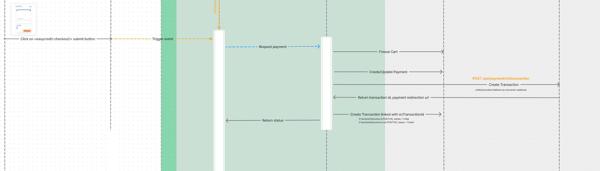

# Create Payment

* [Create payment workflow](#workflow)
* [Example request](#request)
* [Response Format](#success-response)
* [Error response](#error-response-4xx)

## Overview
This API is designed to create payment details from CommerceTools using the provided `cartId`, needed `redirectLinks` and `customerRelationship` data. The optional `paymentType` selects `INSTALLMENT_PAYMENT` (default) or `BILL_PAYMENT`.
<br />

## Conditions

To use this functionality, the following conditions must be met:

1. A valid `cartId` must be provided, corresponding to a cart in CommerceTools.
2. The session must be authenticated, and a valid session token must be included in the request.
<br />

## Workflow

1. **Validate and get `cart`**: Retrieve CT `cart` instance by `cartId` and validate its addresses and currency.
2. **Check payment type availability**: The selected payment type must be activated for the webshop and the cart total must be within its effective limits. Activation status and limits come from the cached easyCredit webshop configuration (`GET /payment/v3/webshop/{webShopId}`), subject to the fallback policy in [Payment type availability](#payment-type-availability). `BILL_PAYMENT` additionally requires `BILL_PAYMENT_ENABLED=1`.
3. **Freeze the cart**: The cart is frozen with the `HardFreeze` strategy, see [Cart freeze](#cart-freeze).
4. **Create CT Payment**: Create the payment from the cart and attach it to the cart. `paymentMethodInfo` records the selected type, see [Stored payment method](#stored-payment-method).
5. **Create EC transaction**: Convert CT data into EC data (including the `paymentType`) and create the transaction.
6. **Add CT transaction**: An `Authorization` transaction is added to the CT payment, with the easyCredit `transactionId` as `interactionId` and the `technicalTransactionId` in a custom field. Its state is `Initial`, or `Failure` if easyCredit answers with a negative decision (the API then returns `400 TransactionNotSuccess` and unfreezes the cart).


<br />

## Stored payment method

The `paymentType` is only a selector. The connector validates it server-side and stores it on the CT payment:

| `paymentMethodInfo` field | Value |
| --- | --- |
| `paymentInterface` | `easycredit` (unchanged, payment lookup and validation key on this field) |
| `method` | `INSTALLMENT_PAYMENT` or `BILL_PAYMENT` |
| `name` | `{ "de": "easyCredit Ratenkauf" }` or `{ "de": "easyCredit Rechnung" }` |

Payments created before this change have `method: "easycredit"`. They are treated as `INSTALLMENT_PAYMENT`. Merchant or order flows that identify easyCredit payments by `method === 'easycredit'` must use `paymentInterface` instead.
<br />

## Cart freeze

The cart is frozen with `HardFreeze`: prices, discounts and discount codes stay fixed and shipping methods cannot be set (commercetools Cart freeze documentation). A cart that is frozen with another strategy (for example `SoftFreeze`) is unfrozen and frozen again with `HardFreeze`; a cart that is already hard-frozen is left as it is. Merchants can therefore not change the shipping method after the payment was started.

Freezing can reprice the cart (unfreezing documents it, freezing an active cart does not say either way). If the total or currency of the frozen cart differs from the cart that was validated, the limits and the payment type availability are validated again on the frozen cart. On failure no payment is created and the cart is unfrozen again.

Validation failures (addresses, currency, payment type availability) leave the cart untouched, including a cart that was already frozen. Once the cart is frozen, every failure of the request unfreezes it again. Until the CT `Authorization` transaction is written, the CT payment is an orphan on the cart. If the easyCredit call or writing that transaction fails, the connector also removes the payment from the cart in the same update that unfreezes it. A negative decision writes a `Failure` transaction and only unfreezes the cart. If this cleanup fails, it is only logged and the original error is returned.
<br />

## Payment type availability

The request is rejected before any cart or payment change if:

- easyCredit rejected the webshop request with a permanent error or sent an invalid installment configuration, or a known deactivation/permanent failure blocks fallback without usable cached data, see [Webshop configuration](GetPaymentMethod.md#webshop-configuration) (`503 EasyCreditUnavailable`),
- the selected payment type is disabled or not activated for the webshop (error code below). For installment this means `availability: false` or `installmentPaymentActive: false`. For bill this means `BILL_PAYMENT_ENABLED` is not `1`, `availability: false`, `billPaymentActive: false`, absent or invalid bill configuration, or stale/default webshop data (bill fails closed). The error is `400 PaymentTypeNotAvailable`,
- the payment type is enabled but the cart total is outside its effective limits (`400 InvalidAmount`). A disabled type never returns `InvalidAmount`, only `PaymentTypeNotAvailable`.

The optional request field `paymentType` defaults to `INSTALLMENT_PAYMENT`. The checkout component sends the payment type it was built with. `BILL_PAYMENT` is accepted if it is enabled and activated for the webshop and the customer is a private person. A GET payment method response for `BILL_PAYMENT` and this endpoint use the same check.

Limits are defined by easyCredit per webshop and cannot be configured in the connector. During temporary failures, installment uses usable cached limits or, if none remain, the legacy 200 € to 10.000 € defaults, unless a known deactivation or permanent failure blocks fallback. Bill payment is unavailable with stale or default data. See [Get Payment Method](./GetPaymentMethod.md#webshop-configuration) for caching and retries.

The billing address must be complete for both payment types, see the `InvalidAddress` error below.
<br />

## Example URL Call

To create a payment, you can make a call to the following URL. Ensure to include the session header for authentication.

### Request

**HTTP Method:** `POST`  
**URL:** `https://your-api-endpoint.com/payments/`  
**Headers:**
```http
X-Session-Id: <session_id>
Content-Type: application/json
```

To obtain the `X-Session-Id`, refer to the [CommerceTools Sessions API documentation](https://docs.commercetools.com/checkout/installing-checkout#create-checkout-sessions).

**Parameters:**

```json
{
    // cartId of a valid cart
    // a valid cart must have
    //     a total amount within the effective limits of the selected payment type (webshop limits, or outage defaults for installment)
    //     identical, complete billing and shipping addresses in Germany
    "cartId": "YOUR_CART_ID", 
    // optional, defaults to INSTALLMENT_PAYMENT. Use BILL_PAYMENT for pay by invoice
    "paymentType": "INSTALLMENT_PAYMENT",
    "redirectLinks": {
        "urlSuccess": "https://example.com/success",
        "urlCancellation": "https://example.com/cancellation",
        "urlDenial": "https://example.com/denial"
    },
    "customerRelationship": {
        "customerStatus": "NEW_CUSTOMER",
        "customerSince": "yyyy-MM-dd",
        "numberOfOrders": 0
    }
}
```

### Response Format

#### Success Response:

On successful creation of a payment, the API returns a `201 Created` response along with the following structure:

```json
{
    "technicalTransactionId": "c2b818bb.1120065723LwY1rRZcggpX9az7qUgAvdEh",
    "paymentId": "25559370-d4a0-4291-b84e-b0f7e46d6972",
    "redirectUrl": "https://ratenkauf.easycredit.de/app/payment/c2b818bb.1120065723LwY1rRZcggpX9az7qUgAvdEh/finanzierungsvorgaben",
    "transactionInformation": {
        "status": "OPEN",
        "decision": {
            "decisionOutcome": "",
            "decisionOutcomeText": null
        }
    }
}
```

#### Error Response 4xx:  

If the provided `cartId` is invalid, or if there is an issue with the session token, the API will return a `404 Not found` error:

```json
{
    "message": "The Resource with ID '35c84223c-d598-4d76-a059-ed5b3da396b7' was not found.",
    "statusCode": 404,
    "errors": [
        {
            "code": 404,
            "message": "The Resource with ID '35c84223c-d598-4d76-a059-ed5b3da396b7' was not found.",
            "fields": [
                {
                    "code": "ResourceNotFound",
                    "message": "The Resource with ID '35c84223c-d598-4d76-a059-ed5b3da396b7' was not found."
                }
            ]
        }
    ]
}
```

#### Error Response 400:

If the cart fails validation, the API returns a `400 Bad Request` error. The checks run in the same order as in [Get Payment Method](./GetPaymentMethod.md#workflow): for installment the address and currency checks run first, for pay by invoice the payment type checks run first. `InvalidAmount` and `PaymentTypeNotAvailable` are never returned together with an address, currency or customer error.

| Code | Reason |
| --- | --- |
| `InvalidBillingAddress`, `InvalidShippingAddress` | The cart has no billing or shipping address. |
| `AddressesUnmatched` | Billing and shipping address differ, or the country is not `DE`. |
| `InvalidAddress` | The billing address is incomplete or invalid: `firstName`, `lastName`, `streetName` and `city` must not be blank and `postalCode` must be 5 digits. Only reported if both addresses exist, in addition to the codes above. |
| `InvalidCurrency` | The cart currency is not `EUR`. |
| `CorporateCustomerNotAllowed` | Only for `BILL_PAYMENT`: the cart has a Business Unit or a company in the billing or shipping address. |
| `InvalidAmount` | The cart total is outside the effective limits of the selected payment type, which is enabled. The message contains the limits from fresh or usable stale webshop data, or the installment defaults. |
| `PaymentTypeNotAvailable` | The selected payment type is disabled or not activated for the webshop. |
| `TransactionNotSuccess` | easyCredit answered the new transaction with a negative decision. The message is the `decisionOutcomeText`. The CT transaction is `Failure` and the cart is unfrozen. |

easyCredit errors (for example `5xx`) are returned with the upstream HTTP status and the title easyCredit sent as code, and the cart is unfrozen as described in [Cart freeze](#cart-freeze).

Example for a webshop whose installment limits are 200 € to 10.000 €:

```json
{
    "message": "Die Summe des Warenkorbs muss zwischen 200€ und 10.000€ liegen.",
    "statusCode": 400,
    "errors": [
        {
            "code": "InvalidAmount",
            "message": "Die Summe des Warenkorbs muss zwischen 200€ und 10.000€ liegen.",
            "fields": {
                "webShopId": "2.de.7607.2"
            }
        }
    ]
}
```
