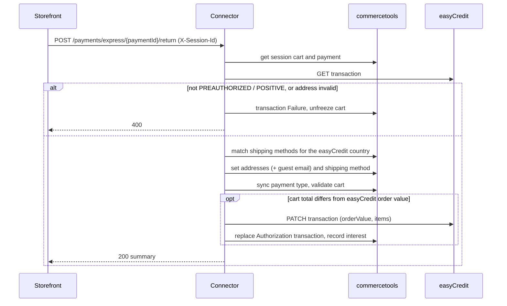

# Express Return

* [Workflow](#workflow)
* [Customer data](#customer-data)
* [Shipping costs and amount sync](#shipping-costs-and-amount-sync)
* [Changes after the return](#changes-after-the-return)
* [Example request](#request)
* [Response Format](#success-response)
* [Error response](#error-responses)

## Overview
This API completes an express checkout started with [Create Express Payment](./CreateExpressPayment.md). The shopper entered name, email, phone and address on the easyCredit payment page; the connector takes them over onto the cart, sets the shipping method and brings the easyCredit transaction to the new cart total. Call it from the page behind `urlSuccess`, then show the regular confirm page. Create the order as for a regular payment, see [Authorize and create the order](./CommercetoolsFrontendIntegration.md#authorize-and-create-the-order): only after the authorization succeeded, that is a `204` with `waitForAuthorization: true`. Without it, a `204` only means the request was sent and the transaction is still `Pending`.
<br />

## Conditions

1. The session must be authenticated, and a valid session token must be included in the request.
2. The payment must be attached to the cart of the session, be an easyCredit payment created with Create Express Payment, and its `Authorization` transaction must be `Initial`.
3. easyCredit must report the transaction as `PREAUTHORIZED` with the decision `POSITIVE`.
<br />

## Workflow

1. Check the payment against the session cart (conditions 2 and 3). `OPEN`, `DECLINED`, `EXPIRED` or a transaction easyCredit no longer finds abandon the attempt, see [Error responses](#error-responses).
2. Read address and contact from the easyCredit transaction and check them: complete address in `DE`, and an invoice address entered on the easyCredit page must be the same as the shipping address, name included. The cart gets one address as billing and shipping address, as Create Payment requires. A missing name on either side falls back to the customer name.
3. Choose the shipping method for the easyCredit country, before anything is written: the method already on the cart (usually the default one set by [Create Express Payment](./CreateExpressPayment.md#shipping-costs)) if it matches, otherwise the default matching method. Without a matching method, or on a cart the shop froze with `HardFreeze` whose method would have to change, the attempt ends and the cart gets no customer data.
4. Write the address as billing and shipping address, the email for guests and the shipping method in one cart update. A cart frozen with `HardFreeze` accepts the address and the email but not `setShippingMethod` (checked against commercetools on 2026-11-25), so it keeps its matching method. commercetools rejecting this update with `400` ends the attempt; its error response and the logs carry only the error code and field, not the rejected value. A method the connector swaps in is recorded on the payment before the cart update, see [Stored express flag](./CreateExpressPayment.md#stored-express-flag). If that record fails, the call stops before the cart changes and can be repeated. If commercetools rejects the cart update with `400`, the method recorded before is restored. After a `409`, a `5xx` or no answer the record stays, as this or a concurrent call may have set the method.
5. Sync the payment type the shopper chose on the easyCredit page, as in [Get Payment](./GetPayment.md).
6. Validate the cart for that payment type as in [Create Payment](./CreatePayment.md): addresses, private customer, currency, limits and [excluded cart items](./GetPaymentMethod.md#excluded-cart-items).
7. Read the CT payment again. If a concurrent call (for example [Cancel Payment](./CancelPayment.md)) moved the `Authorization` transaction away from `Initial` in the meantime, stop with `400 TransactionNotPreauthorized` and write nothing.
8. If the cart total now differs from the easyCredit order value or the CT transaction amount, sync them, see [Shipping costs and amount sync](#shipping-costs-and-amount-sync).

The cart stays frozen. The call can be repeated: a second call finds the address and amount already in sync and changes nothing.


<br />

## Customer data

| | Guest | Logged-in customer (`cart.customerId` set) |
| --- | --- | --- |
| Cart email | Email from easyCredit | Account email, not changed |
| Billing and shipping address | Address from easyCredit | Address from easyCredit, on the cart only, not saved to the address book |
| Customer account | None. No login, no lookup or merge by email | Cart and order stay linked to the account |

Only the name, phone and address are taken over: `firstName`, `lastName`, street (`streetName` and `streetNumber` split from the easyCredit address line), `additionalStreetInfo`, `postalCode`, `city`, `country`, and the mobile number as `phone` and `mobile`. The name comes from the easyCredit shipping address, falling back to the customer name. Birth date, bank account, income and employment are not read and are written neither to the cart, the payment, the order nor the logs. The response contains no customer data.
<br />

## Shipping costs and amount sync

easyCredit finances the cart total including shipping (`orderValue`). [Create Express Payment](./CreateExpressPayment.md#shipping-costs) already includes the shipping costs of the default method, so the total usually stays the same after the return. It changes if another method matches the easyCredit address or the shopper changes the method. The cart has no interest line, so the cart total is compared with the easyCredit `orderValue` directly (in cents).

easyCredit accepts only a lower or equal `orderValue`: any increase is rejected, even by one cent (checked in the sandbox on 2026-11-15). A higher total therefore abandons the attempt with `400 AmountIncreaseNotPossible`, like TeamBank's plugins reset the payment when the update fails.

If they differ, the connector:

1. sends `PATCH /transaction/{technicalTransactionId}` with `orderValue` (the cart total), `numberOfProductsInShoppingCart` and `shoppingCartInformation`. easyCredit accepts it only while the transaction is `PREAUTHORIZED` and answers with a new decision.
2. requires the decision of the response to be `POSITIVE`.
3. replaces the CT `Authorization` transaction, as commercetools cannot change a transaction amount: the old one is set to `Failure`, a new `Initial` one with the new amount, the same `interactionId` and the same custom fields is added, and `amountPlanned` follows. The connector always works with the transaction that is not `Failure`.
4. stores `easyCreditInterest` and `easyCreditTotalValue` from the response on the new transaction.

A rejected PATCH or a decision that is not `POSITIVE` abandons the attempt. A PATCH without a clear answer (no answer, a `5xx` or an unreadable body: `502` / `504 TransactionUpdateFailed`) keeps it, as easyCredit may have changed the amount: a retry reads the new `orderValue` and only replaces the CT transaction. easyCredit answering `408`, `409` or `429` keeps it too, as it did not reject the new total itself; a retry sends the PATCH again. A commercetools error in step 3 (for example `409` from a second return call that replaced the transaction first) keeps it: a retry finds easyCredit already updated and only replaces the transaction.

The limits are validated for the new total before the PATCH. The later authorization needs no amount: easyCredit authorizes the updated `orderValue`.

For an installment payment the confirm page shows the interest as its own line and includes it in the total. Take `decision.interest` and `decision.totalValue` from the response of this call, see [Showing the interest on the storefront](./GetPayment.md#showing-the-interest-on-the-storefront).
<br />

## Changes after the return

easyCredit cannot change the address of an existing transaction and requires that the order uses the address the shopper entered there. Show billing and shipping address read-only on the confirm page of an express order. If the shopper wants another address, discard the express attempt (for example with [Cancel Payment](./CancelPayment.md)) and start the easyCredit payment again.

[Authorize Payment](./AuthorizePayment.md#express-payments) checks this again before it sends the authorization request, and syncs a total that changed after the return (another shipping method, a removed discount code) in the same way as this call.

A transaction expires 30 minutes after the last activity of the shopper or a `PATCH` of the shop. easyCredit then answers the lookup with `400 CONSTRAINT_VIOLATION` on `decision` instead of the status `EXPIRED` (sandbox, 2026-11-15). Both abandon the attempt, so the shopper can start a new express checkout. This call answers both with `400 TransactionExpired`. [Authorize Payment](./AuthorizePayment.md#workflow) answers the lookup error with `400 TransactionExpired` and the status `EXPIRED` with `400 TransactionNotPreauthorized`, as for regular payments. Authorize does not end an `OPEN` transaction: the shopper may still be on the easyCredit page, so it answers `400 TransactionNotPreauthorized` and keeps the attempt.
<br />

## Example URL Call

### Request

**HTTP Method:** `POST`  
**URL:** `https://your-api-endpoint.com/payments/express/{paymentId}/return`  
**Headers:**
```http
X-Session-Id: <session_id>
```

`paymentId` is the `paymentId` from the response of Create Express Payment. The request has no body; an empty body with `Content-Type: application/json` is accepted.

### Response Format

#### Success Response:

`200` with the same body as [Get Payment](./GetPayment.md#response-format). `amount` is the new transaction amount, and `decision` comes from the PATCH response if the amount was synced. For a `BILL_PAYMENT`, the PATCH response still carries installment values; the connector drops them, so `decision` has no `interest`, `installment` or `lastInstallment`, `numberOfInstallments` is `1` and `totalValue` equals `orderValue`, as in Get Payment.

```json
{
    "webShopId": "1.de.1234.1",
    "amount": 504.95,
    "status": "PREAUTHORIZED",
    "paymentType": "INSTALLMENT_PAYMENT",
    "decision": {
        "orderValue": 504.95,
        "interest": 13.10,
        "totalValue": 518.05,
        "decisionOutcome": "POSITIVE",
        "numberOfInstallments": 12,
        "installment": 43.20,
        "lastInstallment": 42.85
    }
}
```

#### Error Responses:

**Abandoned attempt:** the `Authorization` transaction is set to `Failure` and the cart is unfrozen. A failure before the address is written also removes the placeholder, see [Placeholder address](./CreateExpressPayment.md#placeholder-address). Send the shopper back to the cart with a message to start the easyCredit payment again.

| Code | Reason |
| --- | --- |
| `TransactionNotPreauthorized` | easyCredit reports `OPEN` or `DECLINED` |
| `TransactionExpired` | easyCredit reports `EXPIRED`, or no longer finds the transaction (`404`, `410`, `400 CONSTRAINT_VIOLATION` on `decision`) |
| `DecisionNotPositive` | The decision, or the decision after the PATCH, is not `POSITIVE` |
| `InvalidShippingAddress` | easyCredit returned no shipping address |
| `AddressesUnmatched`, `InvalidAddress` | The address is not in `DE` or incomplete, or the invoice address differs from the shipping address (name included) |
| `NoShippingMethod` | No shipping method matches the address. The cart gets no customer data |
| `ShippingMethodNotChangeable` | The shop froze the cart with `HardFreeze` and its shipping method does not match the address. The cart gets no customer data |
| commercetools error with `400` | commercetools rejected the update with the customer data and the shipping method |
| `ShippingModeNotSupported` | The cart uses multiple shipping addresses |
| `InvalidAmount`, `BillPaymentExcludedItems`, `CorporateCustomerNotAllowed`, `InvalidCurrency` | The cart no longer meets the rules of the payment type, see [Create Payment](./CreatePayment.md#error-response-400) |
| `AmountIncreaseNotPossible` | The total rose after the decision and easyCredit rejected the PATCH |
| easyCredit error | easyCredit rejected the PATCH of a lower total |

**Attempt left open:** nothing is failed and the call can be repeated.

| Code | Reason |
| --- | --- |
| `InvalidSession` | The session has no cart, or the payment is not attached to it |
| `NotExpressPayment` | The payment was created with Create Payment |
| `TransactionNotPreauthorized` | The `Authorization` transaction is no longer `Initial`, or easyCredit reports `AUTHORIZED` |
| `PaymentTypeNotAvailable`, `EasyCreditUnavailable` | The payment type cannot be offered right now |
| commercetools or easyCredit error with `409` or `5xx`, easyCredit `408` or `429` on the PATCH | Transient failure while reading or updating, including a `409` while replacing the CT transaction after the PATCH or while recording the shipping method |
| `TransactionUpdateFailed` (`502` / `504`) | easyCredit did not answer the PATCH, answered with `5xx` or with an unreadable body. A retry reads whether easyCredit applied it |
