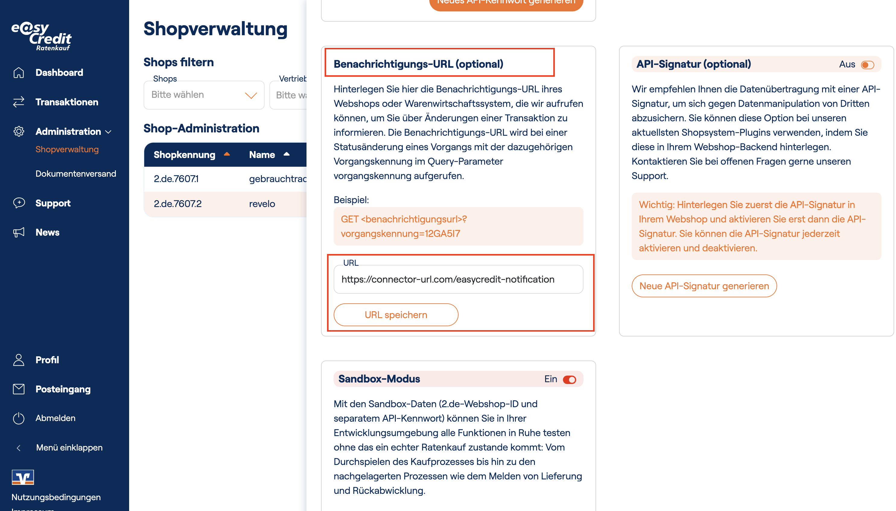

# Triggering Refunding Easycredit Payment

This guide provides instructions on how to trigger a Refund for an Easycredit payment from CommerceTools shop side. It works for `INSTALLMENT_PAYMENT` and `BILL_PAYMENT` payments alike, for full and partial refunds and for several refunds on the same payment.

Pay by invoice (`BILL_PAYMENT`) behaves like installment: full, partial and several refunds work, also before the capture, and the notification completes them the same way.

Behavior changes for existing integrations, installment included, are listed in the [changelog](../CHANGELOG.md#breaking-changes).

## Table of Contents

- [API endpoint](#api-endpoint)
- [Process](#process)
- [Handling Notification](#handling-notification)

## API endpoint

- We provide an endpoint `POST /payments/:paymentId/refund` to trigger the Refund for an Easycredit payment. The endpoint requires:
  - Headers:
    - `Authorization`: Require CommerceTools access token which can be obtained from their auth endpoint and with your CommerceTools credentials
  - Params:
    - `paymentId`: The CommerceTools Payment ID
  - Payload:
    - `amount`: The amount that you want to refund

- Request example:
  ```
    curl --location '{{connectorProcessorUrl}}/payments/{{paymentId}}/refund' \
    --header 'Authorization: Bearer {{accessToken}}' \
    --header 'Content-Type: application/json' \
    --data '{
        "amount": 2.5
    }'
  ```

## Process

- When you call the endpoint, it will start to check the following conditions:
  - The CommerceTools Payment should be existed
  - The refunding amount must be greater than 0 and at most the CommerceTools Payment `amountPlanned` (in EUR). The connector does not check the remaining refundable amount, easyCredit does (see below)
  - The CommerceTools Payment `paymentMethodInfo.paymentInterface` is `easycredit`
  - The CommerceTools Payment must have a transaction with type = `Authorization`, state = `Success` and a defined `interactionId`, which is the EasyCredit transaction ID

- After validating completely, the connector will first create a new transaction for the refund. The transaction will have type = `Refund`, state = `Initial` and the amount is the refunding amount

- Next, the connector will create a Refund request for this EasyCredit transaction, with the ID of the new Refund transaction as `bookingId`

- Following the [Easycredit docs](https://developer.easycredit-ratenkauf.de/documentation/dokumentation-transaction-api-v3/), a successful refund request will return 202 as status code.
So if the connector received 202 as status code, it will update the above Initial Refund transaction, change its state to `Pending` and return `202` with the updated payment. If another request changed the payment at the same time, the state change is repeated on the latest version. If it still cannot be saved, the API returns `202` with the transaction in state `Initial`; the notification completes it as well.

- If easyCredit rejects the refund with a `4xx`, the transaction is changed to `Failure` and the API returns the error: the status code and the `title` of the easyCredit response as `code` and `message`, with the easyCredit `violations` as `fields`. Without a usable `title` the code is `RefundFailed`.

- If easyCredit answers with a `5xx`, cannot be reached, or does not answer within 10 seconds, the API returns the error (`502`, or `504` on a timeout, with the code `RefundFailed`), but easyCredit may still book the refund. The transaction is changed to `Pending` and completed by the notification. **Do not send the refund again**: a new request is a new refund with its own `bookingId`. Check the transaction state instead.

- If easyCredit or commercetools reject the connector's own credentials (`401` or `403`), the API returns `502` with the code `UpstreamAuthenticationFailed`, so it does not read like the caller's token was rejected.

- easyCredit accepts a refund of a payment that is not captured yet. A refund above the remaining refundable amount is accepted with `202` as well and fails later: the notification then changes the transaction to `Failure`.

- Each request uses its own Refund transaction ID as easyCredit `bookingId`, also when another refund of the same payment is still `Initial` or `Pending`.

- Then, the process of triggering the refund is done. However, the refund request will need time to be processed and we cannot wait for it to be done. However, the EasyCredit provide us a feature to receive new notifications about the resource called [Benachrichtigungs-URL](https://developer.easycredit-ratenkauf.de/documentation/anleitung-einbindung-transaction-api-v3/#2003044967732465). Our connector also supports this feature, all you need to do is open your EasyCredit portal account, and register our endpoint: `GET /easycredit-notification`

## Error responses

| Status | `code` | When | Refund transaction |
| --- | --- | --- | --- |
| `400` | `InvalidRefundAmount` | The amount is not greater than 0 or above the payment `amountPlanned`. | none added |
| `401` | `invalid_token` | The access token is missing or invalid. | none added |
| `404` | `404`, with `ResourceNotFound` in `fields` | No payment exists for `paymentId`. | none added |
| `409` | `409`, with `ConcurrentModification` in `fields` | Another request changed the payment while the refund transaction was added. Nothing was sent to easyCredit, so the refund can be sent again. | none added |
| easyCredit status (`4xx`) | `title` of the easyCredit response, or `RefundFailed` | easyCredit rejects the refund. | `Failure` |
| `502` / `504` | `RefundFailed` | easyCredit answers with a `5xx`, cannot be reached, or does not answer within 10 seconds (`504`). **Do not send the refund again.** | `Pending` |
| `502` | `UpstreamAuthenticationFailed` | easyCredit or commercetools reject the connector's own credentials. | `Failure` if easyCredit rejected them |

```json
{
    "message": "The refund amount cannot be greater than the payment amount and must be greater than 0",
    "statusCode": 400,
    "errors": [
        {
            "code": "InvalidRefundAmount",
            "message": "The refund amount cannot be greater than the payment amount and must be greater than 0"
        }
    ]
}
```

An easyCredit rejection carries the easyCredit `violations` as `fields`, in the same shape as for [capture](./CapturePayment.md#error-responses).

## Handling notification

- Like what we just explained above, we provide an endpoint for EasyCredit to notify us whenever a refund has been processed completely. It is `GET /easycredit-notification`

- For example, a refund just happened successfully in an EasyCredit's transaction, if you registered the above endpoint to your EasyCredit portal already, EasyCredit will notify you via that endpoint with a param in the URL, for example: `/easycredit-notification?vorgangskennung=V8RW8H`. The `V8RW8H` is EasyCredit's transaction ID. The connector reads this EasyCredit transaction and finds the CommerceTools Payment by the `bookingId` of its first completed refund booking, which is the ID of a CommerceTools Refund transaction. It then sets each `Initial` or `Pending` refund whose ID matches a completed booking to `Success` (booking `DONE`) or `Failure` (booking `FAILED`).

- Steps to register Notification URL:
  - Access the [portal site](https://partner.easycredit-ratenkauf.de/portal/shopverwaltung)
  - Go to Administration -> Shopverwaltung
  - Click on the specific Web Shop ID, you will see the place to fill in the value for Benachrichtigungs-URL
  - 