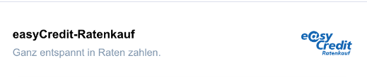
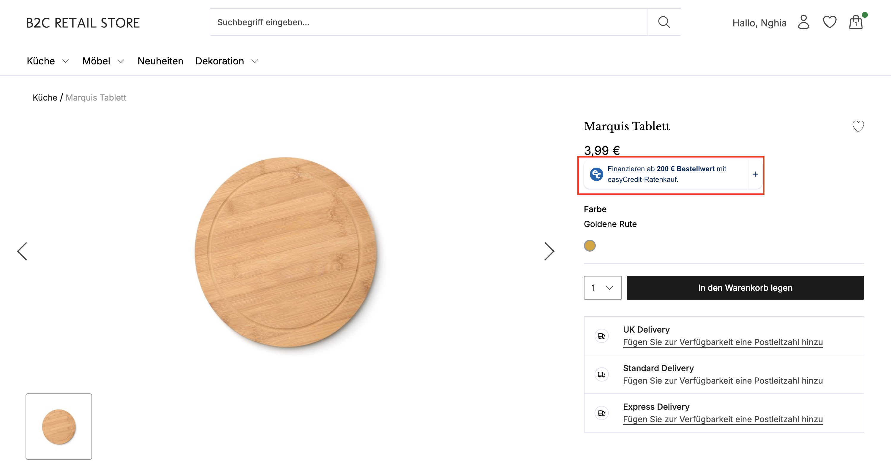
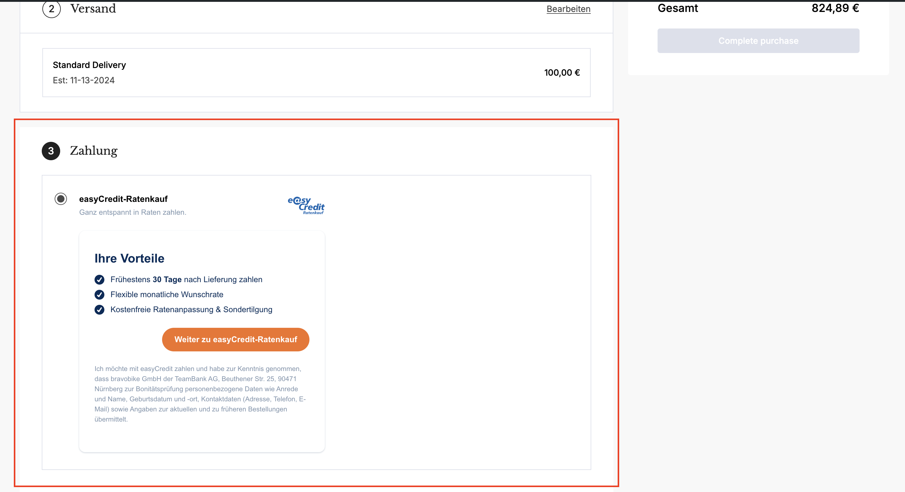
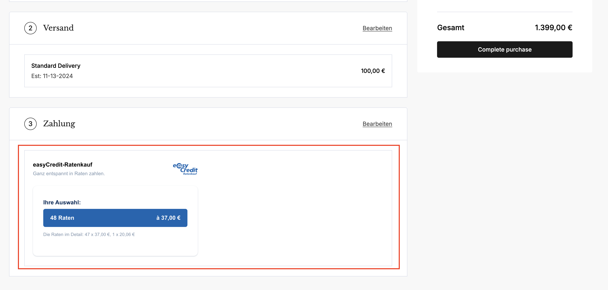

# Connector Web Components Integration Guide

For the terms in this document (EC, CT, easyCredit status values, cart freeze), see [Terms](./CommercetoolsFrontendIntegration.md#terms).

This guide tells you how to add the web components of the connector to your shop and how to show them. The components are the [easyCredit Web Components](https://netzkollektiv.com/docs/easycredit-components/?path=/docs/getting-started-installation--docs). The connector adds its own validation logic.

## Table of Contents

- [Step 1: Configuration](#step-1-configuration)
- [Step 2: Initialize and Display the components](#step-2-initialize-and-display-the-components)
- [Step 3: Troubleshooting](#step-3-troubleshooting)

## Step 1: Configuration

- Deploy the connector. Then set all the credentials that the processor needs. See [Deploy and upgrade](../README.md#deploy-and-upgrade) and [connect.yaml](../connect.yaml).
- Load the enabler at runtime from the asset URL of the connector (`<ASSET_URL>`). For the two bundles and how to load them, see [Load the enabler](./CommercetoolsFrontendIntegration.md#load-the-enabler).
- For the TypeScript types, install the npm package as a development dependency, see [Load the enabler](./CommercetoolsFrontendIntegration.md#load-the-enabler).
- The snippets below use the name `Enabler`. With the ES module, `Enabler` is the export of the module: `const { Enabler } = await import('<ASSET_URL>/connector-enabler.es.js')`. With the UMD bundle, use `window.Connector.Enabler`.

## Step 2: Initialize and Display the components

- A short JavaScript script initializes the components. See the [demo file](../assets/index.html).
- There are 4 components, made from the easyCredit Web Components: label, widget, checkout and summary.

### Label component

- It is made from the [easyCredit Label component](https://netzkollektiv.com/docs/easycredit-components/?path=/docs/checkout-label--docs).
- The code is in [label.component.ts](../assets/src/components/label.component.ts).
- To use this component, add this snippet to your shop:

  ```js
    // Assumes: Enabler is loaded, see Step 1.
    const enabler = new Enabler({
      processorUrl: '<PROCESSOR_URL>', // Connector's processor URL
      sessionId: '', // The label needs no session
    });

    enabler.createLabelBuilder().then((labelBuilder) => {
      // paymentType: 'INSTALLMENT_PAYMENT' (default) or 'BILL_PAYMENT'
      const labelComponent = labelBuilder.build({ paymentType: 'INSTALLMENT_PAYMENT' });
      labelComponent.mount('#easycredit-checkout-label');
    });
  ```

- The component reads only `GET /operations/widget-enabled`. It renders when `isEnabled` is `true`, that is when `WIDGET_ENABLED` is `1`. The checkout component does not read this value. It then looks like this image: 
- For pay by invoice, easyCredit controls the label text. See *A/B test* in [Terms](./CommercetoolsFrontendIntegration.md#terms).

### Widget component

- It is made from the [easyCredit Widget component](https://netzkollektiv.com/docs/easycredit-components/?path=/docs/marketing-widget--docs).
- The code is in [widget.component.ts](../assets/src/components/widget.component.ts).
- Shops mostly use the widget on the product page (PDP). To show it, set `WEBSHOP_ID` correctly and set `WIDGET_ENABLED` to `1`.
- Then add this snippet to your shop:

  ```js
    // Assumes: Enabler is loaded, see Step 1.
    // totalValue: the amount in EUR major units, for example 599.9. Your shop provides it.
    const enabler = new Enabler({
      processorUrl: '<PROCESSOR_URL>', // Connector's processor URL
      sessionId: '', // The widget needs no session
    });

    async function mountWidget() {
      const widgetBuilder = await enabler.createWidgetBuilder();

      const widgetComponent = widgetBuilder.build({
        amount: totalValue,
      });

      // Mount the new widget
      widgetComponent
        .mount('#easycredit-widget') // The place to display the component
        .catch((error) => {
          console.error('failed to mount', error);
        });
    }

    mountWidget();
  ```

- The component sends API calls to the connector to find out if the widget can be shown. If it can be shown, it looks like this image: 
- `GET /operations/widget-enabled` needs no checkout session. The widget therefore also works on product pages for shoppers who have no cart.

#### Pay by invoice in the widget

- The shop does not pass a payment type. `GET /operations/widget-enabled` returns `{ isEnabled, webShopId, paymentTypes }`. `paymentTypes` lists what the checkout offers. It uses the same rules as [Get Payment Method](./GetPaymentMethod.md):
  - `INSTALLMENT_PAYMENT` is in the list when installment is active for the webshop.
  - `BILL_PAYMENT` is in the list only when all of these are true: `BILL_PAYMENT_ENABLED=1`, easyCredit reports `availability` and `billPaymentActive`, and the webshop data is fresh. It fails closed (see [Terms](./CommercetoolsFrontendIntegration.md#terms)). Stale or default data never advertises it.
- The widget renders these types as `payment-types` (for example `payment-types="INSTALLMENT,BILL"`). With both types, the easyCredit widget reads "Finanzieren ab … / Monat oder heute bestellen, in 30 Tagen zahlen". The widget of easyCredit applies the amount limits.
- An empty `paymentTypes` means that the checkout offers no easyCredit payment type. The widget is then not rendered. This happens in these cases: neither type is active for the webshop; easyCredit reports the webshop as unavailable (the checkout answers 503 `EasyCreditUnavailable`); `WIDGET_ENABLED` is not `1` (the connector then does not call easyCredit).
- If there is an error, or the lookup takes longer than 1.5 s, `paymentTypes` is empty and the widget is not rendered. A slow lookup continues and fills the cache (`WEBSHOP_CACHE_TTL`). The next widget then gets the full list. The first widget after a deploy or a cache expiry can therefore be missing.
- Older processors do not send `paymentTypes`. The widget then renders without the attribute, and the easyCredit component defaults to installment.
- The widget sets the attribute when it is mounted. The easyCredit component ignores later changes to `payment-types`. After the invoice setting changes, clear the container and call `mount` again.

### Checkout component

- It is made from the [easyCredit Label component](https://netzkollektiv.com/docs/easycredit-components/?path=/docs/checkout-label--docs) and the [easyCredit Checkout component](https://netzkollektiv.com/docs/easycredit-components/?path=/docs/checkout-checkout--docs).
- The code is in [checkout.component.ts](../assets/src/components/checkout.component.ts).
- To use this component, add this snippet to your shop:

  ```js
    // Assumes: Enabler is loaded, see Step 1. Your shop provides these values:
    // sessionId: the checkout session ID. cartId: the commercetools cart ID.
    // isLoggedIn: the shopper is logged in. customerCreatedAt: the createdAt of the commercetools customer.
    // numberOfOrders: the number of earlier orders of the customer.
    const enabler = new Enabler({
      processorUrl: '<PROCESSOR_URL>', // Connector's processor URL
      sessionId: sessionId, // The checkout session ID
    });

    enabler.createCheckoutBuilder().then((checkoutBuilder) => {
      const checkoutComponent = checkoutBuilder.build({
        cartId: cartId,
        paymentType: 'INSTALLMENT_PAYMENT', // optional, 'INSTALLMENT_PAYMENT' (default) or 'BILL_PAYMENT'
        redirectLinks: {
          urlSuccess: window.location.origin + window.location.pathname + '?step=3',
          urlCancellation: window.location.origin + window.location.pathname + '?step=2&status=cancelled',
          urlDenial: window.location.origin + window.location.pathname + '?step=2&status=denied',
        },
        customerRelationship: {
          customerStatus: isLoggedIn && numberOfOrders > 0 ? 'EXISTING_CUSTOMER' : 'NEW_CUSTOMER',
          customerSince: customerCreatedAt?.slice(0, 10), // format yyyy-MM-dd
          numberOfOrders: numberOfOrders,
        },

        onError: (err) => {
          console.error('onError', err);
        },

        onSuccess: (response) => {
          console.log('connector handled it successfully', response);

          window.location.replace(response?.redirectUrl);
        },
      });

      checkoutComponent
        .mount('#easycredit-checkout') // The place to display the component
        .catch((error) => {
          console.error('failed to mount', error);
        });
    });
  ```

- The component sends API calls to the connector to find out if it can be shown. If it can be shown, it looks like this image: 

#### Availability

- `paymentType` selects the easyCredit payment method: `INSTALLMENT_PAYMENT` (default) or `BILL_PAYMENT`. The component asks the connector if it can offer this payment type for the cart. See [Get Payment Method](./GetPaymentMethod.md).
- `isAvailable()` tells you whether to show the option. It does not reject. If it returns `false`, hide the payment option. Some errors show the option with an alert inside the widget:

  | Processor response | `INSTALLMENT_PAYMENT` | `BILL_PAYMENT` |
  | --- | --- | --- |
  | `400 PaymentTypeNotAvailable` | hidden | hidden |
  | `503 EasyCreditUnavailable` | hidden | hidden |
  | `400 InvalidAmount` (cart total outside the limits) | shown with an alert | hidden |
  | `400 InstallmentPaymentExcludedItems`, `400 BillPaymentExcludedItems` | shown with an alert | shown with an alert |
  | `503 InstallmentPaymentCheckFailed`, `503 BillPaymentCheckFailed` | shown with an alert | shown with an alert |
  | `400 CorporateCustomerNotAllowed` (pay by invoice only) | not applicable | shown with an alert |
  | `400 AddressesUnmatched`, `InvalidBillingAddress`, `InvalidShippingAddress`, `InvalidAddress`, `InvalidCurrency` | shown with an alert | shown with an alert |
  | `200` without `paymentTypes.BILL_PAYMENT.available: true` | not applicable | hidden |
  | No `webShopId` in the response, for example `401 invalid_token` for a session that is missing, not valid or expired, or a `500` | hidden | hidden |
  | Network error, or a body that is not JSON | hidden | hidden |

- "Hidden" means that `isAvailable()` returns `false`. `mount()` then renders nothing, with two exceptions:

  | Case | `mount()` |
  | --- | --- |
  | Network error, or a body that is not JSON | rejects with an error, for both payment types |
  | `INSTALLMENT_PAYMENT` and no `webShopId` in the response | throws an error |

  Call `isAvailable()` before `mount()`.
- You do not have to disable an option that shows an alert. If the shopper submits that form, the processor refuses the payment with the same error, and the component calls `onError`.
- Each `isAvailable()` and `mount()` call asks the processor for the current cart state.
- If the cart total, an address or the cart ID changes, call `isAvailable()` again. If it returns `false`, hide the payment option and clear the label and widget containers that you mounted before. Also clear the containers before you mount an available option again. Then the container holds no outdated content.

#### Compatibility

`paymentType` and `isAvailable()` need a processor that supports the `paymentType` query parameter of [Get Payment Method](./GetPaymentMethod.md). Deploy the enabler and the processor from the same connector release. An older processor ignores `paymentType` and answers with the installment checks. The enabler then shows pay by invoice only if that response reports `paymentTypes.BILL_PAYMENT.available: true`. A processor without this field therefore never offers pay by invoice.

To check a deployed processor, send `GET /payments/payment-method/{cartId}?paymentType=UNKNOWN` with a valid session. A processor that supports the parameter returns `400 InvalidField`. An older processor ignores the parameter and answers with the installment checks.

In TypeScript, `isAvailable` is an optional member of `CheckoutComponent`. Custom implementations and typed test doubles that you wrote for earlier versions therefore compile unchanged. The components that the supplied builder returns always implement it. The builder is typed with `CheckoutComponent`, so call `isAvailable?.()` and treat a missing method as unavailable. A caller that uses only `mount()` and `submit()` gets an empty installment container when installment is switched off (`INSTALLMENT_PAYMENT_ENABLED=0`) or easyCredit is unavailable. Call `isAvailable()` before you show either payment option. Then the option itself is also hidden. A custom implementation that adds the method must follow the availability rules above.

A test double for availability can return the result that the test scenario needs:

```ts
const availableCheckout: CheckoutComponent = {
  mount: () => {},
  submit: () => {},
  isAvailable: async () => true,
};
const unavailableCheckout: CheckoutComponent = {
  ...availableCheckout,
  isAvailable: async () => false,
};
```

#### Pay by invoice as a separate payment method

- Build a second checkout component with `paymentType: 'BILL_PAYMENT'`. Build a label with `{ paymentType: 'BILL_PAYMENT' }`. You can mount both payment methods on the same page. Give each its own container.
- For the rules that decide if the connector offers each payment type, see [Payment type availability](./GetPaymentMethod.md#payment-type-availability).
- If `paymentType` is not `INSTALLMENT_PAYMENT` or `BILL_PAYMENT`, the builder throws an error.
- Pay by invoice is available only for private persons who receive the goods at their billing address in Germany. If the cart breaks one of these rules, the widget shows an error message. For the rules, see [Payment type availability](./GetPaymentMethod.md#payment-type-availability).

  ```ts
  const [labelBuilder, checkoutBuilder] = await Promise.all([
    enabler.createLabelBuilder(),
    enabler.createCheckoutBuilder(),
  ]);

  for (const [paymentType, elementId] of [
    ["INSTALLMENT_PAYMENT", "easycredit-checkout"],
    ["BILL_PAYMENT", "easycredit-bill-checkout"],
  ] as const) {
    // Assumes: enabler as above. checkoutOptions: the options of the checkout snippet above, without paymentType.
    const checkoutComponent = checkoutBuilder.build({
      ...checkoutOptions,
      paymentType,
    });

    if (!(await checkoutComponent.isAvailable?.())) {
      continue; // do not offer this payment method
    }

    // show the payment option, then mount label and widget into it
    labelBuilder.build({ paymentType }).mount(`#${elementId}-label`);
    await checkoutComponent.mount(`#${elementId}`);
  }
  ```

The example uses TypeScript. If you use plain JavaScript, omit `as const`.

### Summary component

- It is made from the [easyCredit Label component](https://netzkollektiv.com/docs/easycredit-components/?path=/docs/checkout-label--docs) and the [easyCredit Checkout component](https://netzkollektiv.com/docs/easycredit-components/?path=/docs/checkout-checkout--docs).
- The code is in [summary.component.ts](../assets/src/components/summary.component.ts).
- The summary shows the payment type of the payment, installment or pay by invoice. It uses `paymentType` from [Get Payment](./GetPayment.md). This is the final type from easyCredit. If easyCredit reports another type than the one the payment was created with (a switch on the easyCredit page, see [Create Payment](./CreatePayment.md#switching-on-the-easycredit-page)), the summary renders the new type, whatever type the component was built with.
- If the response has no `paymentType` (for example, an error), the summary uses the optional `paymentType` build option. If you do not set it, the summary uses installment. Pass the payment type that the customer selected. Then an error is not shown under the installment label.
- To use this component, add this snippet to your shop:

  ```js
    // Assumes: Enabler is loaded, see Step 1. Your shop provides these values:
    // sessionId: the checkout session ID. paymentId: the ID of the commercetools payment.
    const enabler = new Enabler({
      processorUrl: '<PROCESSOR_URL>', // Connector's processor URL
      sessionId: sessionId, // The checkout session ID
    });

    enabler.createSummaryBuilder().then((summaryComponentBuilder) => {
      const summaryComponent = summaryComponentBuilder.build({
        paymentId: paymentId,
        paymentType: 'BILL_PAYMENT', // optional, 'INSTALLMENT_PAYMENT' (default) or 'BILL_PAYMENT'
      });

      summaryComponent
        .mount('#easycredit-summary') // The place to display the component
        .catch((error) => {
          console.error('failed to mount', error);
        });
    });
  ```

- The component sends API calls to the connector to find out if it can be shown. If it can be shown, it looks like this image: 

## Step 3: Troubleshooting

- If the components do not work as you expect, look for errors in the Console tab of the browser developer tools.
