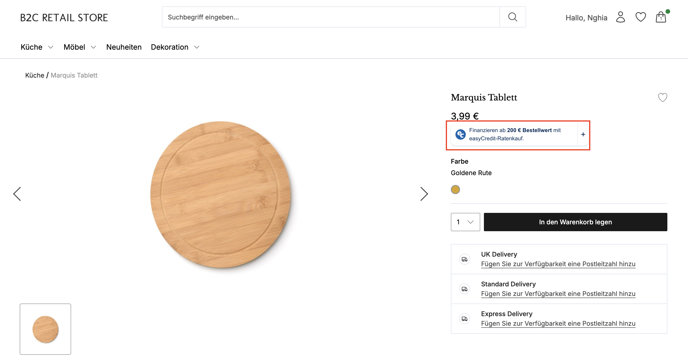

# Connector Web Components Integration Guide

For the terms in this document (EC, CT, easyCredit status values, cart freeze), see [Terms](./CommercetoolsFrontendIntegration.md#terms).

This guide tells you how to add the web components of the connector to your shop and how to show them. The components are the [easyCredit Web Components](https://netzkollektiv.com/docs/easycredit-components/?path=/docs/getting-started-installation--docs). The connector adds its own validation logic.

## Table of Contents

- [Step 1: Configuration](#step-1-configuration)
- [Step 2: Initialize and Display the components](#step-2-initialize-and-display-the-components)
- [Step 3: Troubleshooting](#step-3-troubleshooting)

## Step 1: Configuration

- Deploy the connector. Then set all the credentials that the processor needs. See [Deploy and upgrade](../README.md#deploy-and-upgrade) and [connect.yaml](../connect.yaml).
- Load the enabler at runtime from the asset URL of the connector (`<ASSET_URL>`). For the two bundles and how to load them, see [Load the enabler](./CommercetoolsFrontendIntegration.md#load-the-enabler).
- For the TypeScript types, install the npm package as a development dependency, see [Load the enabler](./CommercetoolsFrontendIntegration.md#load-the-enabler).
- The snippets below use the name `Enabler`. With the ES module, `Enabler` is the export of the module: `const { Enabler } = await import('<ASSET_URL>/connector-enabler.es.js')`. With the UMD bundle, use `window.Connector.Enabler`.

## Step 2: Initialize and Display the components

- A short JavaScript script initializes the components. See the [demo file](../assets/index.html).
- There are 5 components, made from the easyCredit Web Components: label, widget, checkout, summary and express button.

### Label component

- It is made from the [easyCredit Label component](https://netzkollektiv.com/docs/easycredit-components/?path=/docs/checkout-label--docs).
- The code is in [label.component.ts](../assets/src/components/label.component.ts).
- To use this component, add this snippet to your shop:

  ```js
    // Assumes: Enabler is loaded, see Step 1.
    const enabler = new Enabler({
      processorUrl: '<PROCESSOR_URL>', // Connector's processor URL
      sessionId: '', // The label needs no session
    });

    enabler.createLabelBuilder().then((labelBuilder) => {
      // paymentType: 'INSTALLMENT_PAYMENT' (default) or 'BILL_PAYMENT'
      const labelComponent = labelBuilder.build({ paymentType: 'INSTALLMENT_PAYMENT' });
      labelComponent.mount('#easycredit-checkout-label');
    });
  ```

- The component reads only `GET /operations/widget-enabled`. It renders when `isEnabled` is `true`, that is when `WIDGET_ENABLED` is `1`. The checkout component does not read this value. It then looks like this image: 
- For pay by invoice, easyCredit controls the label text. See *A/B test* in [Terms](./CommercetoolsFrontendIntegration.md#terms).

### Widget component

- It is made from the [easyCredit Widget component](https://netzkollektiv.com/docs/easycredit-components/?path=/docs/marketing-widget--docs).
- The code is in [widget.component.ts](../assets/src/components/widget.component.ts).
- Shops mostly use the widget on the product page (PDP). To show it, set `WEBSHOP_ID` correctly and set `WIDGET_ENABLED` to `1`. To show it only on the PDP or only in the cart, set `WIDGET_VISIBILITY`, see [Placement](#placement).
- Then add this snippet to your shop:

  ```js
    // Assumes: Enabler is loaded, see Step 1.
    // totalValue: the amount in EUR major units, for example 599.9. Your shop provides it.
    const enabler = new Enabler({
      processorUrl: '<PROCESSOR_URL>', // Connector's processor URL
      sessionId: '', // The widget needs no session
    });

    async function mountWidget() {
      const widgetBuilder = await enabler.createWidgetBuilder();

      const widgetComponent = widgetBuilder.build({
        amount: totalValue,
      });

      // The place to display the component: a selector or the element. Resolves after the widget has rendered.
      const shown = await widgetComponent.mount('#easycredit-widget');
      document.querySelector('#easycredit-widget').hidden = !shown; // Hide without a widget
    }

    mountWidget();
  ```

- The component sends API calls to the connector to find out if the widget can be shown. If it can be shown, it looks like this image: 
- `GET /operations/widget-enabled` needs no checkout session. The widget therefore also works on product pages for shoppers who have no cart.
- `mount()` resolves to `true` when the widget has rendered and to `false` when no widget shows. It does not reject. For installment, it also waits until the widget shows the plan, which easyCredit loads after the first render. The new widget stays hidden until then, without `display: none`, because easyCredit picks its layout from the width it measures. After 5 seconds without a render, `mount()` resolves `true` and the widget shows when the easyCredit script arrives. If the easyCredit script that the enabler added fails to load, `mount()` removes the widget and resolves `false`. If your page added the script itself, a failed load ends as the 5 second case.
- On the cart page, the total changes. Mount the widget again for each new total. A new mount replaces the widget of the earlier mount when the new widget has rendered. It removes only `easycredit-widget` elements, so other content of the container stays. If two mounts of the same container overlap, only the one that started last changes the container. The earlier one resolves with the result of the latest mount, so you can apply every result to the container. For an amount of 0 or less, `mount()` renders nothing, sends no request and resolves `false`.
- The widget can take several seconds to show, so show a placeholder until `mount()` resolves. For an example, see [Widget on the product and cart page](./CommercetoolsFrontendIntegration.md#widget-on-the-product-and-cart-page).

#### Placement

`WIDGET_VISIBILITY` controls where the widget shows: `PDP_AND_CART` (default), `PDP` or `CART`. The connector reads it only if `WIDGET_ENABLED` is `1`. With `WIDGET_ENABLED=0`, the widget does not show anywhere.

The widget must know if it is on a product page (PDP) or in the cart. There are two ways:

- **The shop passes `placement`.** This is optional and the safest way:

  ```js
    widgetBuilder.build({ amount: totalValue, placement: 'PDP' }); // or 'CART'
  ```

- **The widget guesses from the page path.** If the shop does not pass `placement`, the widget reads the path of the current page (`location.pathname`) and sends the result as `placement`. The path itself never leaves the browser. The widget uses these rules:
  - The path is exactly `/cart` or `/checkout` (a trailing `/` is allowed): cart.
  - Every other path: PDP. This includes `/p/<sku>` and `/`.
  - The match is exact and case-sensitive. `/de/cart`, `/Cart` and `/warenkorb` count as PDP.

The guess fits the routes of the commercetools Frontend template. It has an effect only if `WIDGET_VISIBILITY` is `PDP` or `CART`. With the default `PDP_AND_CART`, the widget shows on all pages, as before.

**Wrong guess.** If your cart has another path, for example `/warenkorb` or a locale prefix like `/de/cart`, the widget treats your cart page as a PDP. Then:

- With `WIDGET_VISIBILITY=PDP`, the widget **shows in your cart**.
- With `WIDGET_VISIBILITY=CART`, the widget **does not show in your cart**.

In this case, pass `placement` on the product page and on the cart page. There is no setting for other cart paths.

Other details:

- `placement` accepts only `PDP` and `CART`. The widget ignores other values, for example `'cart'`, and guesses from the path.
- A placement that `WIDGET_VISIBILITY` hides gets `isEnabled: false` and an empty `paymentTypes`. The connector then does not call easyCredit.
- The label component ignores `WIDGET_VISIBILITY`. It reads only `WIDGET_ENABLED`.
- The widget and the label call `GET /operations/widget-enabled` without custom headers, so the browser sends no CORS preflight for these calls. The widget sends only `?placement=PDP` or `?placement=CART`, and the label sends no query.

#### Pay by invoice in the widget

- The shop does not pass a payment type. `GET /operations/widget-enabled` returns `{ isEnabled, webShopId, paymentTypes, amountLimits, expressButtonEnabled, expressButtonVisibility }`. The two express fields are for the [express button](#express-button-component). `paymentTypes` lists what the checkout offers. It uses the same rules as [Get Payment Method](./GetPaymentMethod.md):
  - `INSTALLMENT_PAYMENT` is in the list when installment is active for the webshop.
  - `BILL_PAYMENT` is in the list only when all of these are true: `BILL_PAYMENT_ENABLED=1`, easyCredit reports `availability` and `billPaymentActive`, and the webshop data is fresh. It fails closed (see [Terms](./CommercetoolsFrontendIntegration.md#terms)). Stale or default data never advertises it.
- The widget renders these types as `payment-types` (for example `payment-types="INSTALLMENT,BILL"`). With both types, the easyCredit widget reads "Finanzieren ab … / Monat oder heute bestellen, in 30 Tagen zahlen". The widget of easyCredit applies the easyCredit amount limits.
- `amountLimits` is only sent for a payment type whose [merchant amount limits](./GetPaymentMethod.md#merchant-amount-limits) narrow the easyCredit limits, for example `{ "BILL_PAYMENT": { "minAmount": 100, "maxAmount": 5000 } }`. The enabler leaves that type out of `payment-types` if the `amount` of the widget is outside these limits or is not a number. It checks the amount only on mount, so mount the widget again for a new total, as described above. If no type is left, the widget is not rendered. Deploy the processor and the enabler from the same build. An older enabler ignores `amountLimits` and can advertise a type that the checkout then rejects with `InvalidAmount`.
- `GET /operations/widget-enabled?productTypeId=<uuid>` is for the [express button on the product page](#which-payment-types-the-button-shows). A value that is not a UUID gets `400`. The widget does not send it. The response shape does not change.
- An empty `paymentTypes` means that the checkout offers no easyCredit payment type. The widget is then not rendered. This happens in these cases: neither type is active for the webshop; easyCredit reports the webshop as unavailable (the checkout answers 503 `EasyCreditUnavailable`); neither `WIDGET_ENABLED` nor `EXPRESS_BUTTON_ENABLED` is `1` (the connector then does not call easyCredit).
- If there is an error, or the lookup takes longer than 1.5 s, `paymentTypes` is empty and the widget is not rendered. A slow lookup continues and fills the cache (`WEBSHOP_CACHE_TTL`). The next widget then gets the full list. The first widget after a deploy or a cache expiry can therefore be missing.
- Older processors do not send `paymentTypes`. The widget then renders without the attribute, and the easyCredit component defaults to installment.
- The widget sets the attribute when it is mounted. The easyCredit component ignores later changes to `payment-types`. After the invoice setting changes, call `mount` again.

### Checkout component

- It is made from the [easyCredit Label component](https://netzkollektiv.com/docs/easycredit-components/?path=/docs/checkout-label--docs) and the [easyCredit Checkout component](https://netzkollektiv.com/docs/easycredit-components/?path=/docs/checkout-checkout--docs).
- The code is in [checkout.component.ts](../assets/src/components/checkout.component.ts).
- To use this component, add this snippet to your shop:

  ```js
    // Assumes: Enabler is loaded, see Step 1. Your shop provides these values:
    // sessionId: the checkout session ID. cartId: the commercetools cart ID.
    // isLoggedIn: the shopper is logged in. customerCreatedAt: the createdAt of the commercetools customer.
    // numberOfOrders: the number of earlier orders of the customer.
    const enabler = new Enabler({
      processorUrl: '<PROCESSOR_URL>', // Connector's processor URL
      sessionId: sessionId, // The checkout session ID
    });

    enabler.createCheckoutBuilder().then((checkoutBuilder) => {
      const checkoutComponent = checkoutBuilder.build({
        cartId: cartId,
        paymentType: 'INSTALLMENT_PAYMENT', // optional, 'INSTALLMENT_PAYMENT' (default) or 'BILL_PAYMENT'
        redirectLinks: {
          urlSuccess: window.location.origin + window.location.pathname + '?step=3',
          urlCancellation: window.location.origin + window.location.pathname + '?step=2&status=cancelled',
          urlDenial: window.location.origin + window.location.pathname + '?step=2&status=denied',
        },
        customerRelationship: {
          customerStatus: loggedIn === true ? 'EXISTING_CUSTOMER' : 'NEW_CUSTOMER',
          customerSince: account?.createdAt,
          numberOfOrders: myOrdersCount,
        },

        onError: (err) => {
          console.error('onError', err);
        },

        onSuccess: (response) => {
          console.log('connector handled it successfully', response);

          window.location.replace(response?.redirectUrl);
        },
      });

      checkoutComponent
        .mount('#easycredit-checkout') // The place to display the component
        .catch((error) => {
          console.error('failed to mount', error);
        });
    });
  ```

- The component sends API calls to the connector to find out if it can be shown. If it can be shown, it looks like this image: 

#### Availability

- `paymentType` selects the easyCredit payment method: `INSTALLMENT_PAYMENT` (default) or `BILL_PAYMENT`. The component asks the connector if it can offer this payment type for the cart. See [Get Payment Method](./GetPaymentMethod.md).
- `isAvailable()` tells you whether to show the option. It does not reject. If it returns `false`, hide the payment option. Some errors show the option with an alert inside the widget:

  | Processor response | `INSTALLMENT_PAYMENT` | `BILL_PAYMENT` |
  | --- | --- | --- |
  | `400 PaymentTypeNotAvailable` | hidden | hidden |
  | `503 EasyCreditUnavailable` | hidden | hidden |
  | `400 InvalidAmount` (cart total outside the limits) | shown with an alert | hidden |
  | `400 InstallmentPaymentExcludedItems`, `400 BillPaymentExcludedItems` | shown with an alert | shown with an alert |
  | `503 InstallmentPaymentCheckFailed`, `503 BillPaymentCheckFailed` | shown with an alert | shown with an alert |
  | `400 CorporateCustomerNotAllowed` (pay by invoice only) | not applicable | shown with an alert |
  | `400 AddressesUnmatched`, `InvalidBillingAddress`, `InvalidShippingAddress`, `InvalidAddress`, `InvalidCurrency` | shown with an alert | shown with an alert |
  | `200` without `paymentTypes.BILL_PAYMENT.available: true` | not applicable | hidden |
  | No `webShopId` in the response, for example `401 invalid_token` for a session that is missing, not valid or expired, or a `500` | hidden | hidden |
  | Network error, or a body that is not JSON | hidden | hidden |

- "Hidden" means that `isAvailable()` returns `false`. `mount()` then renders nothing, with two exceptions:

  | Case | `mount()` |
  | --- | --- |
  | Network error, or a body that is not JSON | rejects with an error, for both payment types |
  | `INSTALLMENT_PAYMENT` and no `webShopId` in the response | throws an error |

  Call `isAvailable()` before `mount()`.
- You do not have to disable an option that shows an alert. If the shopper submits that form, the processor refuses the payment with the same error, and the component calls `onError`.
- Each `isAvailable()` and `mount()` call asks the processor for the current cart state.
- If the cart total, an address or the cart ID changes, call `isAvailable()` again. If it returns `false`, hide the payment option and clear the label and widget containers that you mounted before. Also clear the containers before you mount an available option again. Then the container holds no outdated content.

#### Compatibility

`paymentType` and `isAvailable()` need a processor that supports the `paymentType` query parameter of [Get Payment Method](./GetPaymentMethod.md). Deploy the enabler and the processor from the same connector release. An older processor ignores `paymentType` and answers with the installment checks. The enabler then shows pay by invoice only if that response reports `paymentTypes.BILL_PAYMENT.available: true`. A processor without this field therefore never offers pay by invoice.

To check a deployed processor, send `GET /payments/payment-method/{cartId}?paymentType=UNKNOWN` with a valid session. A processor that supports the parameter returns `400 InvalidField`. An older processor ignores the parameter and answers with the installment checks.

In TypeScript, `isAvailable` is an optional member of `CheckoutComponent`. Custom implementations and typed test doubles that you wrote for earlier versions therefore compile unchanged. The components that the supplied builder returns always implement it. The builder is typed with `CheckoutComponent`, so call `isAvailable?.()` and treat a missing method as unavailable. A caller that uses only `mount()` and `submit()` gets an empty installment container when installment is switched off (`INSTALLMENT_PAYMENT_ENABLED=0`) or easyCredit is unavailable. Call `isAvailable()` before you show either payment option. Then the option itself is also hidden. A custom implementation that adds the method must follow the availability rules above.

A test double for availability can return the result that the test scenario needs:

```ts
const availableCheckout: CheckoutComponent = {
  mount: () => {},
  submit: () => {},
  isAvailable: async () => true,
};
const unavailableCheckout: CheckoutComponent = {
  ...availableCheckout,
  isAvailable: async () => false,
};
```

#### Pay by invoice as a separate payment method

- Build a second checkout component with `paymentType: 'BILL_PAYMENT'`. Build a label with `{ paymentType: 'BILL_PAYMENT' }`. You can mount both payment methods on the same page. Give each its own container.
- For the rules that decide if the connector offers each payment type, see [Payment type availability](./GetPaymentMethod.md#payment-type-availability).
- If `paymentType` is not `INSTALLMENT_PAYMENT` or `BILL_PAYMENT`, the builder throws an error.
- Pay by invoice is available only for private persons who receive the goods at their billing address in Germany. If the cart breaks one of these rules, the widget shows an error message. For the rules, see [Payment type availability](./GetPaymentMethod.md#payment-type-availability).

  ```ts
  const [labelBuilder, checkoutBuilder] = await Promise.all([
    enabler.createLabelBuilder(),
    enabler.createCheckoutBuilder(),
  ]);

  for (const [paymentType, elementId] of [
    ["INSTALLMENT_PAYMENT", "easycredit-checkout"],
    ["BILL_PAYMENT", "easycredit-bill-checkout"],
  ] as const) {
    // Assumes: enabler as above. checkoutOptions: the options of the checkout snippet above, without paymentType.
    const checkoutComponent = checkoutBuilder.build({
      ...checkoutOptions,
      paymentType,
    });

    if (!(await checkoutComponent.isAvailable?.())) {
      continue; // do not offer this payment method
    }

    // show the payment option, then mount label and widget into it
    labelBuilder.build({ paymentType }).mount(`#${elementId}-label`);
    await checkoutComponent.mount(`#${elementId}`);
  }
  ```

The example uses TypeScript. If you use plain JavaScript, omit `as const`.

### Summary component

- It is made from the [easyCredit Label component](https://netzkollektiv.com/docs/easycredit-components/?path=/docs/checkout-label--docs) and the [easyCredit Checkout component](https://netzkollektiv.com/docs/easycredit-components/?path=/docs/checkout-checkout--docs).
- The code is in [summary.component.ts](../assets/src/components/summary.component.ts).
- The summary shows the payment type of the payment, installment or pay by invoice. It uses `paymentType` from [Get Payment](./GetPayment.md). This is the final type from easyCredit. If easyCredit reports another type than the one the payment was created with (a switch on the easyCredit page, see [Create Payment](./CreatePayment.md#switching-on-the-easycredit-page)), the summary renders the new type, whatever type the component was built with.
- If the response has no `paymentType` (for example, an error), the summary uses the optional `paymentType` build option. If you do not set it, the summary uses installment. Pass the payment type that the customer selected. Then an error is not shown under the installment label.
- To use this component, add this snippet to your shop:

  ```js
    // Assumes: Enabler is loaded, see Step 1. Your shop provides these values:
    // sessionId: the checkout session ID. paymentId: the ID of the commercetools payment.
    const enabler = new Enabler({
      processorUrl: '<PROCESSOR_URL>', // Connector's processor URL
      sessionId: sessionId, // The checkout session ID
    });

    enabler.createSummaryBuilder().then((summaryComponentBuilder) => {
      const summaryComponent = summaryComponentBuilder.build({
        paymentId: paymentId,
        paymentType: 'BILL_PAYMENT', // optional, 'INSTALLMENT_PAYMENT' (default) or 'BILL_PAYMENT'
      });

      summaryComponent
        .mount('#easycredit-summary') // The place to display the component
        .catch((error) => {
          console.error('failed to mount', error);
        });
    });
  ```

- The component sends API calls to the connector to find out if it can be shown. If it can be shown, it looks like this image: 

### Express button component

- It is made from the `easycredit-express-button` web component of easyCredit. For the payment flow behind it, see [Create Express Payment](./CreateExpressPayment.md) and [Express Return](./ExpressReturn.md).
- The code is in [express.component.ts](../assets/src/components/express.component.ts).
- It starts an express checkout from the product page (PDP) or the cart. The shopper enters name and address on the easyCredit page.
- To show the button, set `EXPRESS_BUTTON_ENABLED` to `1` and set `WEBSHOP_ID` correctly. `WIDGET_ENABLED` has no effect on the button. `EXPRESS_BUTTON_VISIBILITY` selects where the button shows: `PDP_AND_CART` (default), `PDP` or `CART`. These settings only control the button. The express endpoints do not check them.
- To use this component, add this snippet to your shop:

  ```js
    // Assumes: Enabler is loaded, see Step 1. Your shop provides these values:
    // sessionId: the checkout session ID. amount: the amount in EUR major units, for example 599.9.
    // This snippet is for the cart. For the product page, see Product page below.
    const enabler = new Enabler({
      processorUrl: '<PROCESSOR_URL>', // Connector's processor URL
      sessionId: sessionId, // The checkout session ID. On the PDP, `sessionId` can be empty: `prepareCart` supplies the session of the prepared cart, see below.
    });

    const expressBuilder = await enabler.createExpressButtonBuilder();
    const expressButton = expressBuilder.build({
      placement: 'CART', // 'PDP' or 'CART'. PDP needs prepareCart and productTypeId, see below.
      amount: amount,
      redirectLinks: {
        urlSuccess: window.location.origin + '/express/return',
        urlCancellation: window.location.origin + '/cart?status=cancelled',
        urlDenial: window.location.origin + '/cart?status=denied',
      },
      onLoading: () => {}, // optional, for example show a spinner
      onError: (err) => console.error('onError', err),
      onSuccess: (response) => window.location.replace(response.redirectUrl),
    });

    // The place to display the component: a selector or the element. Resolves after the button has rendered.
    const rendered = await expressButton.mount('#easycredit-express');
    document.querySelector('#easycredit-express').hidden = !rendered; // Hide without a button, show with one
  ```

#### Options

| Option | Required | Description |
| --- | --- | --- |
| `placement` | yes | `PDP` or `CART`. It selects the payment type check and the visibility setting. |
| `amount` | yes | The amount in EUR major units. If it is not a finite number, or is 0 or less, the button is not rendered and no request is sent. On the PDP it is the gross price of one unit, because the quantity is always 1. |
| `productTypeId` | no | PDP only: the ID of the commercetools product type of the product, for example `product.productType.id`. It must be the UUID, not the product type key: any other value makes the processor answer `400`, and the button is not rendered (the component logs the status in the console). The processor drops the payment types that exclude this product type. Without it, the button also shows payment types that the product excludes. The click then fails with `BillPaymentExcludedItems` or `InstallmentPaymentExcludedItems`, and the only sign beforehand is one `console.warn`. Always pass it on the PDP. It is ignored on the cart. |
| `redirectLinks` | yes | `urlSuccess`, `urlCancellation` and `urlDenial`. They follow the rules in [Create Express Payment](./CreateExpressPayment.md). |
| `prepareCart` | on `PDP` | A function that empties the cart, puts only this product in it and returns the checkout session ID of that cart. Required on the PDP: without it, `mount()` renders nothing, resolves to `false` and logs an error to the console. Optional on the cart. See [Product page](#product-page). |
| `fullWidth` | no | If `true`, the button fills the width of its container. Default: the fixed width of easyCredit, centered. The component sets `full-width` on every element it renders, also after `setAmount()` and after a failed start. Do not set the attribute yourself: the next element does not have it. |
| `onLoading` | no | Called when the shopper clicks the button, before any request. |
| `onError` | yes | Called with an `ExpressButtonError`, see [Errors](#errors). |
| `onSuccess` | yes | Called with the response of `POST /payments/express`. Send the shopper to `redirectUrl`. |

#### Which payment types the button shows

- Both placements read `GET /operations/widget-enabled`. The button shows only if `expressButtonEnabled` is `true`, `expressButtonVisibility` is the placement or `PDP_AND_CART`, and the response has a `webShopId`. An older processor does not send the express fields, so the button stays hidden.
- `PDP`: the button shows the `paymentTypes` of `widget-enabled`. It does not check the cart. It drops a type if the amount is outside the [merchant amount limits](./GetPaymentMethod.md#merchant-amount-limits) of that type (`amountLimits`). The easyCredit web component applies its own limits.
- `PDP` with `productTypeId`: the component sends it as `GET /operations/widget-enabled?productTypeId=<uuid>`. The processor looks up the product type only if the express button is enabled and `EXPRESS_BUTTON_VISIBILITY` is `PDP` or `PDP_AND_CART`. It drops each payment type that excludes the product type, as the checkout does (`BILL_PAYMENT_EXCLUDED_PRODUCT_TYPES`, `INSTALLMENT_PAYMENT_EXCLUDED_PRODUCT_TYPES`). An installment-only button stays, and the button is not rendered when no type is left. If the lookup fails or takes too long, the processor hides the payment types that have configured exclusions. A failed lookup is not repeated for 30 seconds.
- `POST /payments/express` checks the cart again. So a wrong filter can only show a button that fails on click. A processor that does not know `productTypeId` ignores it, and the click then fails with an error such as `BillPaymentExcludedItems`. Deploy the processor and the enabler from the same build.
- `CART`: the button keeps a payment type only if `GET /payments/express/payment-method` answers `200` for the cart of the session. See [Check the payment types](./CreateExpressPayment.md#check-the-payment-types).
- If no payment type is left, the button is not rendered.

#### Mount and click behavior

- `mount()` resolves to `true` when the button has rendered and to `false` when no button shows. It does not reject. If it resolves to `false`, it removed any earlier button from the container (unless a later mount took over, see below). Hide the container on `false` and show it again on `true`. Show your placeholder until `mount()` resolves.
- The new button stays hidden until it has rendered, and an earlier button stays until then, so the page does not jump. After 5 seconds without a render, `mount()` resolves `true`, and the button shows when the easyCredit script arrives. If the easyCredit script that the enabler added fails to load, `mount()` removes the button and resolves `false`.
- The container must exist when you call `mount()` and stay in the DOM until `mount()` resolves. `mount()` accepts a selector or the element. The component looks up the container before its first request and renders the button into that element.
- A second `mount()` in the same container replaces the button. On the PDP, use [`setAmount`](#set-the-amount-on-the-product-page) for a new amount. On the cart, call `mount()` again for each new amount. If two mounts overlap, only the one that started last changes the container. The earlier one does not touch the container and resolves with the result of the latest mount, so you can apply every result to show or hide the container.
- Do not mount the button inside a `<form>`. The web component also fires a deprecated `submit` event that bubbles.
- A click while an earlier click is still running is ignored.
- On click, the component calls `prepareCart` (always on the PDP, on the cart if set). Then it sends `POST /payments/express` with the chosen payment type and `redirectLinks`, and calls `onSuccess` or `onError`.
- Only the payment type goes to the connector. The number of installments that the shopper chose in the easyCredit modal is not forwarded.
- After the shopper accepts, the easyCredit modal stays open. If the page has not navigated away after 10 seconds, easyCredit shows its own alert that easyCredit payment is not possible at the moment and closes the modal. So `prepareCart`, `POST /payments/express` and the redirect in `onSuccess` must finish within 10 seconds.
- The alert of easyCredit is the global `window.alert`, and its timer cannot be cancelled. So the component wraps `window.alert` page-wide. The wrapper swallows only the exact easyCredit text and passes every other alert on. It stays for 11 seconds after the latest accept and then restores the original, unless another script has replaced `window.alert` meanwhile. This is a workaround until easyCredit offers a way to cancel the alert.
- After an error, the shopper sees only the message of your `onError` handler. The component replaces the button with a new one at once, without waiting for the render, because the new element closes the easyCredit modal. A button for a new amount that is still waiting to render is dropped. The shopper can click again.

#### Errors

`onError` always gets an `ExpressButtonError`. It is never an `Error` object. A shop that checks `instanceof Error` must read `errors` instead.

```ts
type ExpressButtonError = {
  statusCode?: number;
  errors: { code: string; message: string }[];
  cause?: unknown; // The raw error, for logging only. Do not show it.
};
```

| Case | `statusCode` | `errors` |
| --- | --- | --- |
| The processor answers with an error body that has an `errors` array | the HTTP status | the `errors` of the processor, for example `PaymentTypeNotAvailable` |
| The error body is not JSON or has no `errors` (for example a gateway `502` or `504`) | the HTTP status | one entry with the code `UnexpectedResponse` |
| A network error, an error in `prepareCart`, an unknown payment type, or a successful response whose body is not valid JSON | none | one entry with the code `ExpressInitFailed` |

For the last two cases, `message` is fixed and German: "Die Zahlung mit easyCredit konnte nicht gestartet werden. Bitte versuchen Sie es erneut oder wählen Sie eine andere Zahlungsart." The processor messages are not for shoppers, so show your own text for the codes you know and this message otherwise.

#### Set the amount on the product page

- `setAmount(amount)` changes the amount of a mounted PDP button without a new `mount()`. Call it when the shopper selects another variant. It returns a `Promise<boolean>`: `true` if a button is shown, `false` if not.
- On the cart, it rejects with an error. Mount the cart button again instead, because its payment types come from a check of the cart.
- It applies the merchant amount limits again and replaces the button with a new one for the new amount. The old button stays until the new one has rendered, and the promise resolves then. An open easyCredit modal closes, because the modal computes its total only once. If no type is left, or the amount is not a finite number or is 0 or less, it removes the button and resolves `false`. A later valid amount renders the button again. If you call it again before the new button has rendered, only the latest amount shows, and every call resolves with the result of the latest one. Until the new button has rendered, the old one stays clickable with the old amount. Once the easyCredit script has loaded, this takes milliseconds.
- Before `mount()` has finished, it waits for the mount. If the amount changed meanwhile, it then shows the button for the latest amount.
- If the last mount got no usable configuration, `setAmount` loads it again with one `GET /operations/widget-enabled`. This happens when the express button is off, the visibility does not include the PDP, the request failed, or the amount was not a finite number at mount.
- If easyCredit did not answer in time at mount, the processor sends no payment types. The button then stays hidden until the next `mount()`.
- If a later mount has taken over the container, it changes nothing and resolves with the result of that mount.
- It does not change `amount` in your options.
- A new product (for example after a navigation in a single-page app) needs a new `build()` and `mount()`, because the product type and `prepareCart` change too.

  ```js
    // On variant change: pass the gross price of one unit.
    const shown = await expressButton.setAmount(newAmount);
    document.querySelector('#easycredit-express').hidden = !shown;
  ```

#### Product page

- On the PDP, `prepareCart` is required, and pass `productTypeId`. `POST /payments/express` charges the whole cart of the session, but the button shows the price of this product. So `prepareCart` must empty the cart and put only this product in it, quantity 1. This is a requirement of easyCredit (TeamBank). It returns the checkout session ID of this cart. The component sends the express request with this session ID.
- The function runs on every click, also when the shopper clicks again after `onError`. It must be idempotent: after each run, the cart holds exactly this product, quantity 1.
- `prepareCart` runs when the shopper clicks, not when you build the button. So read the selected variant inside the function, because the shopper can change it after `build()`.
- An error in the function goes to `onError` with the code `ExpressInitFailed`.

  ```js
    placement: 'PDP',
    productTypeId: productTypeId, // The UUID of the product type, for example product.productType.id
    prepareCart: async () => {
      // Your shop code: remove all line items, then add only this product with quantity 1.
      await replaceCartWithProduct(productId);
      return await createCheckoutSession(); // The session of the cart that holds only this product
    },
  ```

## Step 3: Troubleshooting

- If the components do not work as you expect, look for errors in the Console tab of the browser developer tools.
