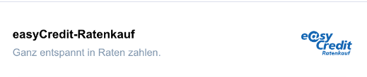
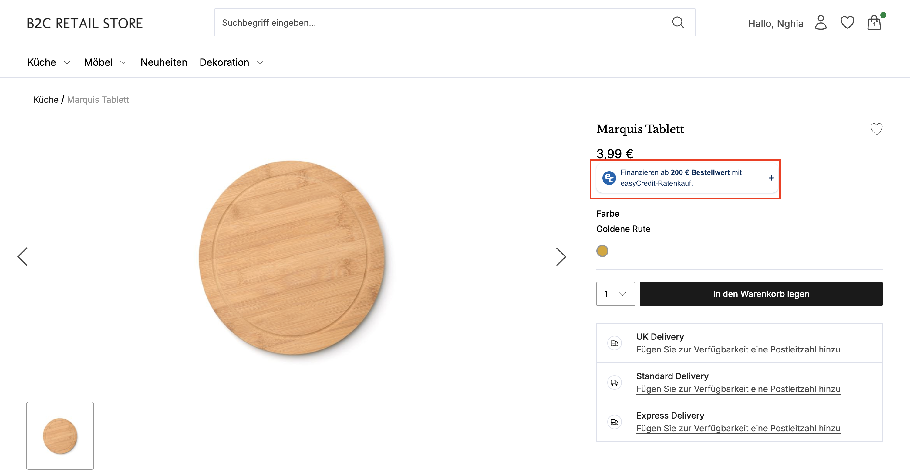
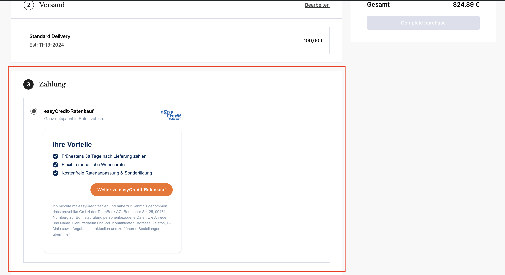
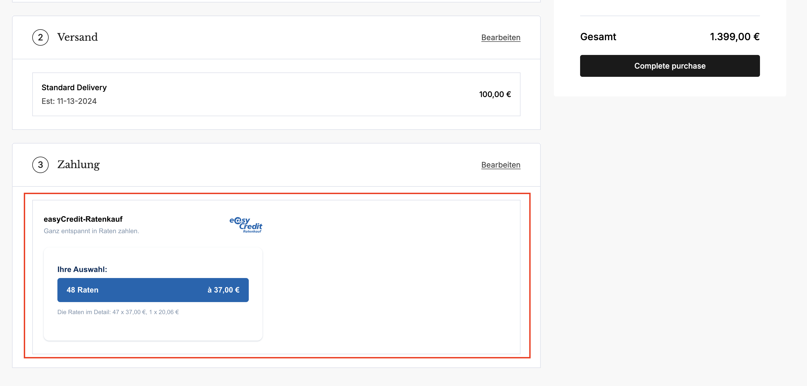

# Connector Web Components Integration Guide

This guide provides instructions on how to integrate and display the connector's provided web-components which are [EasyCredit Web Components](https://netzkollektiv.com/docs/easycredit-components/?path=/docs/getting-started-installation--docs) but with our connector's validation logic.

## Table of Contents

- [Step 1: Configuration](#step-1-configuration)
- [Step 2: Initialize and Display the components](#step-2-initialize-and-display-the-components)
- [Step 3: Troubleshooting](#step-3-troubleshooting)

## Step 1: Configuration

- First, after install the connector into the shop, you must config all the necessary credentials that defined in the processor part, you can have a look at [this file](../connect.yaml)

- Then, in your shop, you need to install our package to use provided components:
  - Install via npm package \
    Simply run `npm i @shopmacher/easy-credit-commercetools-component`.
  - Install via CT connector asset service url \
    After installing the connector, an URL will be generated hosting the required package. \
    Simply include this URL as follow 
    ```
    <script type="module" src="YOUR_ASSET_URL_HERE" />
    ```

## Step 2: Initialize and Display the components

- We provide you a way to initialize the components easily just with a short Javascript script. You can have a look at the [demo file](../assets/index.html)
- Currently, we have 4 components which created from EasyCredit Web Components: label, widget, checkout and summary.

### Label component

- Created from [EasyCredit Label component](https://netzkollektiv.com/docs/easycredit-components/?path=/docs/checkout-label--docs)
- It is handled in [label.component.ts](../assets/src/components/label.component.ts)
- To use this component, you need to integrate this short snippet into your shop:

  ```
    const enabler = new Enabler({
      processorUrl: 'https://service-bk5phtyi8svk2ne51fw3ulsn.europe-west1.gcp.commercetools.app/', // Connector's processor URL
      sessionId: session.token, // CommerceTools session ID
    });

    enabler.createLabelBuilder().then((labelBuilder: any) => {
          // paymentType: 'INSTALLMENT_PAYMENT' (default) or 'BILL_PAYMENT'
          const labelComponent = labelBuilder.build({ paymentType: 'INSTALLMENT_PAYMENT' });
          labelComponent.mount('#easycredit-checkout-label');
          setLabelLoaded(true);
        });
  ```

- By doing this, the component will make API calls to the connector to check whether the component can be displayed or not, if it is able to be displayed, the result will be like the image below: 

### Widget component

- Created from [EasyCredit Widget component](https://netzkollektiv.com/docs/easycredit-components/?path=/docs/marketing-widget--docs)
- It is handled in [widget.component.ts](../assets/src/components/widget.component.ts)
- To display the EasyCredit Widget, which mostly been used in the PDP of every shop, you need to make sure that the `WEBSHOP_ID` is set up correctly and the `WIDGET_ENABLED` is set to be `1`
- Then, in the shop side, you need to integrate this short snippet:

  ```
    const enabler = new Enabler({
      processorUrl: 'https://service-bk5phtyi8svk2ne51fw3ulsn.europe-west1.gcp.commercetools.app/', // Connector's processor URL
      sessionId: sessionToken, // CommerceTools session ID
    });

    const widgetBuilder = await enabler.createWidgetBuilder();

    const widgetComponent = widgetBuilder.build({
      amount: totalValue, // Cart amount
    });

    // Mount the new widget
    widgetComponent
      .mount('#easycredit-cart') // The place to display the component
      .then((res: any) => {
        console.log('mounted successfully', res);
      })
      .catch((error: any) => {
        console.log('failed to mount', error);
      });
  ```

- By doing this, the component will make API calls to the connector to check whether the widget can be displayed or not, if it is able to be displayed, the result will be like the image below: 

### Checkout component

- Created from [EasyCredit Label component](https://netzkollektiv.com/docs/easycredit-components/?path=/docs/checkout-label--docs) and [EasyCredit Checkout component](https://netzkollektiv.com/docs/easycredit-components/?path=/docs/checkout-checkout--docs)
- It is handled in [checkout.component.ts](../assets/src/components/checkout.component.ts)
- To use this component, you need to integrate this short snippet into your shop:

  ```
    const enabler = new Enabler({
      processorUrl: 'https://service-bk5phtyi8svk2ne51fw3ulsn.europe-west1.gcp.commercetools.app/', // Connector's processor URL
      sessionId: session.token, // CommerceTools session ID
    });

    enabler.createCheckoutBuilder().then((checkoutBuilder: any) => {
      const checkoutComponent = checkoutBuilder.build({
        cartId: cart.cartId,
        paymentType: 'INSTALLMENT_PAYMENT', // optional, 'INSTALLMENT_PAYMENT' (default) or 'BILL_PAYMENT'
        redirectLinks: {
          urlSuccess: window.location.origin + window.location.pathname + '?step=3',
          urlCancellation: window.location.origin + window.location.pathname + '?step=2&status=cancelled',
          urlDenial: window.location.origin + window.location.pathname + '?step=2&status=denied',
        },
        customerRelationship: {
          customerStatus: loggedIn === true ? 'EXISTING_CUSTOMER' : 'NEW_CUSTOMER',
          customerSince: account?.createdAt,
          numberOfOrders: myOrdersCount,
        },

        onError: (err: any) => {
          console.error('onError', err);
        },

        onSuccess: (response: any) => {
          console.log('connector handled it successfully', response);

          window.location.replace(response?.redirectUrl);
        },
      });

      checkoutComponent
        .mount('#easycredit-checkout') // The place to display the component
        .then((res: any) => {
          console.log('mounted successfully', res);
        })
        .catch((error: any) => {
          console.log('failed to mount', error);
        });
    });
  ```

- By doing this, the component will make API calls to the connector to check whether the component can be displayed or not, if it is able to be displayed, the result will be like the image below: 

#### Availability

- `paymentType` selects the easyCredit payment method: `INSTALLMENT_PAYMENT` (default) or `BILL_PAYMENT`. The component asks the connector whether this payment type can be offered for the cart, see [Get Payment Method](./GetPaymentMethod.md).
- `isAvailable()` resolves to `false` if the payment type cannot be offered at all. Hide the payment option in that case; `mount()` then renders nothing.

  | Payment type | Hidden on |
  | --- | --- |
  | `INSTALLMENT_PAYMENT` | `PaymentTypeNotAvailable` (installment not activated for the webshop) |
  | `BILL_PAYMENT` | `PaymentTypeNotAvailable` (disabled in the connector or by easyCredit), `InvalidAmount` (cart total outside the billing limits), `EasyCreditUnavailable` |

- Any other error is shown as an alert inside the widget, for example billing and shipping address differ or are not in Germany, or the cart total is outside the installment limits.
- Each `isAvailable()` call queries the current cart state from the processor. The next `mount()` reuses that result once, avoiding a second request; later mounts fetch again.
- After the cart changes, call `isAvailable()` again. Hide the payment option when it returns `false`, and clear any previously mounted label and widget containers. Clear the containers before remounting an available option as well, so outdated content is not retained.

#### Pay by invoice as a separate payment method

- Build a second checkout component with `paymentType: 'BILL_PAYMENT'` and a label with `{ paymentType: 'BILL_PAYMENT' }`. Both payment methods can be mounted on the same page, each into its own container.
- Pay by invoice is only offered if `BILL_PAYMENT_ENABLED=1` in the connector, easyCredit has activated it for the webshop and the cart total is within the billing limits.
- Pay by invoice is only available for private persons. For a cart with a Business Unit or a company in the billing address or any applicable shipping address, the widget shows an error message.

  ```ts
    const [labelBuilder, checkoutBuilder] = await Promise.all([
      enabler.createLabelBuilder(),
      enabler.createCheckoutBuilder(),
    ]);

    for (const [paymentType, elementId] of [
      ['INSTALLMENT_PAYMENT', 'easycredit-checkout'],
      ['BILL_PAYMENT', 'easycredit-bill-checkout'],
    ] as const) {
      const checkoutComponent = checkoutBuilder.build({
        ...checkoutOptions, // same options as above
        paymentType,
      });

      if (!(await checkoutComponent.isAvailable())) {
        continue; // do not offer this payment method
      }

      // show the payment option, then mount label and widget into it
      labelBuilder.build({ paymentType }).mount(`#${elementId}-label`);
      await checkoutComponent.mount(`#${elementId}`);
    }
  ```

The example uses TypeScript; omit `as const` when using plain JavaScript.

### Summary component

- Created from [EasyCredit Label component](https://netzkollektiv.com/docs/easycredit-components/?path=/docs/checkout-label--docs) and [EasyCredit Checkout component](https://netzkollektiv.com/docs/easycredit-components/?path=/docs/checkout-checkout--docs)
- It is handled in [summary.component.ts](../assets/src/components/summary.component.ts)
- The summary currently always shows easyCredit installment, as pay by invoice transactions cannot be created yet.
- To use this component, you need to integrate this short snippet into your shop:

  ```
    enabler = new Enabler({
      processorUrl: 'https://service-bk5phtyi8svk2ne51fw3ulsn.europe-west1.gcp.commercetools.app/', // Connector's processor URL
      sessionId: session.token, // CommerceTools session ID
    });

    enabler.createSummaryBuilder().then((summaryComponentBuilder: any) => {
      const summaryComponent = summaryComponentBuilder.build({
        paymentId: easyCreditPayment.id,
      });

      summaryComponent
        .mount('#easycredit-summary') // The place to display the component
        .then((res: any) => {
          console.log('mounted successfully', res);
        })
        .catch((error: any) => {
          console.log('failed to mount', error);
        });
    });
  ```

- By doing this, the component will make API calls to the connector to check whether the component can be displayed or not, if it is able to be displayed, the result will be like the image below: 

## Step 3: Troubleshooting

- When integrating, if any unexpected behavior occurs, check the Console tab in Dev Tools for errors that may assist in troubleshooting.
